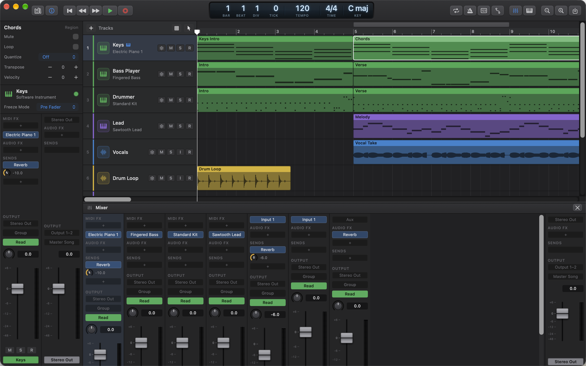
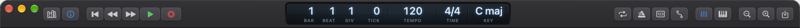
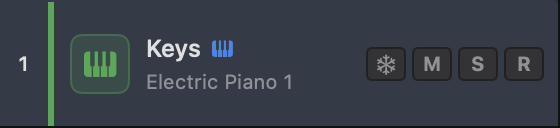
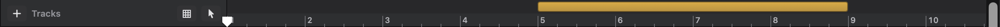

# 1. Getting Started

Ongaku Studio is a music-making app for the Mac, laid out like Apple's Logic Pro: you build a song from tracks, and each track holds blocks of music called regions that you can move, copy and edit. This chapter shows you around the window, explains how projects are created and saved, and covers the controls you'll use every few seconds: the transport, zoom and undo.

If you have never used a program like this, read this chapter from start to finish once. Everything else in the manual builds on the words and places introduced here.

## What Ongaku Studio is

A song in Ongaku is a **project**. A project holds:

- **Tracks**, stacked one above the other. Each track is one part of the song: a drum kit, a bass, a vocal, a piano.
- **Regions** on those tracks. A region is a block of music laid along the timeline: either recorded or imported audio, or MIDI notes that an instrument plays. Chapter 2 is all about regions.
- **The song's tempo, time signature and key**, which decide where the bars and beats fall.
- **A mix**: each track's volume, pan, effects and where its sound goes (see [Chapter 7](07-mixing-and-automation.md)).

Time runs from left to right, measured in bars and beats rather than seconds, so a region placed "at bar 9" stays at bar 9 even if you later change the tempo.

There are three kinds of track:

| Track kind | What it holds | Typical use |
|---|---|---|
| **Software Instrument** | MIDI regions (notes), played by an instrument such as a piano, synth or drum kit | Anything you play on a keyboard, or draw in note by note |
| **Audio** | Audio regions (recordings and imported sound files) | Vocals, guitars, samples, loops |
| **Aux** | No regions: it only mixes the sound other tracks send to it | A shared reverb, or a group of tracks you want to control with one fader |

Drummer, Bass Player and Keyboard Player tracks are software instrument tracks that come with a virtual musician already playing; they are described in [Chapter 5](05-session-players.md).

## A tour of the window

Each project opens in its own window. Ongaku always uses a dark appearance, whatever your Mac is set to.

From top to bottom and left to right, the window is made of these areas:

| Area | Where it is | What it's for | Show or hide |
|---|---|---|---|
| **Control bar** | Across the top | Transport buttons, the LCD display (position, tempo, time signature, key) and buttons that show other areas | Always shown |
| **Inspector** | Down the left | The selected track's details and channel strip, and the Region Inspector when regions are selected | **I**, or the **Inspector** button |
| **Library** | Down the left, beside the Inspector | Sounds for the selected software instrument track | **Y**, or the **Library** button |
| **Track headers** | Left of the tracks | Each track's number, name, instrument and buttons | Always shown |
| **Ruler** | Above the tracks | Bar numbers, the cycle range and the playhead | Always shown |
| **Global tracks** | Under the ruler | Arrangement, Chord, Marker, Signature and Tempo tracks | **G**, or **Track › Show Global Tracks** |
| **Tracks area** | The large middle area | Where regions sit and are edited | Always shown |
| **Editor pane** | Below the tracks | The Piano Roll and the other editors | **E**, or the **Editor** button |
| **Mixer pane** | Below the tracks (in place of the editor) | A channel strip for every track | **X**, or the **Mixer** button |

The editor and the mixer share the space below the tracks, so only one of them shows at a time.

Ongaku's preferences are in the **Settings** window: choose **Settings…** from the app menu (the menu named after the app, next to the Apple menu), or press ⌘,. This manual writes its pages as, for example, **Settings › General**. All the settings are described in [Chapter 9](09-library-bounce-files-settings.md).

### The control bar

The control bar replaces the normal window title bar. You can drag any empty part of it to move the window. From left to right it holds:

1. **Library** and **Inspector** buttons. Each lights up while its area is showing.
2. **The transport**: **Go to Beginning**, **Back One Bar**, **Forward One Bar**, **Play** (which turns into **Stop** while playing) and **Record**.
3. **The LCD**, the display in the middle (see [The LCD display](#the-lcd-display) below).
4. **Cycle**, **Metronome**, **Count-in** and **Automation** buttons. These light up in their own colours while they are on.
5. **Mixer** and **Editor** buttons, which show the mixer or editor pane below the tracks.
6. **Zoom Out**, **Zoom In** and **Import Audio**.

Hold the pointer over any button to see its name and keyboard shortcut. The shortcuts are also shown next to the matching commands in the **Transport** and **View** menus.

### The LCD display

The LCD is the glowing display in the middle of the control bar. It shows four things, each with a small caption underneath:

| Caption | What it shows | How to change it |
|---|---|---|
| **BAR**, **BEAT**, **DIV**, **TICK** | Where the playhead is: bar, beat, division of the beat, and tick (a very fine subdivision) | Move the playhead (see [The playhead](#the-playhead)) |
| **TEMPO** | The tempo at the playhead, in beats per minute (BPM) | Double-click it and type a new value, then press Return |
| **TIME** | The time signature at the playhead | Click it and choose from the list |
| **KEY** | The key at the playhead | Click it and choose a major or minor key |

Some things to know:

- **Tempo** accepts values from 5 to 990 BPM and can include decimals (for example 92.5). Typing a new tempo changes whichever tempo is in effect at the playhead: the song's starting tempo, or the most recent tempo change before the playhead if your song has any. Press Escape to cancel typing.
- **Time signature** offers the common meters: 2/4, 3/4, 4/4, 5/4, 6/4, 7/4, 2/2, 3/8, 5/8, 6/8, 7/8, 9/8 and 12/8. As with tempo, choosing one changes the time signature in effect at the playhead. To put a change of meter part-way through a song, use the Signature track ([Chapter 2](02-arranging-and-editing.md#the-signature-track)).
- **Key** is the key at the playhead. As with tempo and time signature, choosing one changes the key in effect there: the song's key, or a key change. To change key part-way through a song, add a key change on the Signature track ([Chapter 2](02-arranging-and-editing.md#the-signature-track)). The key is used when Ongaku suggests chords on the Chord track, and by the session players where there are no chords ([Chapter 5](05-session-players.md)). It doesn't transpose anything.

You can change the LCD's colour (blue, amber, green or white) in **Settings › Display** ([Chapter 9](09-library-bounce-files-settings.md)).

### Track headers

Each track has a header on the left of its lane. From left to right:

- **Track number** and a thin **colour stripe** in the track's colour.
- **Icon**: a keyboard for software instrument tracks, a waveform for audio tracks, merging arrows for aux tracks, and a stack symbol for summing stacks.
- **Name**. Double-click it to rename the track; press Return to finish or Escape to cancel. A small keyboard icon after the name means your MIDI keyboard plays this track (see [Selecting tracks](#selecting-tracks)); hold the pointer over it to see why.
- **Instrument name** (software instrument tracks only). Click it to choose a different instrument. See [Chapter 8](08-instruments-effects-midi-fx.md).
- **Freeze** button (the snowflake), on audio and instrument tracks. Right-click it to choose the track's **Freeze Mode**. Freezing is covered in [Chapter 7](07-mixing-and-automation.md).
- **M** (Mute) silences the track. **S** (Solo) plays only the soloed tracks.
- **I** (Input Monitoring), on audio tracks only, lets you hear what's coming into the track's input live, through its plug-ins. It turns orange while it's on. See [Chapter 3](03-recording-and-takes.md#hearing-yourself-input-monitoring).
- **R** (Record Enable) arms the track for recording. Aux tracks don't have one. See [Chapter 3](03-recording-and-takes.md).

Right-click (or Control-click) a header for more: **Rename Track**, **Create Summing Stack** or **Flatten Stack**, **Freeze Track**, **Instrument**, **Color** and **Delete Track**. If the track you right-click is one of several selected tracks, the last item is called **Delete Tracks** and deletes all of them.

You can make the headers wider or narrower by dragging their right-hand edge. Double-click that edge to go back to the standard width. Ongaku remembers the width for next time.

### Selecting tracks

The **selected track** is the one you clicked last. Its header and lane are highlighted. The selected track matters because:

- the Inspector and Library show it;
- new tracks are added just below it;
- pasting, and splitting with nothing selected, act on it;
- a MIDI keyboard plays it, if it's a software instrument track and no instrument track is record-enabled. (While instrument tracks are record-enabled, the keyboard plays all of those instead. See [Chapter 3](03-recording-and-takes.md#which-tracks-you-hear).)

Click a header to select that track. **Shift-click** another header to select every track in between, or **⌘-click** to add or remove one track at a time. The same clicks work on the channel strips in the Mixer. Selecting several tracks is mainly useful for creating a summing stack ([Chapter 2](02-arranging-and-editing.md#track-stacks-and-track-outputs)) or a mixer group ([Chapter 7](07-mixing-and-automation.md#mixer-groups)).

Clicking an empty part of a track's lane also selects that track.

### The corner above the track headers

Above the track headers, level with the ruler, is a small area with four things in it:

- a **+** button that adds a new track (see [Adding tracks](#adding-tracks));
- the word **Tracks**;
- the **Snap** button (a grid icon), whose menu sets what regions snap to when you drag them. Its icon dims while snapping is off (see [Chapter 2](02-arranging-and-editing.md#snapping-to-the-grid));
- the **Tool** button, which shows the icon of the tool you're using in the tracks area (see [Chapter 2](02-arranging-and-editing.md#tools)).

When the global tracks are showing, their names and their own **+** buttons appear in this corner too.

### The ruler

The ruler runs across the top of the tracks area and shows bar numbers, with small marks for each beat. When you are zoomed far out, only every second, fourth or eighth bar is numbered.

The ruler has two parts:

- **The upper strip** holds the **cycle range**, a coloured bar that marks the part of the song that repeats when cycling is on (see [Cycle](#cycle)).
- **The lower part**, with the bar numbers, moves the playhead when you click it.

### How long the song is

A song is always at least 128 bars long, and it grows by itself as you need more room. After every edit, import or recording, Ongaku makes sure the song runs to 8 bars past whatever ends last: a region (or its repeats, if you've dragged its loop out to a set length), a marker or an arrangement section. So you can always scroll a little past the end of your music and keep going. While you record, the tracks area widens ahead of the playhead, so recording never runs out of room.

Undoing an edit also takes back the extra length it added. The song never gets shorter by itself, though: deleting the last region leaves the length as it was.

### The Inspector

The Inspector runs down the left of the window and is shown when you open a project. From top to bottom it shows:

- **The Region Inspector**, but only while regions are selected. It changes how the selected regions play, such as their gain, transposition or looping ([Chapter 2](02-arranging-and-editing.md#the-region-inspector)).
- **The selected track's name and kind**, with a coloured dot you can click to change the track's colour.
- **Freeze Mode** (audio and instrument tracks) and **Flex** (audio tracks). See [Chapter 7](07-mixing-and-automation.md) and [Chapter 6](06-flex-and-smart-tempo.md).
- **Two channel strips**: the selected track's, and **Stereo Out** (the main output that everything plays through). These let you mix the track without opening the Mixer.

If no track is selected, the Inspector says **No Track Selected**.

### The Library

The Library (press **Y**) lists sounds for the selected software instrument track. Clicking a sound loads it straight away, so you can play through sounds on a MIDI keyboard until you find one you like. See [Chapter 9](09-library-bounce-files-settings.md).

### The editor and mixer panes

Below the tracks area there is room for one of two panes:

- **The editor** (press **E**, click **Editor** in the control bar, or choose **View › Show Editor**) shows whichever editor suits the region you're working on: the Piano Roll for a MIDI region, or the Step Editor, Step Sequencer, Drummer, Player, Takes or Flex Pitch editor. See [Chapter 4](04-midi-editing.md). Double-clicking a MIDI region opens it here.
- **The Mixer** (press **X**, or click **Mixer**) shows a channel strip for every track. See [Chapter 7](07-mixing-and-automation.md).

To change the height of the pane, drag the line between it and the tracks. While you drag, a highlighted line shows where it will end up, with the new height written on it; the pane resizes when you let go. Double-click the line to go back to the standard height. Ongaku remembers the height of each pane separately.

**Which area your keys act on.** While the editor is showing, some keys (Delete, ⌘C, ⌘V and the like) act on the tracks area or the editor, whichever you clicked last. That area has a thin blue outline, so you can see at a glance where Delete will go. Click in the other area to move the outline there. See [Chapter 10](10-key-commands.md#how-focus-affects-which-keys-work).

## Projects

### Creating a project

1. Choose **File › New** (⌘N). If Ongaku shows the standard macOS Open window when it starts, you can click **New Document** there instead.
2. A new project window opens.

A new project starts at 120 BPM, in 4/4, in C major, with the cycle range over bars 1 to 5. What tracks it starts with depends on **Settings › General › New projects start with**:

| Setting | A new project starts with |
|---|---|
| **One software instrument track** (the standard choice) | A track called "Inst 1" |
| **One audio track** | A track called "Audio 1" |
| **No tracks** | An empty project |

Ongaku opens each project in its own window; it doesn't use window tabs.

### Saving a project

1. Choose **File › Save** (⌘S).
2. The first time, choose a name and a place for the project, then click **Save**.

After the first save, macOS saves your changes automatically as you work, as it does for documents in Pages or TextEdit. The usual **File** menu commands for documents (such as Duplicate, Rename and Revert To) also work, because Ongaku uses the standard macOS document system.

**Save early.** Until a project has been saved once, audio you import or record is kept in a temporary folder. It is copied into the project when you first save.

### What's inside a project

An Ongaku project is saved as a single item ending in **.ongaku**. In the Finder it looks like one file, but it is really a folder (a "package") so that it can keep your audio with it. To look inside, right-click it in the Finder and choose **Show Package Contents**. You will find:

| Inside the project | What it holds |
|---|---|
| The project file | Your tracks, regions, notes, mix and settings |
| **Audio Files** folder | A copy of every audio file you've imported or recorded |
| **Freeze Files** folder | Audio rendered for frozen tracks (only while tracks are frozen) |
| **Plug-in Settings** folder | Settings of plug-ins that are too big to keep in the project file (only if needed) |

Things worth knowing:

- **Importing copies the audio.** The original file you imported is never changed or moved, and you can delete it: the project has its own copy. This also means you can move or email a project and its audio goes with it.
- **Audio is kept even after you delete the region that used it**, so that undo can always bring it back. A project can therefore grow as you work.
- **Freeze files are thrown away** when you unfreeze a track, because they can always be made again.
- Don't change the contents of the package by hand.

### Opening a project

Choose **File › Open** (⌘O) and pick a **.ongaku** project, or double-click one in the Finder. **File › Open Recent** lists projects you've used lately.

To bring in a Standard MIDI File, use **File › Import MIDI File…** instead ([Chapter 9](09-library-bounce-files-settings.md)).

## Adding tracks

You can add tracks from the **Track** menu or from the **+** button above the track headers. A new track goes just below the selected track (or at the bottom if no track is selected) and becomes the selected track.

To add a track:

1. Click the track you want the new one to appear under.
2. Choose one of these:

| Track menu | **+** menu | Shortcut | What you get |
|---|---|---|---|
| **New Audio Track** | **Audio** | ⌥⌘A | An empty audio track, named "Audio 1", "Audio 2"… |
| **New Software Instrument Track** | **Software Instrument** | ⌥⌘S | An empty instrument track, named "Inst 1", "Inst 2"… |
| **New Aux Track** | **Aux** | | An aux track, named "Aux 1"… |
| **New Drummer Track** | **Drummer** | ⌥⌘U | A drum track with a drummer already playing |
| **New Drummer Track (Drum Machine)** | **Drummer (Drum Machine)** | | The same, with an electronic drum machine |
| **New Bass Player Track** | **Bass Player** | | A bass track that follows the Chord track |
| **New Keyboard Player Track** | **Keyboard Player** | | A keys track that follows the Chord track |

Drummer and player tracks are explained in [Chapter 5](05-session-players.md).

Tips:

- New tracks get a standard colour for their kind: green for instruments, blue for audio, purple for aux. You can choose different colours in **Settings › Display › Colors of New Tracks**. Tracks you already have keep their colours.
- If the selected track is a summing stack, or is inside one, the new track joins that stack.
- Importing an audio file can create audio tracks for you ([Chapter 2](02-arranging-and-editing.md#importing-audio-files)).
- To make a copy of a track with everything on it, use **Track › Duplicate Track** (⌘D), described in Chapter 2.

### Deleting a track

Select the track and choose **Track › Delete Track** (⌘⌫), or right-click the track header and choose **Delete Track**.

To delete several tracks at once, select them (Shift-click or ⌘-click their headers), then choose **Track › Delete Tracks** (⌘⌫), or right-click one of the selected headers and choose **Delete Tracks**. One **Edit › Undo** (⌘Z) brings them all back.

The **Delete** key on its own never deletes tracks. It deletes the selected regions (or notes), and does nothing if nothing is selected.

Deleting a summing stack also deletes the tracks inside it.

## The transport

"Transport" is the name for the play, stop and record controls, after the buttons on a tape machine.

| Action | Control bar | Key | Transport menu |
|---|---|---|---|
| Play or stop | **Play** / **Stop** | Space | **Play** / **Stop** |
| Go to the start of the song | **Go to Beginning** | Return (or Enter) | **Go to Beginning** |
| Go back a bar | **Back One Bar** | , (comma) | **Back One Bar** |
| Go forward a bar | **Forward One Bar** | . (full stop) | **Forward One Bar** |
| Start or stop recording | **Record** | R | **Record** / **Stop Recording** |
| Turn cycling on or off | **Cycle** | C | **Turn Cycle On** / **Turn Cycle Off** |
| Turn the metronome on or off | **Metronome** | K | **Turn Metronome On** / **Turn Metronome Off** |
| Turn the count-in on or off | **Count-in** | | |

**Back One Bar** goes to the start of the bar you're in first, if you're part-way through one, as rewinding does on a tape machine. Press it again to go back another bar.

The single-key shortcuts (Space, R, C and so on) are shown next to their commands in the **Transport** menu. They work wherever you last clicked in the project window, but not while you are typing in a text field, such as the tempo display or a track name. Click in the tracks area to stop typing, and the keys work again.

### The playhead

The playhead is the white marker in the ruler, with a line down through the tracks. It shows where playback is, or will start from.

To move the playhead:

- click in the lower part of the ruler (it lands on the nearest grid line; see [Snapping](02-arranging-and-editing.md#snapping-to-the-grid));
- use **Go to Beginning**, **Back One Bar** or **Forward One Bar**;
- click a marker on the Marker track, or a chord on the Chord track;
- use **Transport › Go to Previous Marker** (⌥,) or **Go to Next Marker** (⌥.).

During playback the tracks area scrolls along to keep the playhead in view, a page at a time. If you'd rather it didn't, turn off **Scroll to follow the playhead during playback** in **Settings › General**. When the playhead jumps while stopped, the tracks area always scrolls to show it.

### Recording

Clicking **Record** (or pressing **R**) records onto every track whose **R** button is on. Recording is explained fully in [Chapter 3](03-recording-and-takes.md).

### Cycle

**Cycle** makes playback repeat one part of the song over and over, which is handy when you're practising a part, recording several takes or working on a section of the mix. The part that repeats is the **cycle range**, the coloured bar in the upper strip of the ruler. It is yellow while cycling is on and grey while it's off.

To set the cycle range:

1. Drag along the upper strip of the ruler, from where you want the cycle to start to where you want it to end. The ends snap to the grid.
2. Let go. Cycling turns on.

To turn cycling on or off, click the upper strip of the ruler without dragging, click **Cycle** in the control bar, or press **C**.

### The locators

In Logic and in Ongaku, the start and end of the cycle range are also called the **locators**. Some editing commands work on "the section between the locators", for example cutting four bars out of the whole song. They use the cycle range whether cycling is on or off, so you can set the range and then turn cycling off again. See [Chapter 2](02-arranging-and-editing.md#editing-a-section-between-the-locators).

### The metronome

The metronome clicks on every beat so you can keep time. Turn it on or off with **Metronome** in the control bar or the **K** key. Its sound and volume are set in **Settings › Metronome** ([Chapter 9](09-library-bounce-files-settings.md)).

Whether the metronome is on is saved with the project, as the cycle is, so a song you saved with the click on opens with it on. Turning it on or off is an undo step called **Metronome Change**.

The **Count-in** button, just right of **Metronome**, gives you a bar of clicks before recording starts. It's described in [Chapter 3](03-recording-and-takes.md#count-in).

## Zooming and scrolling

**Zooming** makes the timeline wider or narrower, so you can see the whole song or a few beats in detail.

| To | Do this |
|---|---|
| Zoom in | Click **Zoom In** in the control bar, choose **View › Zoom In**, or press ⌘= |
| Zoom out | Click **Zoom Out**, choose **View › Zoom Out**, or press ⌘− |

Each step zooms by half as much again. Zooming changes only the horizontal scale; track heights stay the same.

Zooming also changes how finely things snap when you drag them (with the standard snap setting): zoomed out, regions snap to whole bars; zoomed in, to beats, then eighth notes, then sixteenth notes. See [Snapping to the grid](02-arranging-and-editing.md#snapping-to-the-grid).

**Scrolling** works as in any Mac app: swipe with two fingers on a trackpad, or use a mouse's scroll wheel (hold Shift to scroll sideways on most mice). The ruler stays at the top and the track headers stay at the left while you scroll.

## Undo and redo

Almost every change you make to the song can be undone, one step at a time, right back to when you opened the project.

| To | Choose | Shortcut |
|---|---|---|
| Undo the last change | **Edit › Undo** | ⌘Z |
| Redo a change you undid | **Edit › Redo** | ⇧⌘Z |

The Edit menu names the change it will undo, for example **Undo Move Region** or **Undo Split Regions**, so you can see what you're about to undo.

What counts as a change: anything that alters the song, such as moving, adding or deleting regions and tracks, renaming, changing tempo or key, mixer settings, and turning the cycle or metronome on or off. Things that only change your view are not undo steps: zooming, scrolling, selecting, choosing a tool, and showing or hiding areas of the window.

If an edit can't be done (for example, dragging an audio region onto an instrument track), Ongaku shows a message titled **Something went wrong** explaining why, and nothing changes.

## Limitations

- The song's length can't be set by hand. It grows by itself (see [How long the song is](#how-long-the-song-is)), but never shrinks.
- Track heights can't be changed, and there is no vertical zoom.

## Quick reference

| Action | How |
|---|---|
| New project | **File › New** (⌘N) |
| Open a project | **File › Open** (⌘O) |
| Save | **File › Save** (⌘S) |
| New audio track | **Track › New Audio Track** (⌥⌘A) |
| New software instrument track | **Track › New Software Instrument Track** (⌥⌘S) |
| New drummer track | **Track › New Drummer Track** (⌥⌘U) |
| Delete the selected tracks | **Track › Delete Track** (⌘⌫) |
| Play or stop | Space |
| Go to beginning | Return |
| Back or forward one bar | , or . |
| Record | R |
| Cycle on or off | C, or click the top strip of the ruler |
| Set the cycle range | Drag in the top strip of the ruler |
| Metronome on or off | K |
| Count-in on or off | **Count-in** in the control bar |
| Move the playhead | Click the lower part of the ruler |
| Show or hide the Inspector | I |
| Show or hide the Library | Y |
| Show or hide the editor | E |
| Show or hide the Mixer | X |
| Show or hide automation | A |
| Show or hide the global tracks | G |
| Zoom in or out | ⌘= or ⌘− |
| Undo or redo | ⌘Z or ⇧⌘Z |
| Change the tempo | Double-click **TEMPO** on the LCD and type |
| Change the time signature or key | Click **TIME** or **KEY** on the LCD |
| Rename a track | Double-click its name |
| Resize the track headers | Drag their right edge (double-click to reset) |
| Resize the editor or Mixer | Drag the line above it (double-click to reset) |
