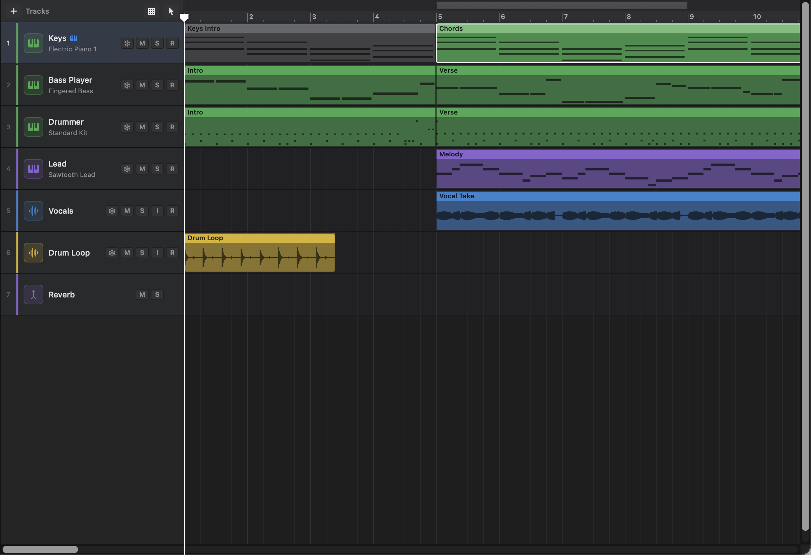
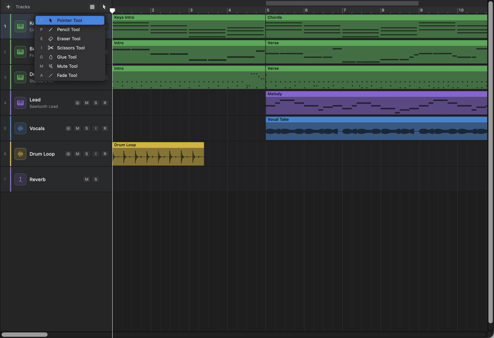
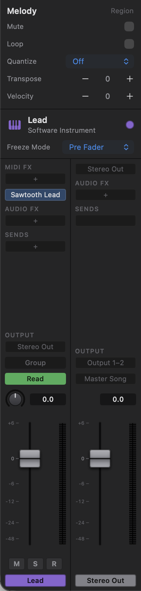
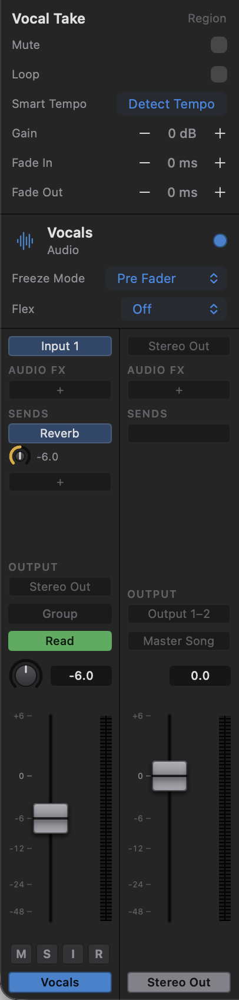
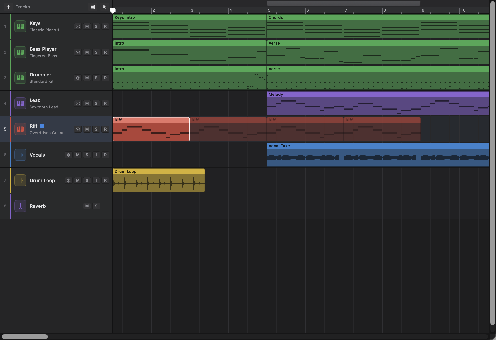
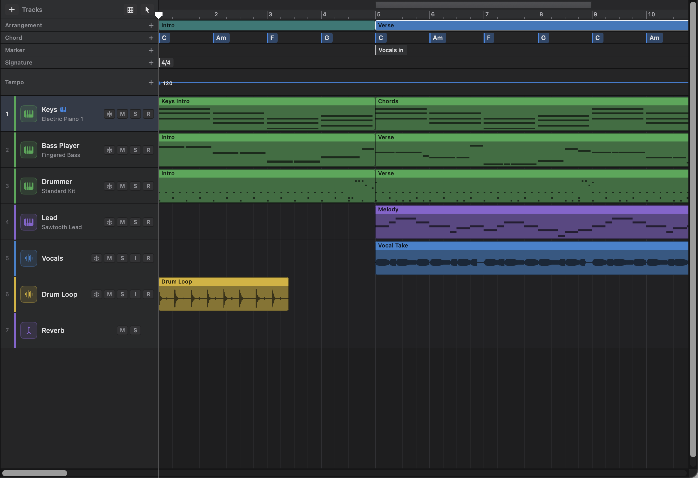
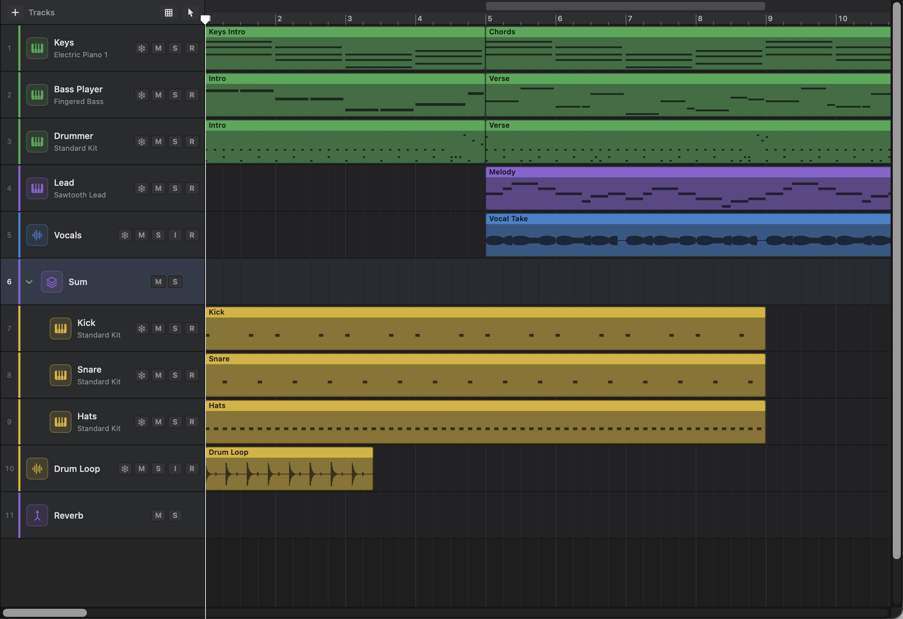
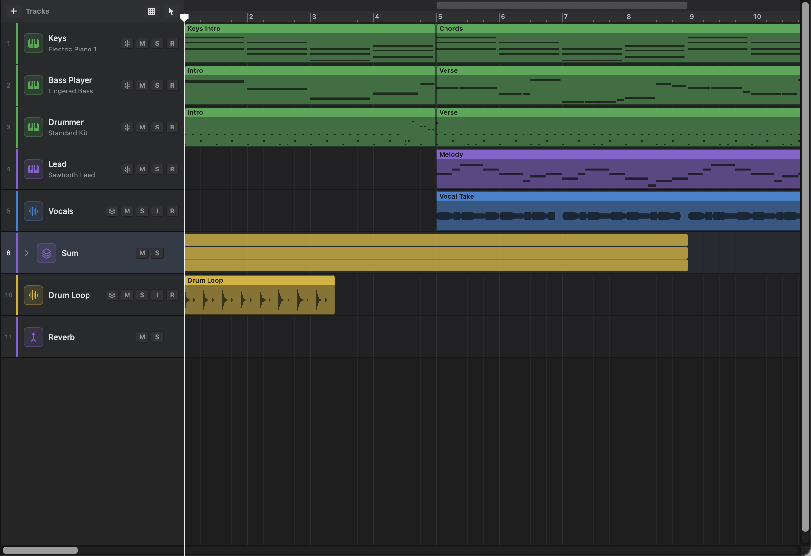

# 2. Arranging and Editing

Arranging means shaping a song from its parts: putting regions in the right places, repeating a chorus, cutting a verse shorter, fading a guitar in. This chapter explains what regions are and every way of editing them in the tracks area, then covers the tools for whole sections of a song: markers, the Arrangement track, tempo and time signature changes, track stacks, and importing audio.

You'll need the words from [Chapter 1](01-getting-started.md): track, region, playhead, cycle range and locators.

## Regions

A **region** is a block of music on a track, shown as a coloured rectangle with its name in a strip along the top. There are two kinds:

| Region | Lives on | Shows | Comes from |
|---|---|---|---|
| **MIDI region** | Software instrument tracks | Small dark bars, one for each note | Recording from a MIDI keyboard, drawing notes, importing a MIDI file, or a session player |
| **Audio region** | Audio tracks | A waveform | Recording from a microphone or instrument, or importing an audio file |

An audio region doesn't hold the sound itself: it is a window onto an audio file stored in the project. When you shorten an audio region, the audio file isn't cut; the window just shows less of it, and you can drag the edge back out later. That's why most region edits are safe to experiment with.

Regions take their track's colour. Selected regions are brighter, with a white outline. Muted regions turn grey.

## Snapping to the grid

When you move, resize or split a region, or click the ruler, the position "snaps" to the nearest line of a musical grid, so things land neatly on the beat. Automation points snap to the same grid ([Chapter 7](07-mixing-and-automation.md)).

You choose the grid with the **Snap** button, the grid icon above the track headers, just left of the Tool button. Click it and pick a setting from its menu. The same choice is in **Settings › General › Snap regions to**; the two are the same setting, so changing one changes the other.

| Setting | Snaps to |
|---|---|
| **Automatic (follows the zoom)** (the standard choice) | A grid that gets finer as you zoom in: bars when zoomed out, then beats, eighth notes and sixteenth notes |
| **Bars** | Whole bars |
| **Beats** | Beats |
| **1/8 Triplets** | Eighth-note triplets |
| **1/16 Triplets** | Sixteenth-note triplets |
| **Off** | Nothing: positions follow the pointer exactly |

The Snap button's icon dims while snapping is **Off**, as a reminder that things will land exactly where you drop them. Hold the pointer over the button to see the current setting.

**Moving freely for one drag.** To place something off the grid just this once, hold **Control (⌃)** while you drag. Press Control *after* you've started dragging, not before: a Control-click is a right-click, so pressing it first opens a menu instead. Let go of the mouse while still holding Control and the region stays exactly where you dropped it. This works for regions, the Piano Roll's notes and automation points.

Tip: with **Automatic**, if a region won't land where you want it, zoom in (⌘=) and drag again.

## Selecting regions

Most edits act on the **selected** regions, so selecting is the first step of nearly everything.

| To | Do this |
|---|---|
| Select one region | Click it |
| Add a region to the selection, or take it out | Shift-click it |
| Select several regions in an area | With the Pointer tool, drag across empty space; every region the rectangle touches is selected (hold Shift to add to the selection) |
| Select every region | **Edit › Select All** (⌘A) |
| Select every region on one track | Right-click the track's lane and choose **Select All on Track** |
| Select a region and everything after it on its track | Right-click the region and choose **Select All Following** |
| Select the regions in a song section | Click the section on the Arrangement track (see [The Arrangement track](#the-arrangement-track)) |
| Deselect everything | Click an empty part of a lane, or below the last track |

Selecting a region also selects its track. When you select several regions, the Region Inspector shows the first one's settings, and changes you make there apply to all of them.

## Moving, copying and resizing regions

### Moving

To move regions:

1. Select the region (or several regions).
2. Drag any one of them by its middle. All the selected regions move together, snapping to the grid.
3. To move them to another track, drag up or down as well.

Regions can only move to tracks of the same kind: MIDI regions onto instrument tracks, audio regions onto audio tracks. If any region in the selection would land on the wrong kind of track, nothing moves and Ongaku tells you why. Regions can't be moved before the start of the song.

### Nudging with the keyboard

To move the selected regions by a small, exact amount, press **⌥←** (earlier) or **⌥→** (later). Each press moves them one step of the snap grid (see [Snapping to the grid](#snapping-to-the-grid)): a bar, a beat or a smaller division, whatever regions would snap to at this zoom. With **Snap** set to **Off**, the step is the grid that **Automatic** would use at this zoom. Each press is one undo step, called **Nudge Region** (or **Nudge Regions**).

The regions keep their spacing, and they stop at the start of the song. These keys work while the tracks area was the last place you clicked; if you clicked in the Piano Roll last, **⌥←** and **⌥→** nudge the selected notes instead ([Chapter 4](04-midi-editing.md#moving-copying-and-resizing)).

### Copying with Option-drag

To make a copy as you drag:

1. Select the regions you want to copy.
2. Drag them to the new place.
3. Hold the Option (⌥) key **as you let go**. Copies land where you dropped and the originals stay put. The copies become the selection.

You can press Option at any point during the drag; what counts is whether it's held when you let go. While it's held, the pointer shows a small **+** (the copy pointer) and the original regions stay where they are on screen, with the copies following the pointer. Let go of Option before you let go of the mouse and the regions are moved instead.

### Resizing (trimming)

Trimming shortens or lengthens a region from either end without moving the music inside it. A note at bar 3 stays at bar 3; trimming just decides how much of the region plays.

To trim a region:

1. Move the pointer over the left edge, or the **lower half** of the right edge, of the region. The pointer turns into a resize arrow.
2. Drag the edge. It snaps to the grid.

Gotchas:

- The **upper half** of the right edge is the loop handle, not a resize handle (see [Looping regions](#looping-regions)). Watch for the circular-arrow pointer.
- Very narrow regions (when you're zoomed out) have no edge handles; zoom in to trim them.
- An audio region can't be stretched to start before the beginning of its audio file.
- If you shorten a MIDI region, notes outside it stay in the region but don't play; lengthen it again and they come back.

## Tools

The **Tool** decides what a click in the tracks area does. Most of the time you'll use the Pointer, but other tools make some jobs one click instead of several.

### Choosing a tool

There are two ways:

- **The Tool button**: click the tool icon above the track headers (to the right of the word **Tracks**) and choose a tool from the menu.
- **The T key**: with the pointer over the tracks area, press **T**. The Tool menu appears under the Tool button, listing each tool with its key. Press that key to choose the tool, or press **Escape** to close the menu without changing. You can also click a tool in the menu.

So **T** then **T** always takes you back to the Pointer, and **T** then **I** gives you the Scissors.

If the pointer is over the editor pane when you press T, you get the editor's own tools instead (see [Chapter 4](04-midi-editing.md)).

The Tool button shows the current tool's icon. It's white for the Pointer and lit in the accent colour for any other tool, as a reminder that clicks will do something different.

### The tools

| Tool | Key (after T) | What a click on a region does | Can move and resize regions? |
|---|---|---|---|
| **Pointer Tool** | T | Selects it | Yes |
| **Pencil Tool** | P | Selects it. Clicking an empty part of an instrument lane creates a new MIDI region | Yes |
| **Eraser Tool** | E | Deletes it | No |
| **Scissors Tool** | I | Splits it where you click (snapped to the grid) | No |
| **Glue Tool** | G | Joins the selected regions | No |
| **Mute Tool** | M | Mutes it, or unmutes it if it was muted | No |
| **Fade Tool** | A | Nothing; you drag with it to make fades (see [Fades and crossfades](#fades-and-crossfades)) | No |

With every tool except the Pointer and Pencil, **clicking a region that is part of the selection acts on all the selected regions**. For example, select four regions, choose the Eraser, and click one of them: all four are deleted. Clicking a region that isn't selected acts on that region alone.

Hold the pointer over the Tool button to see a reminder of what the current tool does.

### Limitations

- There is one tool at a time. Logic's second tool (on the ⌘ key) and right-button tool aren't available.
- The Mute Tool mutes whole regions only.

## Creating MIDI regions

A new, empty MIDI region is one bar long and starts at the bar you clicked in. It's named after its track, and opens in the Piano Roll straight away so you can add notes ([Chapter 4](04-midi-editing.md)).

To create one, do any of these on a software instrument track's lane:

- double-click an empty spot (with any tool);
- click an empty spot with the Pencil Tool;
- right-click an empty spot and choose **New MIDI Region**.

The lane's right-click menu also has **New Pattern Region** (for the Step Sequencer, [Chapter 4](04-midi-editing.md)), **New Drummer Region** and **New Player Region** ([Chapter 5](05-session-players.md)). **Track › New Pattern Region** makes a pattern region from the menu bar too: on the selected instrument track, in the bar containing the playhead.

Double-clicking a MIDI region opens it in the editor. Double-clicking an ordinary audio region does nothing (unless its track uses Flex Pitch, [Chapter 6](06-flex-and-smart-tempo.md), or it's a take folder, [Chapter 3](03-recording-and-takes.md)). Selecting a region and pressing **E** opens the same editor.

## Splitting, joining and deleting

### Splitting

Splitting cuts a region in two at a point. Both halves end up selected, so you can move or delete either straight away.

To split at the playhead:

1. Put the playhead where you want the cut.
2. Select the regions to split. (If nothing is selected, every region under the playhead on the selected track is split.)
3. Choose **Edit › Split Regions at Playhead** (⌘T), or right-click and choose **Split at Playhead**.

To split where you click:

1. Press **T**, then **I**, to choose the Scissors Tool.
2. Click the region where you want to cut. The cut snaps to the grid. If the region was selected, every selected region that crosses that point is cut there too.

What happens to the contents:

- **MIDI**: each note goes to the half it starts in. A long note that crosses the cut stays in the left half.
- **Audio**: a fade-in stays on the left half and a fade-out on the right half.
- **Looped regions**: the repeats carry on after the right-hand half.
- **Drummer and player regions** stay drummer and player regions, each half playing for its own length with the same settings. A drummer's crash stays at the start of the left half and its fill at the end of the right half; a player's lead-in to the next section stays on the right half.
- **Pattern regions** become ordinary MIDI regions, keeping the notes they were playing.

### Joining (glue)

Joining turns several regions on a track into one, running from the start of the first to the end of the last, with the first one's name. It's useful for tidying up after lots of splitting.

To join regions:

1. Select two or more regions on the same track. (If you select regions on several tracks, each track's regions are joined separately.)
2. Choose **Edit › Join Regions** (⌘J), or right-click and choose **Join Selected Regions**, or click one of the selected regions with the Glue Tool (**T** then **G**).

What can be joined:

- **MIDI regions**: always. The joined region keeps the notes that were actually playing: notes hidden by trimming, and muted notes, are left out.
- **Drummer or player regions with the same settings** (for example the two halves of one you split): they join into one drummer or player region that plays over the whole length, with the first one's crash and the last one's fill or lead-in.
- **Drummer or player regions with different settings, and pattern regions**: they're joined as ordinary MIDI regions holding the notes they were playing. The Edit menu then calls the step **Undo Join and Convert to MIDI**, so you can see that's what happened.
- **Audio regions**: only when they play one unbroken stretch of the same audio file, such as the pieces of a recording you split. Joining different files would need a new audio file, which Ongaku doesn't make.

### Deleting

Select the regions and press **Delete**, choose **Edit › Delete Selection** (its shortcut, Delete, is shown in the menu), right-click and choose **Delete**, or click them with the Eraser Tool.

With no regions selected, Delete does nothing. It never deletes tracks: to delete a track, use **Track › Delete Track** (⌘⌫) (see [Chapter 1](01-getting-started.md#deleting-a-track)).

If the editor pane is open and you clicked in the Piano Roll last, Delete removes the selected notes there instead of regions. If you last clicked a chord on the Chord track, Delete removes that chord instead ([Chapter 5](05-session-players.md#changing-moving-and-deleting-chords)). The area Delete will act on has a thin blue outline (see [Chapter 10](10-key-commands.md#how-focus-affects-which-keys-work)).

### When an edit is refused

Some regions can't be resized, split, joined or crossfaded until you've changed them back to plain regions:

- **Take folders** (from recording in cycle, [Chapter 3](03-recording-and-takes.md)): flatten them first.
- **Audio regions with flex markers, retuned notes or Smart Tempo stretch** ([Chapter 6](06-flex-and-smart-tempo.md)): remove those first, with the **Remove Flex Markers**, **Reset Retuned Notes** or **Remove Stretch** button in the Region Inspector.
- **Regions on frozen tracks** can't be edited at all until the track is unfrozen ([Chapter 7](07-mixing-and-automation.md)). Frozen tracks' lanes have an icy tint.

Ongaku explains which of these is in the way when it refuses. For a flexed region, the message names the button that fixes it, for example: "To resize, split, join or crossfade “Vocal”, first remove its flex markers (Remove Flex Markers): select it and use the button in the Region Inspector."

## Muting regions

Muting a region silences it without deleting it, so you can try the song with and without a part. Muted regions turn grey.

To mute or unmute regions, do one of these:

- right-click and choose **Mute or Unmute** (if any of the selected regions are playing, they're all muted; if they're all muted, they're all unmuted);
- click them with the Mute Tool (**T** then **M**);
- turn on **Mute** in the Region Inspector.

To silence a whole track, use the track's **M** button instead.

## Cut, copy, paste and repeat

Ongaku has its own clipboard for regions. It's shared between all open projects, so you can copy MIDI regions from one song into another.

| Command | Menu | Shortcut | What it does |
|---|---|---|---|
| Cut | **Edit › Cut** | ⌘X | Copies the selected regions and removes them |
| Copy | **Edit › Copy** | ⌘C | Copies the selected regions |
| Paste | **Edit › Paste** | ⌘V | Pastes at the playhead, onto the selected track |
| Repeat | **Edit › Repeat Regions** | ⌘R | Places a copy of the selection straight after it |

These commands act on regions when you last clicked in the tracks area, and on notes when you last clicked in the Piano Roll. While you're typing in a text field they work on text as usual.

How pasting works:

1. Copy one or more regions.
2. Click the track you want them on (that selects it) and put the playhead where the first region should start.
3. Choose **Edit › Paste** (⌘V).

The pasted regions keep their spacing in time and between tracks: the topmost copied region lands on the selected track and the others land on the tracks below, in the same pattern. The pasted regions become the selection.

You can also right-click a lane and choose **Paste**: the regions are pasted at the spot you right-clicked, on that track.

Gotchas:

- The tracks they land on must be the right kind (MIDI onto instrument tracks, audio onto audio tracks), and there must be enough tracks below.
- **Audio regions can only be pasted into the project they were copied from.**

### Repeat

**Repeat** is a quick way to make a part play again: select a two-bar drum pattern, press ⌘R three times, and you have eight bars. The copies are laid end to end straight after the selection, keeping the spacing between regions, and the copies become the selection (so pressing ⌘R again carries on).

Right-click a region and choose **Repeat** to make several copies at once: **Once**, **2 Times**, **3 Times**, **4 Times** or **8 Times**.

### Duplicating a track

**Track › Duplicate Track** (⌘D) makes a copy of the selected track just below it, with all its regions, its channel strip settings, plug-ins and automation. The copy gets a numbered name, such as "Bass 2", and becomes the selected track. It's a good way to try a variation of a part while keeping the original.

Summing stacks can't be duplicated yet; duplicate the tracks inside them instead.

## Editing a section between the locators

Sometimes you want to change the length of the whole song: cut out a bar that drags, add two bars of space before the chorus, or play a section twice. These commands work on **every track at once**, between the **locators** (the start and end of the cycle range, whether cycling is on or off).

The commands are in **Edit › Section Between Locators**, and in the right-click menu of the tracks area:

| Command | Shortcut | What it does |
|---|---|---|
| **Cut Section** | ⌃⌘X | Removes everything between the locators and closes the gap: everything after moves earlier |
| **Insert Silence** | ⌃⌘Z | Opens up empty time between the locators: everything from the left locator onwards moves later |
| **Repeat Section** | ⌃⌘R | Plays everything between the locators twice: a copy goes straight after, and everything later moves to make room |

To cut two bars out of a song:

1. Drag in the top strip of the ruler over the bars you want to remove (this sets the locators).
2. Press **C** if you don't want cycling on.
3. Choose **Edit › Section Between Locators › Cut Section** (⌃⌘X).

"Everything" means regions, automation, markers and Arrangement sections. Regions that cross a locator are split there first, so the cut is clean.

Gotcha: if a region crossing a locator can't be split (a take folder, or a flexed region), the whole command is refused, with a message naming the region.

## The Region Inspector

The **Region Inspector** appears at the top of the Inspector (press **I** if it's hidden) whenever regions are selected. It changes how the selected regions **play**, without changing the notes or audio inside them. That's what "non-destructive" means: set **Transpose** to +2 and the region plays a tone higher, but the notes in the Piano Roll are unchanged, and setting it back to 0 restores the original exactly.

The top line shows the region's name (or "3 Regions" if several are selected). Changes apply to every selected region; settings for MIDI only are skipped for audio regions in the selection, and the other way round.

Use the **−** and **+** buttons beside a value to change it. The **Fade In** and **Fade Out** lengths can also be typed: click the number, type a length, and press Return (Escape cancels).

### Settings for all regions

| Setting | What it does |
|---|---|
| **Mute** | Silences the region (see [Muting regions](#muting-regions)) |
| **Loop** | Repeats the region until the next region on its track, or the end of the song (see [Looping regions](#looping-regions)) |

### Settings for MIDI regions

| Setting | Range | What it does |
|---|---|---|
| **Quantize** | **Off**, **1/4 Note**, **1/8 Note**, **1/16 Note**, **1/32 Note**, **1/4 Triplet**, **1/8 Triplet**, **1/16 Triplet**, **1/32 Triplet**, and the mixed grids **1/8 & 1/12**, **1/16 & 1/12**, **1/16 & 1/24**, **1/32 & 1/24** | Plays the notes moved onto the grid, to tighten up timing. Mixed grids move each note to the nearer of a straight line and a triplet line, which suits playing that mixes both |
| **Transpose** | −96 to +96 semitones | Plays every note higher or lower. 12 semitones is an octave |
| **Velocity** | −99 to +99 | Adds to (or takes from) every note's velocity (how hard it was played), keeping the result between 1 and 127 |

Quantizing in the Region Inspector is different from quantizing in the Piano Roll: here the notes only play on the grid, and stay where you played them; in the Piano Roll ([Chapter 4](04-midi-editing.md)), the notes themselves are moved.

### Settings for audio regions

| Setting | Range | What it does |
|---|---|---|
| **Flex** | (only when Flex is on for the track) | **Quantize Audio**, see [Chapter 6](06-flex-and-smart-tempo.md) |
| **Flex Markers** | (only when a selected region has flex markers) | **Remove Flex Markers** removes them from every selected region, even while Flex is off for the track |
| **Flex Pitch** | (only when a selected region has retuned notes) | **Reset Retuned Notes** puts every retuned note back to the pitch it was sung at |
| **Smart Tempo** | | Finds the recording's tempo, and matches it to the song or the song to it. **Remove Stretch** appears beside it whenever the region is stretched. See [Chapter 6](06-flex-and-smart-tempo.md) |
| **Gain** | −96 to +30 dB, in 1 dB steps | Makes the region louder or quieter before it reaches the track's fader. Useful for evening out takes recorded at different levels |
| **Fade In** | 0 to 60,000 ms (60 s), in 10 ms steps, or typed | Length of a fade from silence at the start |
| **Fade Out** | 0 to 60,000 ms (60 s), in 10 ms steps, or typed | Length of a fade to silence at the end |

When you type a fade length, a plain number is in milliseconds. You can add a unit: "250", "250 ms" and "0.25 s" all mean a quarter of a second, and "1.5 s" means one and a half seconds. Lengths over 60 seconds are set to 60 seconds.

## Fades and crossfades

A **fade** makes an audio region rise smoothly from silence at its start (a fade-in) or sink to silence at its end (a fade-out). Even a very short fade, a few milliseconds, removes the click you can hear when a region starts or stops in the middle of a sound.

A **crossfade** is a fade between two regions that touch or overlap: the first fades out while the second fades in. It smooths the join when you've cut between two takes.

Fades appear on the region as a darkened triangle under a white line. Fades are for audio regions only.

### Making a fade with the Fade Tool

1. Press **T**, then **A**, to choose the Fade Tool.
2. To fade in, start dragging in the **first half** of an audio region and drag right; the fade runs from the region's start to where you let go.
3. To fade out, start dragging in the **second half** and drag left; the fade runs from where you let go to the region's end.

The fade appears as you drag. Clicking without dragging does nothing.

You can also set fade lengths in the Region Inspector's **Fade In** and **Fade Out**: step them with **−** and **+**, or click the number and type a length such as "250 ms" or "1.5 s" (see [The Region Inspector](#the-region-inspector)). Changes there apply to every selected region at once.

### Making a crossfade

There are two ways two audio regions on the same track can meet, and the Fade Tool crossfades both:

- **End to end**, so the first ends exactly where the second starts (splitting a region does this for you).
- **Overlapping**, so the second starts before the first ends (for example after you've dragged one region partly over another).

To crossfade them:

1. Choose the Fade Tool (**T** then **A**).
2. Start dragging where the regions meet:
   - for regions **end to end**, start right at the border between them, and drag left or right. The crossfade is twice as long as your drag, centred on the border. To make room for it, each region is lengthened into the other by half the crossfade, as far as its audio file allows. If neither region has any spare audio beyond its edge, Ongaku tells you there's nothing to crossfade with;
   - for **overlapping** regions, start anywhere over the part where they overlap (or just beside it), and drag a little. The crossfade covers the whole overlap: the first region fades out across it while the second fades in.

Gotchas:

- For regions end to end, you need to start the drag within a few pixels of the border; if you start further in, you get an ordinary fade instead. Zooming in helps.
- If there's a gap between the regions, there's nothing to crossfade. Move one of them until it snaps against the other, or overlaps it.

## Looping regions

Looping makes a region repeat over and over without making copies. Change the original and every repeat changes with it, which is ideal for a drum pattern or a riff.

The repeats are drawn as fainter copies of the region after it. You can't click or select the repeats; edit the original region instead.

### Turning looping on

1. Select the region.
2. Turn on **Loop** in the Region Inspector, or right-click the region and choose **Loop or Unloop**.

The region now repeats until the next region on its track, or the end of the song if nothing follows it.

### Setting where the loop stops with the loop handle

To repeat a region for a set length instead:

1. Move the pointer to the **upper half** of the region's right edge. The pointer turns into a circular arrow: this is the **loop handle**.
2. Drag to the right. The repeats appear as you drag, and the end snaps to the grid. The last repeat can stop part way through.
3. To change it later, grab the end of the repeats (again, in the upper half of the track) and drag it.

Dragging the loop end back to the region's own end turns looping off.

### Turning loops into regions

If you want to change one of the repeats on its own (say, add a fill to the last time round), right-click the region and choose **Convert Loops to Regions**. Each repeat becomes an ordinary region of its own, and the original stops looping.

Gotchas:

- Take folders don't have a loop handle.
- Trimming a looped region keeps the loop end where it was on the timeline.

## Markers

**Markers** are named flags along the song, such as "Vocals in" or "Key change", that help you find your way around and jump straight to a spot. They don't change the sound.

Markers live on the **Marker** track, one of the global tracks under the ruler. Press **G** (or choose **Track › Show Global Tracks**) to see them.

To create a marker:

- choose **Transport › Create Marker** (⌥') to put one at the playhead (snapped to the grid), or
- click **+** beside **Marker** in the global track names, or
- double-click an empty spot on the Marker track.

New markers are named "Marker 1", "Marker 2" and so on, each one number past the highest "Marker" number in the song, so deleting a marker never leaves two with the same name. Creating a marker also shows the global tracks. You can't put two markers in exactly the same place.

Working with markers:

| To | Do this |
|---|---|
| Jump to a marker | Click it |
| Jump to the previous or next marker | **Transport › Go to Previous Marker** (⌥,) or **Go to Next Marker** (⌥.) |
| Move a marker | Drag it (it snaps to the grid) |
| Rename a marker | Double-click it, or right-click it and choose **Rename…** |
| Delete a marker | Right-click it and choose **Delete** |

## The Arrangement track

The **Arrangement** track (the top global track) divides the song into **sections**, such as Intro, Verse and Chorus. Once your song has sections, you can rearrange it by dragging whole sections around: drag the second chorus before the bridge, and every region, automation point and marker in it moves too. The menus call sections **arrangement markers**.

### Adding sections

Click **+** beside **Arrangement** in the global track names, or choose **Track › Add Arrangement Marker**. Each new section is eight bars long and goes straight after the last section (the first one starts at bar 1). They're named in turn Intro, Verse, Pre-Chorus, Chorus, Bridge, Solo, Breakdown and Outro.

Sections can't overlap.

### Working with sections

| To | Do this |
|---|---|
| Select a section and the regions that start in it | Click it |
| Rename it | Double-click it, or right-click and choose **Rename…**, or choose a name from right-click **Name** |
| Make it longer or shorter | Drag its right edge. Only the section's length changes; nothing in the song moves |
| Move it, with everything in it | Drag it left or right and drop it where it should go in the song order |
| Copy it, with everything in it | Right-click and choose **Duplicate**. The copy goes straight after it, and everything later moves along |
| Delete it, with everything in it | Right-click and choose **Delete with Contents**. Everything later moves back to close the gap |

How moving works: the sections are laid end to end again in their new order, starting where the first section started, and each section's contents move with it. A region belongs to the section it **starts** in.

Gotchas:

- Gaps between sections close up when you move one.
- Clicking a section selects its regions, so pressing **Delete** afterwards deletes those regions (not the section). Use **Delete with Contents** to remove a section.
- To make a section that doesn't start after the last one, add it and then drag it into place, or resize its neighbours.

## The Chord track

The **Chord** track, under the Arrangement track, holds the song's chords for the Bass and Keyboard players to follow. It's described in [Chapter 5](05-session-players.md).

## The Signature track

The **Signature** track shows the time signature and the key, and any changes of either part-way through the song: for example, one bar of 2/4 in a song in 4/4, or a last chorus that goes up a tone. Time signatures are white labels (**4/4**); keys are blue labels with a note (**♪ C maj**). Where a bar has both, they sit side by side.

### Time signatures

| To | Do this |
|---|---|
| Change the starting time signature | Click the first one (or right-click it) and choose a new one, or use **TIME** on the LCD |
| Add a change after the playhead | Click **+** beside **Signature** and choose **Time Signature at the Next Bar** (see below) |
| Add a change anywhere | Right-click an empty spot on the Signature track and choose from **Add Time Signature at Bar N**. It goes at the nearest bar line |
| Change an existing change | Click it and set it in the box that opens, or right-click it and choose another time signature |
| Move a change to another bar | Drag it (the first one can't be moved) |
| Delete a change | Click it and click **Delete** in the box, or right-click it and choose **Delete** (the first one can't be deleted) |

**Adding a change with +.** Clicking **+** beside **Signature** and choosing **Time Signature at the Next Bar** adds a change at the start of the **next bar** after the playhead, in the time signature already in effect there. (If the playhead is exactly on a bar line, past bar 1, the change goes at that bar instead.) The global tracks are shown, and a box titled **Time Signature at Bar N** opens on the new change so you can set it straight away. If there's already a change at that bar, the box opens on it.

**The time signature box.** Clicking any change on the Signature track opens the same box. In it:

- the stepper sets the number of beats in a bar (VoiceOver calls it **Beats per Bar**);
- the menu after the **/** sets the beat unit (the note that counts as one beat, for example 4 for quarter notes or 8 for eighths);
- the buttons below set a common meter in one click: **2/4**, **3/4**, **4/4** and the rest of the list on the LCD;
- **Delete** removes the change (it isn't there for the first time signature, which can't be deleted).

Each change you make in the box is applied straight away and is its own undo step. Click outside the box to close it.

### Key changes

A **key change** says the song is in a new key from that bar on. It doesn't transpose any of your regions: it's what the Chord track suggests chords and progressions from, and what the session players play where there are no chords (see [Chapter 5](05-session-players.md)). The key at bar 1 is the song's key.

| To | Do this |
|---|---|
| Change the song's key | Click the key at bar 1 and choose one, or use **KEY** on the LCD with the playhead before the first key change |
| Add a key change after the playhead | Click **+** beside **Signature** and choose **Key Change at the Next Bar…** |
| Add a key change anywhere | Right-click an empty spot on the Signature track and choose **Add Key Change at Bar N…**. It goes at the nearest bar line |
| Change a key change | Click it and choose another key, or use **KEY** on the LCD with the playhead after it |
| Move a key change | Drag it to another bar |
| Delete a key change | Click it and click **Delete** in the box, or right-click it and choose **Delete** |

**The key box.** Adding or clicking a key opens a box: choose **Major** or **Minor**, then click one of the twelve keys. When you're adding a change, the box says which key the song is in at that point; nothing is added until you choose a different one. A change to the key that's already playing does nothing, so it's left out (and a change that becomes the same as the key before it, say after you change the song's key, disappears).

Key changes move with the music when you cut a section, insert silence or repeat a section (see [Editing a section between the locators](#editing-a-section-between-the-locators)), and they're written to MIDI files you export ([Chapter 9](09-library-bounce-files-settings.md)).

## The Tempo track

The **Tempo** track, at the bottom of the global tracks, draws the tempo as a line, with a round handle and its BPM at each tempo change. Use it when your song speeds up or slows down at a particular point.

| To | Do this |
|---|---|
| Change the starting tempo | Drag the first handle up or down, or double-click **TEMPO** on the LCD and type |
| Add a tempo change | Double-click the Tempo track: the change goes at that spot (snapped), at the tempo level where you clicked. Or click **+** beside **Tempo** to add one at the playhead |
| Change a tempo | Drag its handle up (faster) or down (slower). Dragged tempos land on whole numbers |
| Move a tempo change | Drag its handle left or right (the first one can't be moved) |
| Delete a tempo change | Right-click its handle and choose **Delete** |

Tempos can be from 5 to 990 BPM. Each change happens instantly at its position; there are no gradual speed-ups (ramps) yet.

Because regions are placed in bars and beats, they stay on the same bars when the tempo changes. MIDI regions simply play faster or slower. Audio isn't sped up or slowed down to match (use Smart Tempo for that, [Chapter 6](06-flex-and-smart-tempo.md)), so plan the tempo before recording or importing audio where you can.

## Track stacks and track outputs

### Where a track's sound goes

Every track has an **output**: where its sound goes after its fader. Normally that's **Stereo Out**, the main output you hear. You can send a track to an **aux track** instead, to treat several tracks as one: put all the drum tracks through one aux, and that aux's fader turns all the drums up and down together.

To change a track's output:

1. Select the track, and find its channel strip in the Inspector (or open the Mixer with **X**).
2. Click the **Output** slot (it says **Stereo Out** to begin with).
3. Choose **Stereo Out** or one of the aux tracks.

Ongaku won't let you make a loop (an aux that feeds back into itself), or output to an aux the track already sends to. Mixing, sends and auxes are covered in [Chapter 7](07-mixing-and-automation.md).

### Summing stacks

A **summing stack** does the same job with less effort: it groups tracks under a new main track and sends all their outputs to it, so the main track's fader, effects, sends and mute work on all of them together. You can also fold the stack up to save space, which helps in a big song.

To create a summing stack:

1. Select the tracks: click the first track header, then Shift-click or ⌘-click the others. (None of them can already be in a stack.)
2. Choose **Track › Create Summing Stack** (⇧⌘D), or right-click one of the headers and choose **Create Summing Stack**.

A new main track called "Sum" (then "Sum 2" and so on) appears where the first selected track was, with the selected tracks indented below it as its **subtracks**. The main track is an aux track, so it has no regions of its own.

Working with stacks:

| To | Do this |
|---|---|
| Fold a stack up, or open it again | Click the triangle on the stack's header |
| Add a track to a stack | Select the stack or one of its subtracks, then add a new track: it joins the stack |
| Take a track out of a stack | Change the subtrack's **Output** to something other than the stack |
| Undo a stack | Select it and choose **Track › Flatten Stack**, or right-click and choose **Flatten Stack**: the subtracks become ordinary tracks again, sent wherever the stack was going, and the main track goes |

When a stack is folded up, its row shows thin coloured strips where each subtrack has regions. These are just for looking at: open the stack to edit the regions.

Deleting the stack's main track (**Track › Delete Track**, ⌘⌫) deletes its subtracks too.

## Importing audio files

You can bring in audio files (for example WAV, AIFF, CAF or MP3, anything your Mac can play) to use as loops, samples or backing tracks.

To import with the menu:

1. Put the playhead where the files should start. They start at the nearest grid line to the playhead, snapped as dropped files are.
2. To put them on an existing audio track, select that track. Otherwise, select any other kind of track (or none).
3. Choose **File › Import Audio Files…** (⇧⌘I), or click **Import Audio** in the control bar.
4. Choose one or more files and click **Open**.

To import by dragging:

1. Drag the files from the Finder onto the tracks area.
2. Drop them on an audio track to put them on that track, or anywhere else (another kind of track, or the empty space below the last track) to give each file a new track. They start where you drop them, snapped to the grid.

Where the files go:

- **Onto an audio track**: the files are placed one after another on that track.
- **Otherwise**: each file gets a new audio track, named after the file, and all of them start at the same position.

Each new region is named after its file and is exactly as long as the audio. If a long file runs past the end of the song, the song grows to fit it (see [How long the song is](01-getting-started.md#how-long-the-song-is)). You can drop MIDI files the same way; they're described in [Chapter 9](09-library-bounce-files-settings.md).

### What happens to the files

- Ongaku **copies** each file into the project (into its **Audio Files** folder, when you save). The original stays where it was, unchanged.
- If a file with the same name is already in the project, the copy gets a number ("Vocal 2.wav").
- Files are kept in their **own format and sample rate**: nothing is converted when you import. If a file's sample rate differs from your audio interface's (say, a 44.1 kHz file on a 48 kHz interface), Ongaku converts it as it plays, so it sounds at the right pitch and speed. The file itself isn't changed.
- Importing several files at once is a single step to undo.

If a file can't be read, Ongaku tells you which file and why, and imports the rest.

## Limitations

- The song's length can't be set by hand. It grows by itself to 8 bars past the last region, marker or section, but never gets shorter by itself.
- There's only one tool at a time (no Command-click tool).
- Fades are straight lines; there's no control over their curve.
- Tempo changes are instant steps; there are no tempo ramps.
- Summing stacks can't be duplicated.
- Audio regions can't be pasted between projects.

## Quick reference

| Action | How |
|---|---|
| Select, add to selection | Click, Shift-click |
| Select with a rectangle | Drag across empty space with the Pointer |
| Select all | ⌘A |
| Move | Drag a region |
| Nudge a snap step earlier or later | ⌥← or ⌥→ |
| Copy by dragging | Drag, hold ⌥ as you release (the pointer shows a +) |
| Trim | Drag the left edge, or the lower half of the right edge |
| Loop to a length | Drag the upper half of the right edge (loop handle) |
| Loop on or off | Region Inspector **Loop**, or right-click **Loop or Unloop** |
| Open the Tool menu | T, then the tool's key |
| Pointer, Pencil, Eraser | T T, T P, T E |
| Scissors, Glue, Mute, Fade | T I, T G, T M, T A |
| New MIDI region | Double-click an empty instrument lane |
| New pattern region at the playhead | **Track › New Pattern Region** |
| Fade in or out | Fade Tool: drag from the start or end of an audio region |
| Crossfade | Fade Tool: drag where two audio regions meet or overlap |
| Type a fade length | Click the **Fade In** or **Fade Out** number in the Region Inspector |
| Split at playhead | ⌘T |
| Join regions | ⌘J |
| Delete the selected regions | Delete |
| Choose what regions snap to | The **Snap** button above the track headers |
| Move freely, off the grid | Hold ⌃ after you start dragging |
| Delete the selected tracks | **Track › Delete Track** (⌘⌫) |
| Cut, copy, paste | ⌘X, ⌘C, ⌘V |
| Repeat | ⌘R (right-click **Repeat** for more) |
| Duplicate track | ⌘D |
| Cut section between locators | ⌃⌘X |
| Insert silence between locators | ⌃⌘Z |
| Repeat section between locators | ⌃⌘R |
| Show global tracks | G |
| Create marker | ⌥' |
| Previous or next marker | ⌥, or ⌥. |
| Add arrangement section | **Track › Add Arrangement Marker** |
| Add tempo change | Double-click the Tempo track |
| Add time signature change | **+** beside **Signature** › **Time Signature at the Next Bar**, or right-click the Signature track |
| Change a time signature | Click it on the Signature track |
| Add a key change | **+** beside **Signature** › **Key Change at the Next Bar…**, or right-click the Signature track |
| Change or delete a key change | Click it on the Signature track |
| Create summing stack | ⇧⌘D |
| Import audio | ⇧⌘I, or drag files from the Finder |
