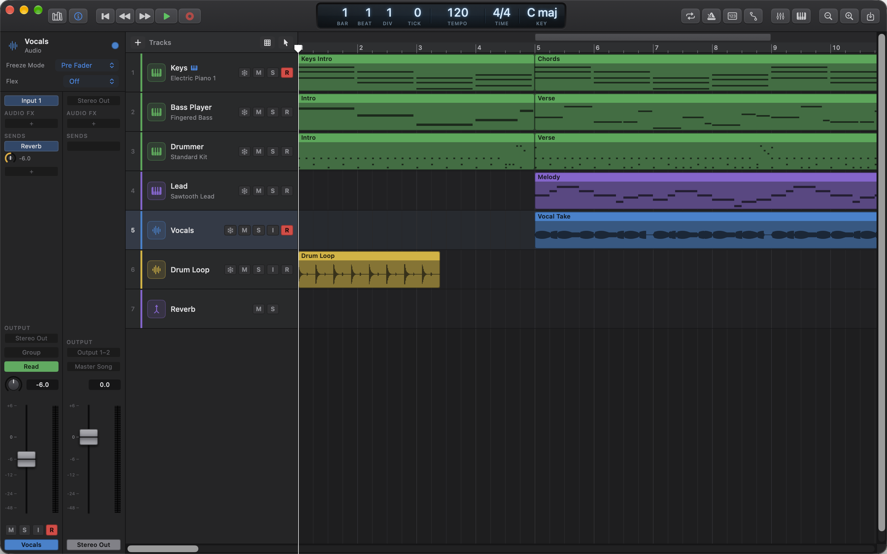
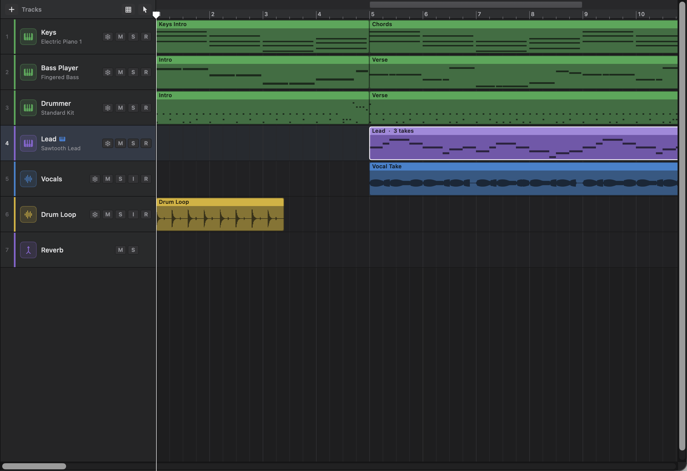
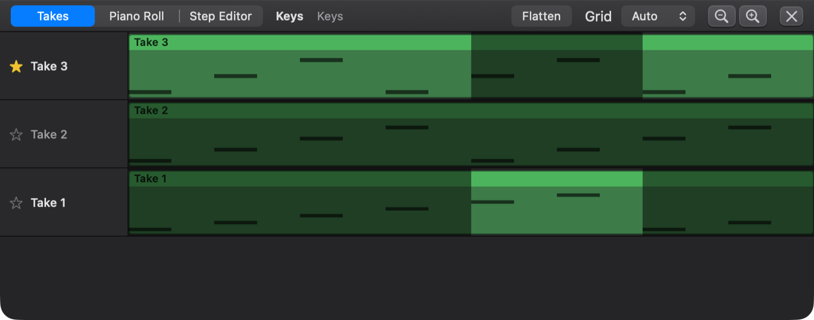

# 3. Recording, Takes and Comping

This chapter covers getting sound into Ongaku Studio: setting up your audio interface and MIDI keyboard, recording audio and MIDI, playing along with the metronome, and recording several takes of a part so you can build one perfect performance out of the best bits. If you've never recorded on a computer before, read the sections in order. Each one builds on the one before.

## Before you record: audio devices

### What it is

Your Mac can have more than one way to make and hear sound: the built-in speakers and microphone, headphones, or an audio interface (a box you plug microphones and guitars into). Ongaku Studio lets you choose where it **plays**. Where it **records from** comes from macOS.

### Choosing the output device

To choose where Ongaku Studio plays:

1. Choose **Ongaku Studio › Settings…** and click the **Audio** tab.
2. Under **Output**, open the **Output device** menu. **System Default** follows whatever is set in macOS. Its name in brackets shows which device that is. Below it you'll find every connected device.
3. Choose an **I/O buffer size**, from 32 to 2048 samples. The default is 512.

Under the menus, Ongaku shows the device's **Sample rate** and the **Buffer latency** your buffer size gives you.

| Setting | What it does |
|---|---|
| **Output device** | Where Ongaku Studio plays. If a device you chose is unplugged, it stays chosen and shows as **Not Connected**. Meanwhile Ongaku plays through the system default. |
| **I/O buffer size** | How much audio is worked out at a time. Small buffers make playing a keyboard feel immediate but work your Mac harder. If you hear crackles, choose a larger buffer. The menu only lists sizes the device accepts. |
| **Sample rate** (shown, not set) | The device's own rate. Recordings are made at this rate. |
| **Buffer latency** (shown) | How long one buffer lasts, in milliseconds. |

**Tip:** Use a small buffer (128 or 256) while you record or play live, and a larger one (1024 or more) while you mix a big project.

### Choosing the input device

Ongaku Studio records from the input device that's chosen in macOS.

To choose it:

1. In **Settings › Audio**, under **Input**, click **Open Sound Settings…**. This opens System Settings › Sound.
2. Choose your microphone or audio interface as the input there.

The first time you record audio (or turn on input monitoring), macOS asks whether Ongaku Studio may use the microphone. Click **Allow**. If you said no by mistake, recording stops with a message. Turn the permission on in **System Settings › Privacy & Security › Microphone**.

### Choosing which inputs a track records

An audio interface often has several inputs, for example input 1 for a vocal mic and input 2 for a guitar. Each audio track records from its own input or pair of inputs. New audio tracks record from **Input 1** (mono).

To change a track's input:

1. Show the Mixer (press **X**).
2. At the top of the track's channel strip, click the input slot (it shows, for example, **Input 1**).
3. Choose a mono input (**Input 1** to **Input 8**) or a stereo pair (**Input 1–2**, **Input 3–4**, **Input 5–6**, **Input 7–8**).

If you choose an input your device doesn't have, Ongaku records from the nearest input it does have. For more on the Mixer, see [Chapter 7](07-mixing-and-automation.md).

## Record-enabling tracks

### What it is

Before you record, you tell Ongaku which tracks should record. This is called **record-enabling** or "arming" a track. Audio tracks record sound from their input. Software instrument tracks record what you play on a MIDI keyboard. You can arm several tracks and record them all at once, for example a drummer's three microphones.

To record-enable a track:

1. Find the **R** button at the right of the track's header. It shows **Record Enable** when you hover over it.
2. Click it. It lights red.
3. Click it again to disarm the track.

**Gotchas:**

- Aux tracks have no **R** button, because they can't record.
- A frozen track can't record. Its **R** button is greyed out and says **Frozen tracks can't record**. Unfreeze the track first (see [Chapter 7](07-mixing-and-automation.md)).
- If you press Record with no track armed, Ongaku says: "Record-enable a track first (the R button on its header)."

## Hearing yourself: input monitoring

### What it is

**Input monitoring** plays what's coming into an audio track's input straight back to you, live, through the track's channel strip: its plug-ins, fader, pan and sends. Use it when you want to sing or play with the track's effects in your headphones (a little reverb on a vocal, an amp simulator on a guitar), or when your audio interface has no direct monitoring of its own.

It works whether or not you're playing or recording, so you can also use it to check your levels and sound before you start. Regions already on the track still play as usual.

To turn input monitoring on:

1. Find the **I** button on the audio track's header, between **S** and **R**. The same button is on the track's channel strip in the Mixer and the Inspector.
2. Click it. It lights orange, and you hear the track's input.
3. Click it again to turn it off.

The track listens to the input chosen in its input slot (see [Choosing which inputs a track records](#choosing-which-inputs-a-track-records)). Input monitoring is off for new tracks. Turning it on or off is saved with the project and can be undone.

**Gotchas:**

- **Use headphones.** With speakers and a microphone in the same room, the mic picks up its own sound from the speakers and you get a loud howl (feedback).
- **There's a small delay.** What you hear is about one or two audio buffers behind what you play. A smaller **I/O buffer size** in **Settings › Audio** makes the delay shorter (see [Choosing the output device](#choosing-the-output-device)). If it still bothers you, use your interface's direct monitoring instead.
- **The input and output devices must run at the same sample rate.** If they don't, Ongaku shows a message saying so. Open **Audio MIDI Setup** (in Applications › Utilities) and set both devices to the same rate.
- **Frozen tracks can't monitor.** The **I** button is greyed out until you unfreeze the track.
- Only audio tracks have an **I** button. Instrument tracks already play what you play on a MIDI keyboard.
- What gets recorded is your input as it arrives, without the track's plug-ins.

## Recording audio and MIDI

### What happens when you record

Recording starts at the playhead and runs until you stop. Everything already on other tracks plays while you record, so you can play along. Ongaku corrects for the small delay between hearing the music and your sound arriving, so your recording lines up with what you heard.

To record:

1. Arm one or more tracks (see above).
2. Put the playhead where you want to start. Click in the lower part of the ruler, or press **Return** to go to the beginning.
3. Start recording in one of these ways:
   - press **R**,
   - click the round **Record** button in the control bar,
   - or choose **Transport › Record**.
4. Play or sing.
5. Stop by pressing **R** again, pressing **Space**, clicking **Stop Recording**, or choosing **Transport › Stop Recording**.

While you record, the Record button pulses. Recording doesn't stop at the end of the song: the tracks area widens ahead of the playhead as you go, and the song grows to fit what you recorded (see [How long the song is](01-getting-started.md#how-long-the-song-is)).

### What you get

- **Audio tracks** get a new audio region that starts where the recorded sound starts. The region is named after the track. Ongaku saves the audio file inside the project.
- **Instrument tracks** get a new MIDI region. It begins at the start of the bar where recording began and ends at the end of the bar where you stopped (or where the last note ends). Any notes still held when you stop end there. Ongaku records the notes and their velocities, plus controllers such as the sustain pedal and mod wheel, pitch bend and aftertouch. Program changes are ignored.
- If you didn't play anything on an instrument track, no region is added to it.
- The whole recording, on every track, is **one undo step** named **Record**. Choose **Edit › Undo** to remove all of it at once.

**Tip:** New recordings are laid on top of whatever is already on the track, not in place of it. If you record over an old part, select the old and new regions and choose **Edit › Pack Take Folder** to keep both as takes (see "Packing regions into a take folder" below).

### Audio file settings

To choose how audio is saved:

1. Choose **Ongaku Studio › Settings…** and click **Recording**.
2. Under **Audio Files**, choose a **File type** and **Bit depth**.

| Setting | Choices | Notes |
|---|---|---|
| **File type** | **CAF** (default), **WAV**, **AIFF** | CAF is Apple's format and handles very long recordings. Choose WAV or AIFF if you want to open the files in other apps. |
| **Bit depth** | **16-bit**, **24-bit** (default), **32-bit float** | 24-bit is the usual choice for recording. |

Recordings are saved inside the project, at the output device's sample rate.

## The metronome and count-in

### What it is

The **metronome** clicks on every beat so you can keep time. It accents the first beat of each bar so you can tell where the bar starts. A **count-in** gives you one or two bars of clicks before recording starts, so you're ready on the downbeat.

To turn the metronome on or off, do one of these:

- press **K**,
- click the **Metronome** button in the control bar (it lights while on),
- or choose **Transport › Turn Metronome On** (or **Turn Metronome Off**).

The metronome follows the project's tempo and time signature. It clicks once for each beat of the time signature: four times in 4/4, and six times (once per eighth note) in 6/8.

Whether the metronome is on is saved with the project, so it's the way you left it when you open the song again. Switching it on or off can be undone, like any other change (the Edit menu calls it **Metronome Change**).

### Metronome sound

To change how the metronome sounds:

1. Choose **Ongaku Studio › Settings…** and click **Metronome**.
2. Set the options:

| Setting | What it does |
|---|---|
| **Sound** | **Click** (a short, bright blip), **Woodblock** (hollow and knocking), **Hi-Hat** (a burst like a closed hi-hat) or **Beep** (a longer, softer tone). |
| **Volume** | How loud the clicks are. |
| **Accent the first beat of each bar** | Makes beat 1 higher and a little louder. |

### Count-in

The quickest way to switch the count-in on or off is the **Count-in** button in the control bar, just right of **Metronome**. It lights while a count-in is on. Hold the pointer over it to see how many bars it counts in.

- Turning it **on** uses the number of bars you last chose in **Settings › Recording** (1 bar if you've never chosen).
- Turning it **off** sets the count-in to **None**.

The button and the setting are the same thing, so changing one changes the other. The count-in is part of the app's settings, not the song, so it applies to every project.

To choose how long the count-in is:

1. Choose **Ongaku Studio › Settings…** and click **Recording**.
2. Under **Metronome**, set **Count-in** to **None**, **1 bar** or **2 bars**. The **Count-in** button remembers the last length you chose here.
3. If you want clicks while you record even when the metronome is off, turn on **Click while recording, even with the metronome off**.

How these work together:

| Metronome | Count-in | Click while recording | What you hear |
|---|---|---|---|
| On | any | any | Clicks during the count-in, recording and playback. |
| Off | 1 or 2 bars | off | The count-in clicks, then silence once recording starts. |
| Off | any | on | Clicks while recording (and during any count-in), none during normal playback. |
| Off | None | off | No clicks. |

**Gotchas:**

- The count-in is only used when you **record**. It isn't used when you just play.
- The **Count-in** button can only switch between your chosen length and none. To change between 1 and 2 bars, use **Settings › Recording**.

## Playing and recording from a MIDI keyboard

### What it is

A MIDI keyboard (or pad controller, or another app that sends MIDI) doesn't make sound by itself. It sends notes to an instrument on a software instrument track. Ongaku listens to every connected MIDI device automatically, and picks up keyboards you plug in while it's running.

### Which tracks you hear

Your keyboard plays:

- **every record-enabled** instrument track, all together, if any are armed. This lets you layer sounds, for example a piano and a pad, and hear exactly what you'll record;
- otherwise, the **selected** track, if it's an instrument track.

A small keyboard icon appears after the name of each track your keyboard plays, so you can always see where your playing will go. Hold the pointer over it to see why that track is playing (it's record-enabled, or it's selected).

To play a different instrument, click its track (and disarm any armed instrument tracks). If a track has MIDI effects such as an arpeggiator, you hear them while you play, each track through its own effects (see [Chapter 8](08-instruments-effects-midi-fx.md)). When you record, Ongaku records the notes you actually played, before the MIDI effects change them.

### Turning inputs on and off

To stop Ongaku listening to a device, for example a controller that sends unwanted notes:

1. Choose **Ongaku Studio › Settings…** and click **MIDI**.
2. Under **Inputs**, turn off the device's switch.

Ongaku Studio plays and records only from inputs that are on. If nothing is connected, the tab says "No MIDI keyboards or controllers are connected."

**Gotcha:** If you arm **several** instrument tracks and record, every armed track gets the **same** recording of everything you played, just as you heard them all while playing. To record separate parts, arm one instrument track at a time.

## Cycle recording and take folders

### What it is

Often you want to try a part several times: sing the chorus five times, then keep the best one. **Cycle recording** makes this easy. Turn on the cycle (a looped section of the song) and record. Ongaku plays the section over and over, and each time round (each "pass") becomes a separate **take**. All the takes are kept together in one **take folder**, a single region that holds them all. Afterwards you choose the best take, or build a **comp** (a compilation) from the best parts of several takes.

To cycle record:

1. Set the cycle range by dragging in the upper strip of the ruler. Then turn the cycle on: press **C**, click the **Cycle** button, or click the cycle strip. See [Chapter 2](02-arranging-and-editing.md) for more about the cycle.
2. Arm the tracks you want to record.
3. Put the playhead at or a little before the cycle start, then press **R**.
4. Perform the part as many times as you like. Ongaku keeps looping.
5. Press **R** or **Space** to stop.

What you get:

- A take folder that covers exactly the cycle range. Its title shows how many takes it holds, for example "Vocal · 4 takes".
- The takes are named **Take 1**, **Take 2** and so on, oldest first.
- The **last** take plays, as in Logic. You can change this in the Takes editor.

How passes become takes:

- **Audio:** each pass that recorded at least one second becomes a take. If you recorded only one pass, you get a plain region instead of a take folder.
- **MIDI:** each pass in which you played something becomes a take. Passes where you played nothing are skipped. If only one pass had notes, you get a plain region. Notes still held at the end of a pass are cut off at the cycle end.

## The Takes editor

### What it is

The Takes editor shows every take in a folder as its own row, newest at the top. Each row's lit sections are the parts that play in the comp. Dimmed parts are not used. A take folder always plays its comp: for each moment, one chosen take.

To open the Takes editor, double-click a take folder in the tracks area, or select it and press **E**. Take folders always open in the Takes editor first.

A **MIDI** take folder can also be edited note by note: the editor pane shows a choice at the top left, **Takes**, **Piano Roll** and **Step Editor**. The Piano Roll and Step Editor edit one take, the one marked with the star (see below), and their header says which, for example **★ Editing Take 3**. To edit a different take's notes, click that take's name in the Takes editor so it plays throughout, then switch to the Piano Roll. An audio take folder only has the Takes editor.

What you see in each row:

| Part | Meaning |
|---|---|
| Star | A filled yellow star marks the take that **starts the comp**: the take that plays at the very start of the folder. For a MIDI folder, it's also the take the Piano Roll and Step Editor edit. |
| Take name | Bright if the take plays somewhere in the comp, grey if it's not used. |
| Take drawing | The take's waveform or notes. Parts that don't play are darkened. |

With VoiceOver, each take row says how much of the comp it plays: **Not used**, **Partly used** or **Used throughout**, followed by "starts the comp" for the starred take.

### Choosing a whole take

To play one take from start to end, click its name in the row header. Its tooltip says "Play Take *n* throughout the folder" (on the starred take, it says the take starts the comp).

### Renaming and deleting takes

Right-click a take's row for its menu:

- **Rename…** opens a box where you type a new name, such as "Best verse". Click **Rename** (or press Return). A take's name can't be empty.
- **Delete Take** removes the take. The parts of the comp it played go silent, unless it was the only take used: then the first take left plays throughout.

When a folder has two takes and you delete one, the folder turns into an ordinary region playing the other take. A folder's only take can't be deleted. Renaming and deleting are ordinary edits, so **Edit › Undo** brings the name or the take back.

### Quick-swipe comping

**Quick-swipe comping** is how you build a comp: you "swipe" across the bits of each take that you like.

To comp:

1. Open the folder in the Takes editor.
2. Drag across the part of a take that you want to hear. A white outline shows the range as you drag.
3. Let go. That take now plays across that range, replacing whatever played there before. The rest of the comp is unchanged.
4. Repeat with other takes. Neighbouring sections from the same take join up automatically.

Each swipe can be undone with **Edit › Undo**.

**Tips:**

- Swipes snap to the editor's **Grid** setting, in the editor's header (see [Chapter 4](04-midi-editing.md)). Choose a finer grid, such as **1/16**, for fine cuts, or **1/4** to comp beat by beat. On **Auto**, the grid gets finer as you zoom in. To make one cut off the grid, hold **⌃** (Control) after you start swiping.
- Use the zoom buttons in the editor's header to see more detail.
- Where two audio sections meet, Ongaku adds a very short crossfade so the switch doesn't click.

### Flattening a take folder

When you're happy with the comp, you can **flatten** the folder. This replaces it with ordinary regions holding just what the comp plays.

To flatten:

- in the Takes editor, click **Flatten** in the header; or
- right-click the take folder in the tracks area and choose **Take Folder › Flatten Take Folder**.

The result:

- **Audio:** one region for each section of the comp, each playing its take, with short fades where they meet.
- **MIDI:** one MIDI region holding each section's notes.

Flattening throws away the takes the comp doesn't use. If you change your mind straight away, choose **Edit › Undo** to get the take folder back.

### Packing regions into a take folder

You can also make a take folder out of regions you already have. For example, you can keep three separate guitar solos you recorded at different times and comp between them.

To pack regions:

1. Select two or more regions **on the same track**.
2. Choose **Edit › Pack Take Folder** (⌥⌘F), or right-click and choose **Take Folder › Pack Take Folder**.

Each region becomes a take. The folder spans from the earliest region's start to the latest region's end. At first the comp plays what you heard before. Where regions overlapped, the later one on the track plays, because it was the one on top.

You can't pack regions from different tracks, or pack a take folder into another one.

## Limitations

- **Input monitoring has a little latency** (about one or two buffers), and needs the input and output devices at the same sample rate. For no delay at all, use your audio interface's direct monitoring.
- **Input device comes from macOS.** You choose the input device in System Settings › Sound, not in Ongaku.
- **No punch-in or punch-out.** Recording starts at the playhead and stops when you stop it.
- **New recordings layer on top** of existing regions. There's no "replace" mode.
- **A MIDI take folder's notes are edited one take at a time**: the take that starts the comp. To edit another take, make it play throughout first.
- **MIDI is played and recorded identically on every armed instrument track.** There's no per-track MIDI input or channel filtering.
- **MIDI clock, SysEx, program changes and MIDI 2.0 messages are ignored** when playing and recording.

## Quick reference

| Action | How |
|---|---|
| Choose output device and buffer size | **Settings › Audio** |
| Choose input device | **Settings › Audio › Open Sound Settings…** (macOS Sound settings) |
| Choose a track's input channels | Mixer (**X**), input slot at the top of the channel strip |
| Record-enable a track | **R** button on the track header |
| Hear an audio track's input live | **I** button on the track header or channel strip (use headphones) |
| Record / stop recording | **R**, the **Record** button, or **Transport › Record** |
| Stop | **Space** |
| Go to beginning | **Return** |
| Metronome on/off | **K**, the **Metronome** button, or **Transport › Turn Metronome On** |
| Metronome sound and volume | **Settings › Metronome** |
| Count-in on/off | The **Count-in** button in the control bar |
| Count-in length, click while recording | **Settings › Recording › Metronome** |
| See which tracks a MIDI keyboard plays | The keyboard icon after the track name |
| Audio file type and bit depth | **Settings › Recording › Audio Files** |
| Turn MIDI inputs on/off | **Settings › MIDI › Inputs** |
| Cycle on/off | **C**, or click the cycle strip in the ruler |
| Open the Takes editor | Double-click a take folder, or select it and press **E** |
| Play one take throughout | Click the take's name in the Takes editor |
| Comp part of a take | Drag across that part of the take's row |
| Rename or delete a take | Right-click its row › **Rename…** or **Delete Take** |
| Flatten a take folder | **Flatten** in the Takes editor, or right-click › **Take Folder › Flatten Take Folder** |
| Pack regions into a take folder | **Edit › Pack Take Folder** (⌥⌘F) |
| Undo a whole recording | **Edit › Undo** (⌘Z) |
