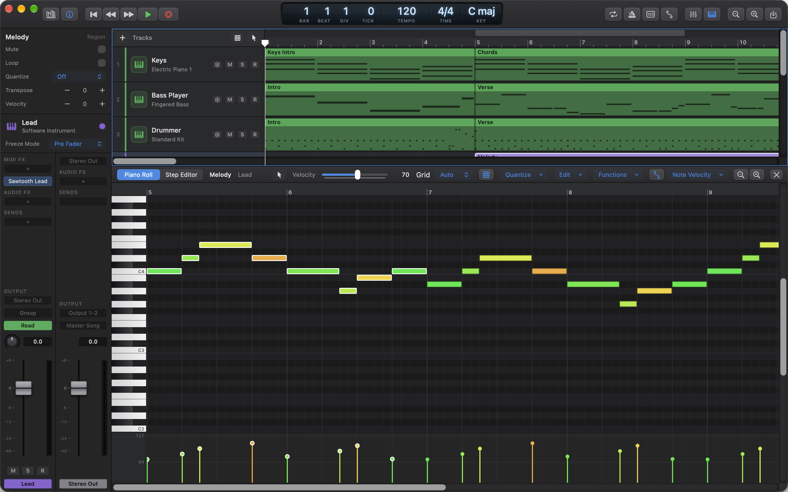
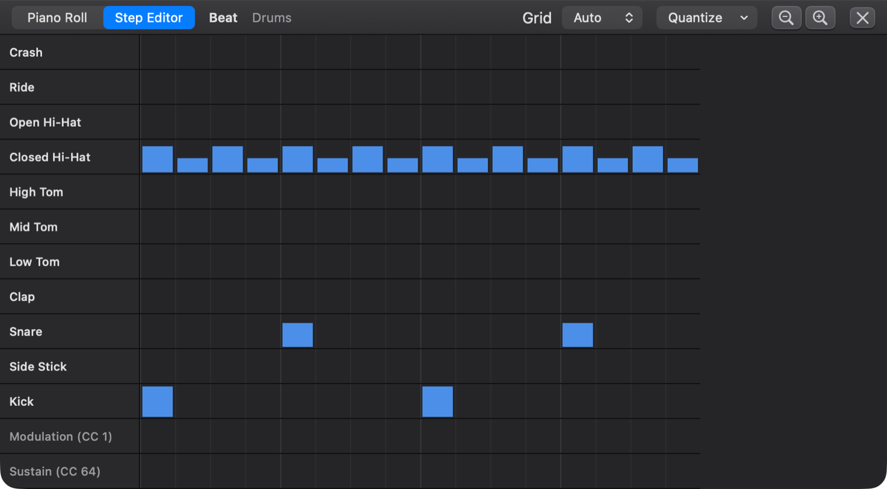
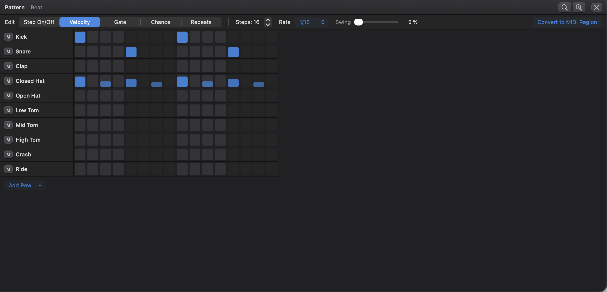
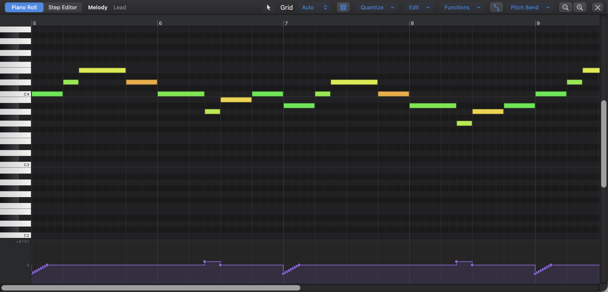

# 4. MIDI Editing: Piano Roll, Step Editor, Step Sequencer, MIDI Draw

A MIDI region doesn't hold sound. It holds instructions: which notes to play, when, for how long and how hard. Because of this, you can fix a wrong note, tighten the timing or change the instrument at any time without re-recording. This chapter shows the editors Ongaku Studio gives you for this work: the **Piano Roll** for notes, the **Step Editor** for drum hits and controllers, the **Step Sequencer** for pattern-based beats, and the **MIDI Draw** lane for velocity, controllers and pitch bend.

## Instrument tracks and sounds

### What it is

A **software instrument track** plays its MIDI regions through an instrument. New instrument tracks use **Acoustic Grand Piano**, a General MIDI sound built into macOS. You can switch to any of the 128 General MIDI sounds, a General MIDI drum kit, one of Ongaku's own instruments, or an Audio Unit instrument you've installed.

To add an instrument track, choose **Track › New Software Instrument Track** (⌥⌘S).

To choose a track's instrument:

1. Click the instrument name under the track's name in the track header, or right-click the header and choose **Instrument**. (In the Mixer, click the instrument slot at the top of the channel strip.)
2. Choose from the menu:

| Menu section | What's in it |
|---|---|
| **Ongaku** | Ongaku's own instruments: **Retro Synth**, **Drum Machine**, **Sampler** and **Session Drummer**. See [Chapter 8](08-instruments-effects-midi-fx.md). |
| **General MIDI** | The 128 General MIDI sounds, grouped into families: **Piano**, **Chromatic Percussion**, **Organ**, **Guitar**, **Bass**, **Strings**, **Ensemble**, **Brass**, **Reed**, **Pipe**, **Synth Lead**, **Synth Pad**, **Synth Effects**, **Ethnic**, **Percussive** and **Sound Effects**. |
| **Drum Kits** | **Standard Kit**, **Power Kit**, **Electronic Kit**, **TR-808 Kit**, **Brush Kit**, **Orchestra Kit** and **Sound Effects Kit**. |
| **Audio Units** | Instrument plug-ins installed on your Mac, shown as "Maker: Name". If there are none, the menu says so. |

For an Audio Unit or Ongaku instrument, the same menu has **Show Instrument Window…** at the top, which opens the instrument's own controls.

**Tip:** It matters whether a track plays drums. Choosing a drum kit (or the Drum Machine) gives you drum names in the Step Editor and a starter beat in new pattern regions.

### Making a MIDI region

To make an empty MIDI region, do one of these:

- double-click an empty spot in an instrument track's lane;
- or right-click the lane and choose **New MIDI Region**.

Either way you get a one-bar region at that bar, and it opens in the Piano Roll. You can also record a region from a MIDI keyboard (see [Chapter 3](03-recording-and-takes.md)) or import a MIDI file (see [Chapter 9](09-library-bounce-files-settings.md)).

### Opening the editors

To open a region in the editor, double-click it, or select it and press **E**. You can also click the **Editor** button in the control bar, or choose **View › Show Editor**. Either way, the pane opens whichever editor suits the region: the Piano Roll, Step Editor, Step Sequencer, Drummer, Player, Takes or Flex Pitch editor. Press **E** again (or choose **View › Hide Editor**) to hide the editor, or click the **×** at the right of the editor's header.

The editor pane holds several editors. When a region suits more than one, a switch at the top left of the editor's header lets you choose: **Piano Roll** or **Step Editor** for a MIDI region. A MIDI take folder offers **Takes**, **Piano Roll** and **Step Editor**, and opens in **Takes** first ([Chapter 3](03-recording-and-takes.md#the-takes-editor)). Pattern regions open in the **Step Sequencer**, and Drummer and session player regions open in their own editors (see [Chapter 5](05-session-players.md)).

## The Piano Roll

### What it is

The Piano Roll shows notes as bars on a grid. Higher notes are higher up, and a piano keyboard runs down the left so you can tell which pitch is which. Time runs left to right, with bar numbers in the ruler along the top. A note's **length** is how wide it is. Its **velocity** (how hard it was played) is its colour: soft notes are violet and blue, through green and yellow, to loud notes in red. Muted notes are grey.

Note names follow Logic: middle C (MIDI note 60) is **C3**.

The header across the top of the Piano Roll holds, from left to right:

| Control | What it does |
|---|---|
| Editor switch | Choose **Piano Roll** or **Step Editor** (only shown when there's a choice). |
| Region and track name | What you're editing. In a MIDI take folder, a yellow **★ Editing Take *n*** follows them: the take whose notes you're editing (the one that starts the comp). |
| Tool button | The current tool's icon. Click it to choose another tool. |
| **Velocity** slider | Appears when notes are selected. Sets the velocity of all selected notes (1–127). |
| **Grid** menu | What notes snap to (see "The grid and snapping"). |
| **Snap** button | Turns snapping to the grid on (lit blue) or off. |
| **Quantize** menu | Quantize options, strength and swing. |
| **Edit** menu | Clipboard and selection commands. |
| **Functions** menu | Note functions such as Transpose and Humanize. |
| **MIDI Draw** button and menu | Shows the MIDI Draw lane and chooses what it edits. |
| Zoom buttons | Zoom the Piano Roll in and out. |

Clicking a note, or a key on the keyboard, plays it so you can hear what you've chosen.

**Important:** The Piano Roll's keys (Delete, Q, ⌥-arrows, ⌘C and so on) work on notes only when the Piano Roll was the **last place you clicked**. While the editor is open, a thin blue outline shows which area your keys act on: the tracks area or the editor. If the outline is round the tracks area, Delete, the clipboard keys and **⌥←** / **⌥→** act on regions; click once in the Piano Roll to move the outline there.

### The grid and snapping

Notes snap to the **grid** when you add, move, resize or split them, and quantizing moves them to it.

To set the grid, choose from the **Grid** menu in the header:

| Choice | Meaning |
|---|---|
| **Auto** | The grid follows the zoom: the finest of 1/32, 1/16, 1/8 or a beat that's still comfortable to click. Zoom in for finer placement. |
| **1/4**, **1/8**, **1/16**, **1/32** | Straight notes. |
| **1/4T**, **1/8T**, **1/16T**, **1/32T** | Triplets: three notes in the time of two straight ones. Use these for shuffles, triplet fills and swing parts. |

The grid is measured from each bar line, so it works in odd meters such as 5/8 or 7/8.

**Turning snapping off.** Click the **Snap** button, next to the **Grid** menu. It's lit blue while snapping is on, which is how every editor starts. With it off, notes go exactly where you draw, move or resize them. The grid lines still show, and **Quantize** still uses the grid, so you can play loose and tighten up later. Click **Snap** again to turn snapping back on.

**Moving freely for one drag.** To leave snapping on but place one note off the grid, hold **Control (⌃)** while you drag. Press it *after* you've started dragging: a Control-click is a right-click, so pressing it first opens the note menu instead.

The Piano Roll's Snap button is separate from the Snap button above the track headers, which sets what regions snap to ([Chapter 2](02-arranging-and-editing.md#snapping-to-the-grid)).

### Tools

#### What they are

The Piano Roll has nine tools, as in Logic. The tool decides what a click or drag does. Most of the time you'll use the **Pointer**. The others are shortcuts for jobs you'd otherwise do with a menu.

To choose a tool, do one of these:

- click the Tool button in the header and choose from the list;
- or move the pointer over the Piano Roll, press **T** to open the Tool menu, then press the tool's key. Press **Escape** to close the menu without choosing.

While you hold **⌘** with the Pointer tool, it acts as the Pencil.

| Key (after T) | Tool | What it does |
|---|---|---|
| **T** | **Pointer Tool** | Select, move and resize notes. Drag in empty space to select several. ⌥-drag to copy. Double-click empty space to add a note. |
| **P** | **Pencil Tool** | Click to add a note. Drag to set its length as you add it. It moves notes too, like the Pointer. |
| **B** | **Brush Tool** | Drag to paint notes along the grid at the pitch under the pointer. |
| **E** | **Eraser Tool** | Click a note to delete it (or the whole selection, if it's selected). |
| **I** | **Scissors Tool** | Click a note to split it there (snapped to the grid). |
| **G** | **Glue Tool** | Select some notes, then click one of them to join the selected notes of each pitch into one long note. |
| **M** | **Mute Tool** | Click a note to mute or unmute it. |
| **V** | **Velocity Tool** | Drag a note up or down to change its velocity (and the selection's). |
| **Q** | **Quantize Tool** | Click a note to quantize it (or the selection) to the grid. |

**Tips:**

- When you click a **selected** note with the Eraser, Mute, Velocity, Scissors or Quantize tool, the tool works on the whole selection.
- The Pencil remembers the length of the last note you drew or resized. A plain click gives a new note that length.
- New notes get the velocity of the last note you clicked (100 at first).
- The Brush skips grid cells that already have a note at that pitch.
- The Glue tool needs at least two selected notes. Otherwise it reminds you: "Select the notes to join, then click one of them with the Glue tool."

### Adding notes

To add notes:

- **Pointer:** double-click empty space. You get a note one grid step long.
- **Pencil:** click to add a note, or drag right to set its length.
- **Brush:** drag across the grid to paint a run of notes, each one grid step long.

### Selecting notes

To select notes:

| To select… | Do this |
|---|---|
| One note | Click it. |
| Add or remove a note | **⇧**-click it. |
| Several notes | With the Pointer, drag a rubber band around them in empty space. **⇧**-drag to toggle more notes in or out of the selection. |
| Every note of one pitch | Click that key on the keyboard at the left. **⇧**-click more keys to add their notes. |
| All notes | **⌘A**, or **Edit › Select All** in the Piano Roll's header. |
| Every note of the pitches already selected | **Edit › Select Same Pitches**. |
| All muted notes | **Edit › Select Muted Notes**. |
| Everything not selected | **Edit › Invert Selection**. |
| Nothing | Click empty space, or **Edit › Deselect All**. |

### Moving, copying and resizing

To **move** notes, drag one of them. All selected notes move together, snapping to the grid (unless **Snap** is off, or you hold ⌃ while dragging). Drag up or down to change their pitch. You hear the new pitch as you go.

To **copy** notes, hold **⌥** as you start dragging. The originals stay put and the copies become the selection.

To **resize** notes, drag a note's left or right edge (the pointer changes to a resize arrow).

- The right edge changes the length.
- The left edge moves the start but keeps the end where it is.
- All selected notes change by the same amount.
- Notes can't get shorter than one grid step this way.

To **transpose and nudge** with the keyboard (selected notes only):

| Keys | Action |
|---|---|
| **⌥↑** / **⌥↓** | Transpose up or down a semitone. |
| **⇧⌥↑** / **⇧⌥↓** | Transpose up or down an octave. |
| **⌥←** / **⌥→** | Nudge earlier or later by one grid step. |

Notes that would go above or below the MIDI range stay where they are. Notes can't be nudged before the start of the region.

**Notes outside the region.** The area to the right of the region's end is shaded. Notes there (dimmed) are kept but don't play. Make the region longer in the tracks area to hear them (see [Chapter 2](02-arranging-and-editing.md)).

### Cut, copy, paste and repeat

Use the Piano Roll's **Edit** menu, the right-click menu, or the usual shortcuts (when the Piano Roll was the last place you clicked):

| Command | Shortcut | What it does |
|---|---|---|
| **Cut** | ⌘X | Removes the selected notes and keeps them on the clipboard. |
| **Copy** | ⌘C | Copies the selected notes. |
| **Paste at Playhead** (**Paste** in the right-click menu) | ⌘V | Pastes at the playhead, or at the region's start if the playhead is before it. The pasted notes are selected. |
| **Repeat** (**Edit › Repeat Notes** in the menu bar) | ⌘R | Copies the selected notes straight after themselves. A phrase of up to a bar repeats one bar later. A longer phrase repeats right after its own end. |
| **Delete** | Delete | Deletes the selected notes. With no notes selected, it does nothing. |

Copied notes can be pasted into another region or another project window.

### Muted notes

A muted note stays in the region but doesn't play. It's drawn grey. Muting is a handy way to try a part without a note before you delete it.

To mute or unmute notes, do one of these:

- click a note with the **Mute Tool** (if it's selected, the whole selection is muted or unmuted);
- or select notes and choose **Functions › Mute / Unmute**. If every selected note is already muted, this unmutes them. With no notes selected, it mutes (or unmutes) every note in the region, like the other functions.

To find muted notes later, choose **Edit › Select Muted Notes**.

### The right-click menu

Right-click a note, or empty space, for a menu of the most common commands: **Cut**, **Copy**, **Paste**, **Repeat**, **Delete**, **Select All**, **Select Same Pitches**, **Invert Selection**, then every note function (see below). If you right-click a note that isn't selected, it's selected first, so the command acts on it.

### Note functions

The **Functions** menu (and the bottom of the right-click menu) changes notes in bulk. A function works on the **selected** notes, or on **every** note in the region if none are selected.

| Function | What it does |
|---|---|
| **Quantize** | Moves notes to the grid (see "Quantize" below). |
| **Transpose › Up a Semitone / Down a Semitone / Up an Octave / Down an Octave** | Changes pitch. |
| **Mute / Unmute** | Mutes the notes, or unmutes them if they're all muted already. |
| **Note Length › Force Legato** | Makes each note last until the next one starts, for smooth, connected lines. |
| **Note Length › Remove Overlaps** | Shortens notes that run into the next note of the same pitch. |
| **Note Length › Set to Grid** | Makes every note one grid step long. The menu shows the current grid. |
| **Velocity › Louder (+10 %) / Softer (−10 %)** | Scales velocities up or down. |
| **Velocity › Set to 127 / 100 / 80 / 64 / 40** | Gives every note the same velocity. |
| **Humanize** | Moves notes and changes their velocities by small random amounts, so a programmed part sounds more played. |
| **Reverse** | Plays the notes backwards in time, within the span they cover. |
| **Invert Pitches** | Mirrors the pitches: the highest note becomes the lowest. |

Every function is a single undo step.

### Quantize

#### What it is

**Quantizing** moves notes onto the grid, so a slightly loose performance plays exactly in time. Ongaku moves each note's **start**. Lengths are kept. Two settings let you keep some feel:

- **Strength** says how far notes move towards the grid. At 100 % they land exactly on it. At 50 % they move halfway, which tightens the timing but keeps some of your feel.
- **Swing** delays every second grid line, for a shuffle. At 100 % the off-beats land a third of a step late, a triplet feel.

To quantize notes:

1. Select the notes to quantize, or select none to quantize the whole region.
2. Set the **Grid** in the header to the smallest note value in your part, for example **1/16**.
3. If you want, open the **Quantize** menu and choose a **Strength** (**100 %**, **75 %**, **50 %**, **25 %**) and a **Swing** (**Off**, **25 %**, **50 %**, **75 %**, **100 %**). Ongaku remembers these until you change them.
4. Press **Q**, or choose **Quantize › Quantize to Grid (Q)**.

The **Quantize** menu also lets you quantize to a grid other than the current one:

| Section | Choices |
|---|---|
| **Straight** | **1/4 Note**, **1/8 Note**, **1/16 Note**, **1/32 Note** |
| **Triplets** | **1/4 Triplet (1/6)**, **1/8 Triplet (1/12)**, **1/16 Triplet (1/24)**, **1/32 Triplet (1/48)** |
| **Straight and Triplets** | **1/8 & 1/12**, **1/16 & 1/12**, **1/16 & 1/24**, **1/32 & 1/24** |

The names in brackets are Logic's names for triplet grids. They count how many fit in a 4/4 bar: twelve eighth-note triplets make a bar, so "1/12".

**Mixed quantize** (the **Straight and Triplets** choices) is for parts that mix straight notes with triplets, such as a drum fill. Each note goes to whichever grid line is nearer, the straight one or the triplet one, so neither kind gets pulled out of shape.

The **Quantize Tool** and **Functions › Quantize** use the current grid, strength and swing too.

**Tip:** To quantize how a region **plays** without moving its notes, use **Quantize** in the region's Inspector instead. It has the same straight, triplet and mixed grids, and you can turn it off again at any time (see [Chapter 2](02-arranging-and-editing.md)).

**Gotcha:** **Q** quantizes only in the Piano Roll. In the Step Editor, use the **Quantize** menu.

## The Step Editor

### What it is

The Step Editor shows a region as rows of steps, like a drum machine. Each row ("lane") is one note, for example a kick drum, or one controller. Each event is a bar as tall as its velocity or value. It's the quickest way to program a drum part, or to set the loudness of each hit at a glance.

To open it, open a MIDI region and click **Step Editor** at the top left of the editor's header.

Which lanes you see:

- On a track playing a **General MIDI drum kit**: **Crash**, **Ride**, **Open Hi-Hat**, **Closed Hi-Hat**, **High Tom**, **Mid Tom**, **Low Tom**, **Clap**, **Snare**, **Side Stick** and **Kick**, then any other notes the region uses.
- On a track playing the Ongaku **Drum Machine**: its own pads, with its names: **Crash**, **Open Hat**, **Closed Hat**, **High Tom**, **Mid Tom**, **Low Tom**, **Shaker**, **Cowbell**, **Clap**, **Snare**, **Rim** and **Kick**, then any other notes the region uses.
- On other tracks: every pitch the region uses, highest first (or **C3** in an empty region).
- Then **Modulation (CC 1)** and **Sustain (CC 64)**, plus any other controller the region already uses.

The step size is the **Grid** setting in the header. On **Auto**, steps are sixteenth notes.

The Step Editor has no keys of its own. In particular, **Delete** does nothing while you're working here (remove events by double-clicking them), so it can't delete notes the Piano Roll had selected out of sight.

To edit steps:

| To… | Do this |
|---|---|
| Add an event, or change one | Click the step. The bar's height is set by how high you click: near the top is loud, near the bottom is soft. |
| Fill several steps | Drag across them. Each step takes the height of the pointer as it passes. |
| Remove an event | Double-click its bar. |

New notes are one step long. Each click or drag is one undo step.

**Gotcha:** The lanes on a drum track are only named for **General MIDI drum kits** and the **Drum Machine**. On a track playing another drum plug-in (including the Session Drummer), lanes are named by note, for example **C1**.

## The Step Sequencer

### What it is

The Step Sequencer is a pattern-based way to make beats and riffs, like the step sequencer in Logic or a hardware groovebox. A **pattern region** holds a pattern of steps rather than notes. The pattern loops through the region. Each row can have its own length, speed and direction, so rows of different lengths drift against each other for interesting polyrhythms. Each step can also have its own velocity, length, chance of playing and number of repeats (rolls).

### Making a pattern region

To make a pattern region:

1. Right-click an empty spot in an instrument track's lane.
2. Choose **New Pattern Region**.

Or select an instrument track and choose **Track › New Pattern Region**: the region goes in the bar containing the playhead.

You get a one-bar region named "Pattern", and it opens in the Step Sequencer.

- On a **drum track** (a General MIDI kit or the Drum Machine), it starts with rows for **Kick**, **Snare**, **Clap**, **Closed Hat**, **Open Hat**, **Low Tom**, **Mid Tom**, **High Tom**, **Crash** and **Ride**, with a simple beat to start from: kick on beats 1 and 3, snare on 2 and 4, eighth-note hats.
- On other tracks, it starts with empty rows for a C major scale from **C3** up to **C4**.

### The pattern bar

The bar across the top of the Step Sequencer sets up the whole pattern:

| Control | What it does |
|---|---|
| **Edit** switch | What clicking and dragging on steps changes: **Step On/Off**, **Velocity**, **Gate**, **Chance** or **Repeats**. |
| **Steps** | How many steps the pattern has before it starts again (1–64; 16 at first). |
| **Rate** | How long each step is: **1/4**, **1/4T**, **1/8**, **1/8T**, **1/16**, **1/16T**, **1/32** or **1/32T** (**T** means a triplet). |
| **Swing** | Delays every second step, for a shuffle. |
| **Convert to MIDI Region** | Turns the pattern into the notes it plays (see below). |

### Edit modes

Choose an edit mode, then click or drag across steps. In every mode except **Step On/Off**, a step's height shows its value, and clicking or dragging sets the value from how high you click. Setting a value also turns the step on.

| Mode | What it changes | Range |
|---|---|---|
| **Step On/Off** | Turns steps on or off. Drag across steps to make them all match the first step you changed. | On or off |
| **Velocity** | How hard the step plays. Brighter steps are louder in every mode. | 1–127 |
| **Gate** | How long the note plays, as a part of the step. Short gates are staccato. | 5 %–100 %, in 5 % steps |
| **Chance** | How likely the step is to play. A step with a chance below 100 % shows a **?**. | 0 %–100 %, in 5 % steps |
| **Repeats** | Plays several quick notes in the step, for rolls and flams. A step with repeats shows **×2**, **×3** or **×4**. | 1–4 |

**Tip on Chance:** Whether a "maybe" step plays is decided once for each place in the song, so the region plays the **same way every time** you play it. It varies from bar to bar, not from playback to playback.

While the song plays, a white outline shows the step each row is on.

### Rows

Each row has an **M** button and a name. Click **M** to mute the row. Click the row's **name** for its menu:

| Menu item | What it does |
|---|---|
| **Length** | **Pattern (*n*)** follows the pattern's step count. Or give the row its own length: **3**, **4**, **5**, **6**, **7**, **8**, **12**, **16**, **24** or **32 Steps**. |
| **Rate** | **Pattern (…)** follows the pattern's rate. Or give the row its own rate. |
| **Direction** | **Forward**, **Backward**, **Ping-Pong** (forwards then backwards) or **Random**. |
| **Clear Row** | Turns every step in the row off. |
| **Remove Row** | Deletes the row. |

When a row has its own length, rate or direction, they're shown in grey next to its name.

**Tip:** For a polyrhythm, give the hi-hat row **3 Steps** while the kick plays 16. The hat pattern lines up with the kick only every three bars.

To add a row, click **Add Row** under the rows and choose:

- **Drums**: **Kick**, **Snare**, **Clap**, **Closed Hat**, **Open Hat**, **Low Tom**, **Mid Tom**, **High Tom**, **Crash**, **Ride**, **Pedal Hat**, **Side Stick**, **Cowbell** or **Shaker**.
- **Notes**: any pitch, grouped by octave (**C4–B4** down to **C0–B0**).

New rows appear at the top.

### Converting a pattern to notes

A pattern region can only be edited in the Step Sequencer. To edit its notes in the Piano Roll (to add a fill by hand, say), convert it:

- click **Convert to MIDI Region** in the pattern bar; or
- right-click the region in the tracks area and choose **Convert to MIDI Region**.

The region becomes an ordinary MIDI region holding the notes the pattern played, and the editor switches to the Piano Roll. There's no command to turn notes back into a pattern. Only **Edit › Undo** takes you back.

## MIDI Draw

### What it is

Besides notes, MIDI carries **controllers**: continuous movements such as the mod wheel, volume, pan, the sustain pedal, pitch bend and aftertouch (pressure on keys you're already holding). The **MIDI Draw** lane, under the Piano Roll's notes, lets you see and draw these over time. It also shows each note's velocity as a "stalk" you can drag. This is often easier than hunting for note colours.

To show the lane, click the **MIDI Draw** button in the Piano Roll's header (its tooltip says "Show MIDI Draw: velocity, controllers, pitch bend and aftertouch"). Click it again to hide it. Ongaku remembers whether it's shown.

To make the lane taller or shorter, drag its top edge.

### Choosing what to edit

When the lane is showing, a menu next to the MIDI Draw button names what it shows. Click it to choose:

- **Note Velocity**
- **Volume (CC 7)**, **Pan (CC 10)**, **Modulation (CC 1)**, **Expression (CC 11)**, **Sustain (CC 64)**
- **Pitch Bend**, **Channel Aftertouch**, **Poly Aftertouch**
- **Other Controllers**: every controller from 0 to 119, by name where it has one (for example **Brightness (CC 74)**).

A dot (**•**) after a name means the region already has data for it.

The scale at the left of the lane shows the range. Pan shows **L64** to **R63** around **C** (centre). Pitch bend shows **+8191** to **-8192** around **0**. Sustain shows **On** at 64 and above, **Off** below.

### Editing velocity

With **Note Velocity** chosen, each note has a stalk at its start. The taller the stalk, the louder the note.

| To… | Do this |
|---|---|
| Change one note | Drag its stalk up or down. |
| Change several notes together | Select them first, then drag one of their stalks. They all move by the same amount. |
| Sweep velocities | Drag across empty space in the lane. Each stalk you pass jumps to the pointer's height. If notes are selected, only selected notes change. Use this for quick crescendos. |

A small label shows the value as you drag.

### Editing controllers, pitch bend and aftertouch

Controller values are drawn as steps, the way MIDI plays them: each value holds until the next point. Before the first point, the line shows the controller's resting value (centre for pan and pitch bend, 100 for volume, full for expression).

| To… | Do this |
|---|---|
| Add a point | Click an empty spot. |
| Move points | Drag a point (sideways for time, up and down for value). ⇧-click to select several, then drag one to move them all. |
| Draw freehand | Drag across empty space. The stroke replaces the points it passes over. |
| Delete points | Select them and press **Delete**. |

**Poly Aftertouch** belongs to one pitch. Select exactly one note first, or the lane says "Select one note to edit its aftertouch."

**Gotchas:**

- New points are not snapped to the grid.
- If any points are selected in the lane, **Delete** removes those points, not your selected notes. Click a note to clear the point selection first.
- New points go on the MIDI channel of the selected note, or the channel most notes in the region use.

## Compound and odd meters

### What it is

In **compound meters**, the beat you feel is a group of three eighth notes (a dotted quarter). Examples are 6/8 (two felt beats in a bar), 9/8 (three) and 12/8 (four). Ongaku treats any meter with 6, 9, 12 or more beats (a multiple of three) over 8 or 16 this way.

You choose a time signature by clicking **TIME** on the control bar's display. The list has **2/4**, **3/4**, **4/4**, **5/4**, **6/4**, **7/4**, **2/2**, **3/8**, **5/8**, **6/8**, **7/8**, **9/8** and **12/8** (see [Chapter 2](02-arranging-and-editing.md)).

How the editors handle them:

- In the Piano Roll and the tracks area, the stronger beat lines fall on the felt beats (every dotted quarter in 6/8). The eighth notes in between are drawn fainter once you zoom in far enough.
- On **Auto**, the coarsest Piano Roll grid is the dotted-quarter beat rather than a quarter note.
- Snapping and quantizing always count from the bar line, so odd meters like 5/8 and 7/8 line up correctly bar after bar.
- The metronome clicks every beat of the meter, for example six clicks per bar in 6/8, with the first one accented.

**Tip:** For a swung or shuffled part in 4/4, try the **1/8T** grid or a mixed quantize rather than switching to 12/8.

## Limitations

- Keyboard shortcuts for notes (**Q**, **⌥**-arrows, **Delete**) work only in the Piano Roll, not in the Step Editor.
- The Piano Roll's **Snap** setting isn't saved: each project window starts with snapping on.
- The Step Editor names drum lanes only for General MIDI drum kits and the Drum Machine.
- A pattern region can't be edited in the Piano Roll until it's converted, and only Undo turns a converted region back into a pattern.
- MIDI Draw points aren't snapped to the grid, and there's no line or curve tool. Draw freehand, or add points one by one.

## Quick reference

| Action | How |
|---|---|
| New instrument track | **Track › New Software Instrument Track** (⌥⌘S) |
| Choose an instrument | Click the instrument name in the track header |
| New MIDI region | Double-click an empty instrument lane, or right-click › **New MIDI Region** |
| New pattern region | Right-click an instrument lane › **New Pattern Region**, or **Track › New Pattern Region** |
| Open/close the editor | Double-click a region, or **E** |
| Choose a tool | **T**, then **T P B E I G M V Q**, or the Tool button |
| Temporary Pencil | Hold **⌘** with the Pointer |
| Add a note | Double-click (Pointer), click (Pencil) |
| Select notes of one pitch | Click a key on the keyboard |
| Rubber-band select | Drag in empty space (Pointer) |
| Copy by dragging | **⌥**-drag notes |
| Transpose a semitone / an octave | **⌥↑ ⌥↓** / **⇧⌥↑ ⇧⌥↓** |
| Nudge a grid step | **⌥← ⌥→** |
| Snapping on or off | **Snap** button in the Piano Roll header |
| Move a note off the grid | Hold **⌃** after you start dragging |
| Quantize | **Q**, or **Quantize › Quantize to Grid (Q)** |
| Strength and swing | **Quantize › Strength**, **Quantize › Swing** |
| Cut / Copy / Paste | ⌘X / ⌘C / ⌘V |
| Repeat notes | ⌘R |
| Select all notes | ⌘A |
| Delete notes (or MIDI Draw points) | Delete |
| Mute notes | **Mute Tool**, or **Functions › Mute / Unmute** |
| Step Editor: set / remove a step | Click / double-click |
| Step Sequencer: change edit mode | **Edit** switch in the pattern bar |
| Convert a pattern | **Convert to MIDI Region** (pattern bar, or right-click the region) |
| Show MIDI Draw | **MIDI Draw** button in the Piano Roll header |
| Zoom the editor | Zoom buttons in the editor header |
