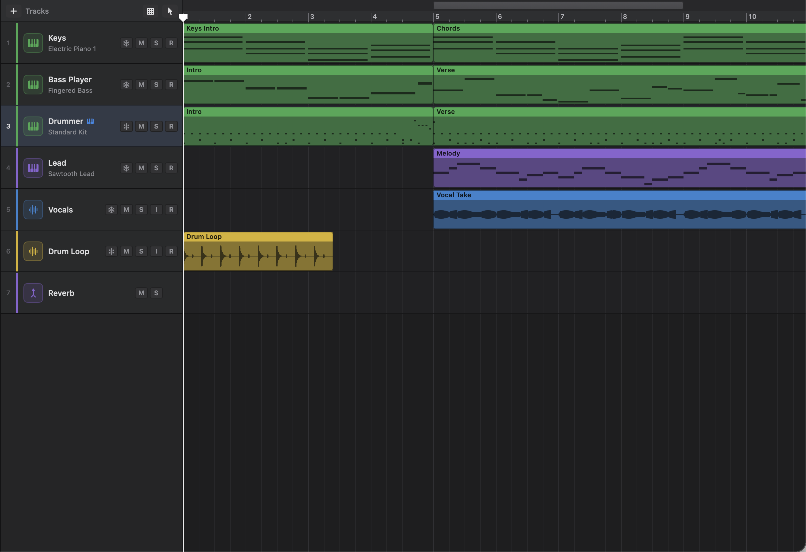
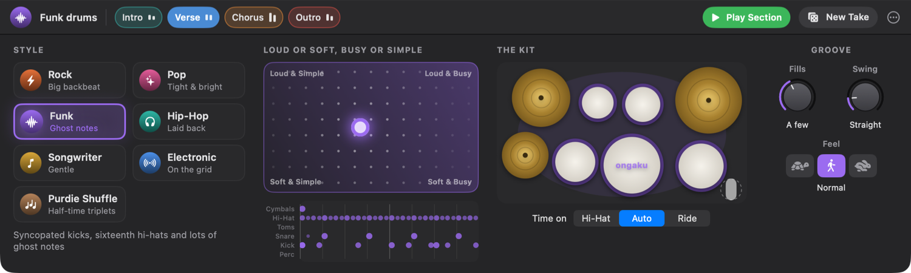
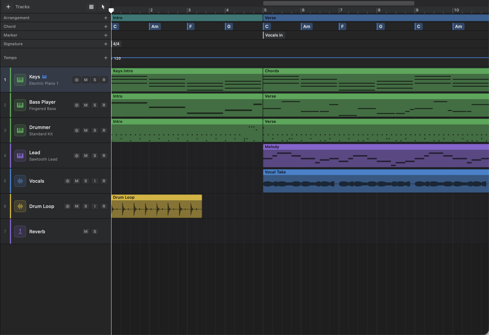
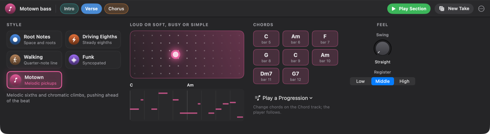

# 5. Session Players: Drummer, Bass, Keys and the Chord Track

Session players are virtual bandmates. You tell them what kind of part you want and how hard to play, and Ongaku Studio writes the notes for you, section by section, to fit your song. This chapter covers the Drummer, the Chord track that the other players read from, and the Bass Player and Keyboard Player.

## What a session player is

A session player region looks like any other MIDI region in the Tracks area, and it plays through the track's instrument like any other. The difference is where the notes come from. You don't draw them. The player works them out from a few settings: a style, how busy, how loud, and so on.

That has some useful results:

- **The part follows your song.** Make a drummer region longer and the drummer plays to the new end. Change the time signature and every drummer and player region is played again in the new meter. Change a chord on the Chord track and the bass and keys follow it straight away.
- **Each section gets its own part.** When your song has arrangement markers (Intro, Verse, Chorus and so on), a new player track gets one region per section. Each one starts with settings that suit its name: a quiet, simple intro, a loud and busy chorus, fills between sections.
- **You can always ask for another version.** **New Take** plays the same settings a different way. The playing is worked out from the settings, so a part sounds the same every time until you change something or ask for a new take.
- **You can turn it into ordinary notes.** If you want to edit single notes, convert the region to a normal MIDI region (see [Converting a part to MIDI](#converting-a-part-to-midi)).

Every change you make in a player editor is a normal edit, so **Edit › Undo** (⌘Z) takes it back.

> Tip: The players work best when your song has arrangement markers. Add them first with **Track › Add Arrangement Marker**. Each new marker is eight bars long and is named after the next suggestion in the list (Intro, Verse, Pre-Chorus, Chorus, Bridge, Solo, Breakdown, Outro). See [Chapter 2](02-arranging-and-editing.md) for the Arrangement track.

### How section names shape the part

When a player region is created for a section, it reads the section's name and picks a starting point. These names are recognised (capital letters don't matter):

| Section name | How the Drummer starts | How the Bass and Keys start |
|---|---|---|
| **Intro** | Soft and fairly simple | Soft and simple |
| **Verse** | Medium | Medium |
| **Pre-Chorus** | A little louder and busier, more fills | A little louder and busier |
| **Chorus** | Loud and busy | Loud and busy |
| **Bridge** | Medium, with fills | Medium |
| **Solo** | Loud and busiest | Loud and busy |
| **Breakdown** | Soft and simple, half time, no toms | Softest and simplest |
| **Outro** | Medium-loud | Medium |
| Any other name | The default middle settings | The default middle settings |

The Drummer also crashes into every section except the first, and fills into every section except the last. The Bass and Keys lead into every section except the last, and play an ending on the last one.

These are only starting points. You can change any of them in the editor afterwards.

## The Drummer

The Drummer plays a full drum kit part: kick, snare, hi-hat or ride, toms, cymbals and, if you want, a shaker. Use it when you need drums quickly, for a demo, a practice track, or as a starting point you'll convert and edit later.

### Adding a Drummer track

1. If you want the drummer to play each part of your song its own way, add arrangement markers first (see the tip above).
2. Choose **Track › New Drummer Track** (⌥⌘U).
3. A new track called **Drummer** appears below the selected track, using a standard drum kit sound. If there's already a track called Drummer, the new one is called **Drummer 2**, and so on.
4. The editor opens at the bottom of the window with the first drummer region selected, showing the Drummer editor.

The Drummer track gets:

- **One region per arrangement section**, named after the section, if your song has arrangement markers.
- **One region called "Drummer"** if it doesn't. It starts at bar 1 and runs to the end of the last region in the song, and is at least eight bars long. The drummer still adds fills along the way.

New Drummer tracks start in the **Rock** style.

For an electronic part, choose **Track › New Drummer Track (Drum Machine)** instead (or **Drummer (Drum Machine)** from the **+** button above the track headers). The track plays the Ongaku Drum Machine, and the drummer starts in the **Electronic** style.

### Adding more drummer regions

You can add a drummer region to any track that plays drums. That means a track using a General MIDI drum kit, or the Ongaku Drum Machine.

1. Right-click an empty spot in the drum track's lane.
2. Choose **New Drummer Region**.

If you click inside an arrangement section, the region fills that section and takes its name. If not, it's eight bars long from the bar you clicked. The new region uses the same style as the other drummer regions already on the track.

On tracks that don't play drums, this menu item says **New Drummer Region (Drum Tracks Only)** and is greyed out. That stops a drummer from playing its kit on a piano or a glockenspiel.

### Opening the Drummer editor

Double-click a drummer region. The editor pane opens with the Drummer editor, because drummer regions can only be edited there. (The Piano Roll and Step Editor tabs don't appear for drummer regions until you convert them to MIDI.) You can also select the region and press **E** to show the editor.

The Drummer editor has a strip across the top, and four areas below it: **Style**, the pad and groove chart, **The Kit**, and **Groove**.

### The song strip

The strip across the top shows the drummer's style (for example "Rock drums") and a row of chips, one for each drummer region on the track, in song order.

- **Click a chip** to edit that section. Each chip shows two small bars: how loud and how busy that section is played. Hover over a chip to see the numbers, for example "Chorus: 78 % loud, 60 % busy".
- Chips are coloured to match their arrangement sections. A region that isn't named after a song section shows its bars instead, for example **Bars 1–8**.
- **Play Section** turns on Cycle around the section you're editing and starts playback, so you can hear your changes as you make them. While it plays, the button changes to **Stop**.
- **New Take** (the dice) plays the same settings a different way.
- **More** (the **…** button) has these options:
  - **Fill into the Next Section**: play a fill at the end of the region, leading into whatever comes next.
  - **Crash as the Section Starts**: hit a crash cymbal on the first downbeat.
  - **Convert to MIDI Region**: turns the part into ordinary notes. See [Converting a part to MIDI](#converting-a-part-to-midi).

If your song has arrangement markers but the drummer's regions don't line up with them (perhaps you added the markers after the drummer, or moved a section), a **Match Song Sections** button appears. Click it to give each arrangement section exactly one drummer region:

- **Sections that already have a drummer region keep it, with your settings.** A region counts as a section's if it covers the same bars, or otherwise if it has the section's name. It's moved and resized to fit the section, renamed after it, and played again to its new length.
- **New sections** get a new drummer region, played to suit the section's name, in the style the track already uses.
- **Drummer regions left over**, for sections that are no longer in the song, are removed. Because their settings go with them, Ongaku asks first: "Remove the drummer regions for sections that are gone?", naming the regions. Click **Match and Remove 1 Region** (or **Match and Remove *n* Regions**) to go ahead, or **Cancel**.

The whole match is one undo step, so **Edit › Undo** puts everything back as it was.

If your song has no arrangement markers, the strip shows a tip instead: add markers with **Track › Add Arrangement Marker** and the drummer plays each section its own way.

### Style

Pick who's playing. Click a style card to switch. The line of text under the cards describes the selected style, and hovering over a card shows its description too.

| Style | Card says | How it plays |
|---|---|---|
| **Rock** | Big backbeat | Straight eighths on the hi-hat, a solid backbeat, tom fills |
| **Pop** | Tight & bright | Tight and steady, with a lighter touch and more kick variation |
| **Funk** | Ghost notes | Syncopated kicks, sixteenth hi-hats and lots of ghost notes |
| **Hip-Hop** | Laid back | Laid-back, swung sixteenths with off-beat kicks |
| **Songwriter** | Gentle | Sparse and gentle, cross-stick when quiet |
| **Electronic** | On the grid | Four on the floor, off-beat open hats, snare rolls |
| **Purdie Shuffle** | Half-time triplets | Half-time triplet shuffle: hi-hat on each beat's first and last triplet, ghost notes between, the backbeat on 3 |

Changing the style also resets **Swing** to that style's usual amount. Hip-Hop, Funk and Purdie Shuffle start with some swing; the others start straight.

### Loud or Soft, Busy or Simple (the pad)

The big square pad is the main way to steer the drummer.

- **Left to right** goes from simple to busy. Busier parts add extra kicks, ghost notes on the snare, faster hi-hats and longer fills.
- **Bottom to top** goes from soft to loud.

The corners are labelled **Loud & Simple**, **Loud & Busy**, **Soft & Simple** and **Soft & Busy**.

1. Drag the dot around the pad.
2. While you drag, the groove chart underneath updates to show what the drummer would play.
3. Let go, and the region is played again with the new settings.

With VoiceOver, the pad has four actions: **Louder**, **Softer**, **Busier** and **Simpler**. Each moves the dot a tenth of the way. (Swiping up and down changes how loud it is.)

How loud the part is also changes what the drummer plays, not only the volume. In the quiet Songwriter and Pop styles the snare becomes a cross-stick. With **Time on** set to **Auto**, a loud part moves from the hi-hat to the ride.

### The groove chart

Under the pad is a small drum chart of the region's first bars: two bars, or four if the pane is wide enough. It has a row each for **Cymbals**, **Hi-Hat**, **Toms**, **Snare**, **Kick** and **Perc**. Each dot is a hit, and bigger, brighter dots are harder hits. While the song plays, a line moves across the chart so you can follow along.

### The Kit

**The Kit** is a drum kit seen from above. Click a drum to leave it out or bring it back in. Drums that are left out are greyed with a dashed outline. While the song plays, each drum lights up as it's hit.

Drums are switched in groups:

| Click | Switches on or off |
|---|---|
| **Crash**, **Hi-Hat** or **Ride** | All the cymbals |
| **High Tom**, **Mid Tom** or **Floor Tom** | All the toms |
| **Kick** or **Snare** | Kick and snare together |
| **Shaker** | Percussion: a shaker, plus a cowbell in busy Funk parts |

Percussion is off when a part starts. Click the shaker to add it.

If you turn off both the kick and snare and the toms, the drummer doesn't play fills, because there's nothing to fill with.

Under the kit, **Time on** chooses what keeps time:

| Setting | What keeps time |
|---|---|
| **Hi-Hat** | Always the closed hi-hat |
| **Auto** | The hi-hat, opening up to the ride when the part gets loud (not in the Electronic style) |
| **Ride** | Always the ride |

On the Ongaku Drum Machine, which has no ride cymbal, open hi-hats play instead of the ride.

### Groove: fills, swing and feel

**Fills** sets how often and how long the drummer fills, from **None** through **A few** and **Some** to **Lots**. Fills come at the end of the region (if **Fill into the Next Section** is on) and now and then every four bars inside it. With lots of fills, some are longer.

**Swing** pushes the off-beats late, toward a triplet feel, from **Straight** through **A little** and **Swung** to **Shuffle**. Funk and Hip-Hop swing their sixteenth notes; the other styles swing eighths.

In the **Purdie Shuffle** style, the knob is called **Ghosts** instead. The triplets already are the swing, so this knob sets how loud the ghost notes on the snare are, from **Whisper** through **Soft** and **Present** to **Hard**.

To use a knob, drag up or down on it. Double-click it, or ⌥-click it, to set it back to zero.

**Feel** has three buttons:

| Button | Feel | What it does |
|---|---|---|
| Tortoise | **Half Time** | The backbeat once a bar, for a big, slow feel |
| Walking figure | **Normal** | The usual backbeat |
| Hare | **Double Time** | Twice as driving |

### Editing several sections at once

Changes in the Drummer editor apply to the region you're editing. If you selected several drummer regions in the Tracks area first (⇧-click to add to the selection) and then opened one of them, each change applies to all the selected drummer regions. Only the setting you change is copied; everything else in each region stays as it was.

Clicking a chip in the song strip selects just that one section again.

### Odd time signatures

The drummer plays in your song's meter, bar by bar, and plays again whenever the meter changes. Compound meters such as 6/8 are felt in dotted quarters, and uneven bars such as 7/8 are grouped 2 + 2 + 3.

### The Session Drummer plug-in

Ongaku Studio also comes with a **Session Drummer** instrument plug-in that you can use in other music apps that support Audio Unit instruments. It has its own list of song sections, since other apps don't share their arrangement markers with plug-ins. See [Chapter 8](08-instruments-effects-midi-fx.md).

## The Chord track

The Chord track is a lane of chord names that runs along the top of the song, with the other global tracks. It doesn't make any sound itself. It tells the Bass Player and Keyboard Player what to play. Whenever you add, change, move or delete a chord, every bass and keys player region is played again to match.

Use the Chord track when you know your song's chords, or when you want to try progressions quickly and hear a band play them.

### Showing the Chord track

Choose **Track › Show Global Tracks**, or press **G**. The global tracks appear under the ruler: **Arrangement**, **Chord**, **Marker**, **Signature** and **Tempo**. The global tracks are also shown automatically whenever you add chords.

### Adding a chord

There are several ways:

- **Double-click** an empty spot in the Chord lane.
- **Right-click** an empty spot and choose **Add Chord Here…**.
- Click the **+** at the Chord track's name to add a chord at the playhead.

Each of these opens a small **Add a Chord** box:

1. Type a chord name, for example `Am7`, `F#m` or `G/B`. While what you've typed isn't a chord yet, the box says **Not a chord name yet** and the **Add** button is greyed.
2. Press Return or click **Add**.

Or click one of the buttons under **In the key of…** to add one of your key's own chords with a single click.

To add a key chord without typing anything, right-click an empty spot and choose a chord from **Add a Chord of the Key**.

Chords land on the grid set with the **Snap** button above the track headers ([Chapter 2](02-arranging-and-editing.md#snapping-to-the-grid)), but never between sixteenth notes, because that's as finely as the players read the chords. With **Snap** set to **Off** or to a triplet grid, or while you hold **⌃** as you drag a chord, it lands on the nearest sixteenth note. If there's already a chord in that spot, the new one replaces it.

### Chord names Ongaku Studio understands

A chord name is a root note, then the kind of chord, then (if you like) a slash and a different bass note.

**Roots:** A to G, followed by `#` or `♯` for sharp, or `b` or `♭` for flat. For example `C`, `F#`, `Bb`, `E♭`.

**Kinds of chord:**

| Chord | You can type | Shown as |
|---|---|---|
| Major | nothing, `maj` or `M` | C |
| Minor | `m`, `min` or `-` | Cm |
| Dominant seventh | `7` | C7 |
| Major seventh | `maj7`, `M7`, `ma7`, `Δ` or `Δ7` | Cmaj7 |
| Minor seventh | `m7`, `min7` or `-7` | Cm7 |
| Diminished | `dim`, `°` or `o` | Cdim |
| Half-diminished | `m7b5`, `m7♭5`, `ø` or `ø7` | Cm7♭5 |
| Augmented | `aug` or `+` | Caug |
| Suspended second | `sus2` | Csus2 |
| Suspended fourth | `sus4` or `sus` | Csus4 |
| Sixth | `6` | C6 |
| Minor sixth | `m6` | Cm6 |
| Added ninth | `add9` | Cadd9 |
| Ninth | `9` | C9 |
| Minor ninth | `m9` | Cm9 |
| Power chord (root and fifth) | `5` | C5 |

**Slash chords:** add `/` and a bass note, for example `C/E` (C major with E in the bass) or `Am7/G`.

Examples: `Am7`, `F♯m7♭5`, `C/E`, `Bbmaj7`, `Dsus4`, `E5`.

Ongaku Studio writes chord names its own way. Roots on black keys are shown as flats, except F♯ and C♯, the way most chord charts write them. So if you type `D#`, the chord shows as **E♭**.

If you type something it doesn't recognise, it shows a message like "“Xyz” isn't a chord name Ongaku Studio knows. Try something like C, Am7, F♯m or G/B."

### Changing, moving and deleting chords

- **Change a chord:** double-click it, or right-click it and choose **Change Chord…**. Type the new name and click **Change**. To swap it for one of the key's chords, right-click it and choose from **Chords of the Key**.
- **Move a chord:** drag it left or right. It lands on the grid (see [Adding a chord](#adding-a-chord)). If you drop it on another chord, it replaces that chord.
- **Select a chord and go to it:** click it, without dragging. The chord is highlighted, and the playhead moves there.
- **Delete a chord:** click it, then press **Delete** (or choose **Edit › Delete Selection**). Or right-click it and choose **Delete**.

A chord stays selected, and Delete keeps acting on it, until you click somewhere else. Clicking in the tracks area or an editor moves Delete back to regions or notes, as usual ([Chapter 10](10-key-commands.md#how-focus-affects-which-keys-work)).

A chord lasts until the next chord on the track.

### Filling the track with a progression

You don't have to enter chords one at a time. Ongaku Studio has a library of common progressions, written so they play in any key. Each chord in a progression lasts one bar.

1. Right-click an empty spot in the Chord lane.
2. Choose **Fill *Section* with a Progression**. *Section* is the name of the arrangement section you clicked in, for example **Fill Chorus with a Progression**. If you didn't click inside a section, it says **Fill 8 Bars with a Progression** and fills eight bars from that bar.
3. Pick a progression. Each one is listed with its chords in your key, for example **Pop: C G Am F**.

The progression repeats to fill the space, and replaces any chords that were already there.

Progressions for major keys:

| Name | Chords (in Roman numerals) | In C major |
|---|---|---|
| **Pop** | I V vi IV | C G Am F |
| **Classic** | I IV V I | C F G C |
| **Fifties** | I vi IV V | C Am F G |
| **Sensitive** | vi IV I V | Am F C G |
| **Lift** | IV I V vi | F C G Am |
| **Build** | ii IV V V | Dm F G G |
| **Folk** | I IV I V | C F C G |
| **Turnaround** | I vi ii V | C Am Dm G |
| **Rock** | I ♭VII IV I | C B♭ F C |
| **Jazz** | ii7 V7 Imaj7 Imaj7 | Dm7 G7 Cmaj7 Cmaj7 |
| **Soul** | Imaj7 iii7 IVmaj7 V7 | Cmaj7 Em7 Fmaj7 G7 |
| **Canon** | I V vi iii IV I IV V | C G Am Em F C F G |
| **Blues** | 12-bar blues with sevenths | C7 ×4, F7 ×2, C7 ×2, G7 F7 C7 G7 |

Progressions for minor keys:

| Name | Chords (in Roman numerals) | In A minor |
|---|---|---|
| **Epic** | i ♭VI ♭III ♭VII | Am F C G |
| **Andalusian** | i ♭VII ♭VI V | Am G F E |
| **Lift** | ♭VI ♭VII i i | F G Am Am |
| **Build** | iv ♭VI ♭VII ♭VII | Dm F G G |
| **Classic** | i iv V7 i | Am Dm E7 Am |
| **Rock** | i ♭VII ♭VI ♭VII | Am G F G |
| **Ballad** | i ♭III ♭VII iv | Am C G Dm |
| **Jazz** | iiø7 V7 i7 i7 | Bm7♭5 E7 Am7 Am7 |
| **Blues** | 12-bar minor blues with sevenths | Am7 ×4, Dm7 ×2, Am7 ×2, F7 E7 Am7 E7 |

Which list you see depends on whether the key is major or minor where the progression goes, and its chords are in that key. Set the key by clicking **KEY** in the control bar, or add a key change on the Signature track ([Chapter 2](02-arranging-and-editing.md#key-changes)): after a key change, the suggestions, progressions and the players' fallback chord are all in the new key.

### Writing chords for the whole song

If you just want to hear something, right-click the Chord lane and choose **Write Chords for the Whole Song**. Ongaku Studio clears the Chord track and writes a progression for each arrangement section. Verses get one progression, pre-choruses another, choruses and outros another, and bridges another, so the song hangs together. The last section ends on the key's home chord. Each time you choose it, you get a different combination.

If your song has no arrangement markers, the whole song is treated as one section.

### Detecting chords from a MIDI region

If you've already played chords into a MIDI region, for example a piano part, Ongaku Studio can work out what they are and put them on the Chord track.

1. Right-click the MIDI region in the Tracks area.
2. Choose **Detect Chords**.

Or select one or more MIDI regions and choose **Track › Detect Chords**. Every selected region that can be read is used, and the whole detection is one undo step.

It listens every half bar, and gives longer and harder notes more weight. When the same chord carries on, it's written once. The detected chords replace any chords that were on the Chord track over the length of each region.

Things to know:

- **Detect Chords** works on ordinary MIDI regions only. It's greyed out for drum tracks, and for drummer, player and Step Sequencer pattern regions. **Track › Detect Chords** skips those and is greyed out when no selected region can be read.
- It recognises major, minor, seventh, major seventh, minor seventh, diminished and suspended fourth chords. It adds a slash bass when the lowest note is a chord tone other than the root. Richer chords (ninths, sixths and so on) come out as the nearest simpler chord, which you can then change by hand.
- If there are too few notes to tell, you'll see a message such as "There aren't enough notes in “Piano” to tell its chords."

### When there are no chords

The players always need a chord to play:

- **If the Chord track is empty**, they play your key's home chord all the way through: C major in C major, A minor in A minor, and so on.
- **Before the first chord** on the track, they play that first chord.

> Note: When you create a Bass Player or Keyboard Player track while the Chord track is empty, Ongaku Studio writes chords for the whole song for you, the same as **Write Chords for the Whole Song**, and shows the Chord track. A player stuck on one chord isn't much use. Undo once to remove the new track and the new chords together.

## The Bass Player and Keyboard Player

The Bass Player plays a bass line and the Keyboard Player plays chords, both following the Chord track. Use them together with the Drummer to hear a whole band playing your progression, or on their own to give you a part to sing or play along with.

### Adding a Bass or Keyboard Player track

1. (Optional) Add arrangement markers and chords first.
2. Choose **Track › New Bass Player Track** or **Track › New Keyboard Player Track**.
3. A new track appears below the selected track, called **Bass Player** or **Keyboard Player** (numbered if that name is taken). The Bass Player starts with a fingered electric bass sound and the **Root Notes** style. The Keyboard Player starts with an electric piano sound and the **Pad** style.
4. The track gets one region per arrangement section (or one region for the whole song if there are none), and the Player editor opens on the first one.

You can change the track's sound to any instrument you like; the notes stay the same. See [Chapter 8](08-instruments-effects-midi-fx.md).

### Adding more player regions

On any instrument track that doesn't play drums:

1. Right-click an empty spot in the lane.
2. Choose **New Player Region**.

As with the drummer, the region fills the arrangement section you clicked in, or eight bars from that bar. It continues in the style the track's other player regions use. On a track with no player regions yet, it plays bass (**Root Notes**) if the track has a General MIDI bass sound, and keys (**Pad**) otherwise.

### Bass styles

| Style | Card says | How it plays |
|---|---|---|
| **Root Notes** | Space and roots | Long roots with room to breathe, and a pickup into each phrase |
| **Driving Eighths** | Steady eighths | Eighths that drive the song, with octave pops and walk-ups |
| **Walking** | Quarter-note line | A line through the chords a beat at a time, leaning into each one |
| **Funk** | Syncopated | The one, then syncopated sixteenths, octave pops and dead notes |
| **Motown** | Melodic pickups | Melodic sixths and chromatic climbs, pushing ahead of the beat |

### Keyboard styles

| Style | Card says | How it plays |
|---|---|---|
| **Pad** | Held chords | Held chords with ninths, re-voiced so the top line moves |
| **Block Chords** | Every beat | Piano chords on the beat over octaves, pushing into changes |
| **Pop Pulse** | Eighth-note chords | Driving eighths and 3-3-2 pushes over a left-hand root |
| **Ballad Arpeggio** | Broken chords | A rolling left hand under held and broken chords |
| **Funk Stabs** | Short stabs | Syncopated ninth and minor-seventh stabs and chanks |

A bass region only offers bass styles, and a keys region only keys styles.

The players think in four-bar phrases. They play the groove, a variation on the second bar of a phrase (once the part is busy enough), and a fill or turnaround on the fourth bar and on the region's last bar. When a chord change is coming, the bass often leans into it with a passing note.

### The Player editor

Double-click a player region to open the Player editor.

The **song strip** across the top works like the Drummer's. It shows the style (for example "Root Notes bass"), a chip for each player region on the track (click one to edit it), **Play Section**, **New Take**, and a **…** menu with:

- **Lead into the Next Section**: end the region with an approach note or pickup into what comes next. Turn it off on the last section to play an ending instead.
- **Convert to MIDI Region**.

While the Chord track is empty, the strip shows a tip saying so: the player plays the key's chord until you add chords on the Chord track or play a progression.

Below the strip, from left to right:

| Area | What it does |
|---|---|
| **Style** | Click a card to choose the style. Changing style resets Swing to that style's usual amount (Walking starts swung; the others start straight). |
| **Loud or Soft, Busy or Simple** | Drag the dot: right for a busier part, up for a louder one. Let go to hear the new part. With VoiceOver, use the **Louder**, **Softer**, **Busier** and **Simpler** actions. |
| The note chart | The section's first two bars as a small piano roll, with the chord names above. It follows the dot while you drag. |
| **Chords** | The chords this section follows, each with its bar number. Click one to move the playhead there. |
| **Play a Progression** | A menu of progressions in your key. Choosing one puts it on the Chord track over this section, replacing the chords there. **Write Chords for the Whole Song** is here too. |
| **Swing** | Drag the knob from **Straight** through **A little** and **Swung** to **Shuffle**. Double-click or ⌥-click to reset it. Funk bass and Funk Stabs swing sixteenths; the others swing eighths. |
| **Register** | **Low**, **Middle** or **High**: play an octave lower or higher than usual. |

Under the chord tiles, a line of text tells you what the player is following:

- "Change chords on the Chord track; the player follows." when the section has chords.
- "No chords yet: playing C, the key's chord. Choose a progression." (with your key's chord) when the Chord track is empty.
- "No chords here yet: playing Am, the Chord track's first chord. Choose a progression." (with that chord) when the Chord track has chords, but none before the end of this section.

As with the Drummer, if you select several player regions of the same kind (all bass or all keys) before opening one, your changes apply to all of them.

> Tip: To change what the player plays harmonically, change the chords, not the player. Edit the Chord track and the part follows straight away, even while the song is playing.

## Converting a part to MIDI

When you want to change single notes, for example to move one kick drum or fix one bass note, turn the region into an ordinary MIDI region:

- In the Drummer or Player editor, open the **…** menu and choose **Convert to MIDI Region**, or
- Right-click the region in the Tracks area and choose **Convert to MIDI Region**.

The region keeps exactly the notes it was playing, and the editor switches to the Piano Roll. See [Chapter 4](04-midi-editing.md).

After converting, the region no longer follows the song. It won't fill a new length, follow chord changes or respond to the player's controls. Converting can only be reversed with **Edit › Undo**. If you selected several drummer or player regions, they're all converted.

### Limitations

- **Joining differently set drummer or player regions converts them to MIDI.** Splitting a drummer or player region keeps both halves "live", and joining regions with the same settings (such as two halves you split) gives one live region again. But **Join Regions** (⌘J) on regions with different settings (a verse and a chorus, say) can't keep both, so the result is an ordinary MIDI region with the notes they were playing, which you can no longer edit in the Drummer or Player editor. The Edit menu calls this step **Join and Convert to MIDI**. See [Chapter 2](02-arranging-and-editing.md#joining-glue).
- **Renaming an arrangement section doesn't restyle its region.** The section-name presets are only used when a region is created. A region keeps its settings if you rename or move the section afterwards. On a drummer track, **Match Song Sections** fits the regions to the sections again, keeping each section's settings, and only new sections get the presets.
- **The drum kit isn't chosen in the Drummer editor.** The drummer plays the track's instrument. Its notes are standard General MIDI drum notes, and if the track uses the Ongaku Drum Machine it plays to suit that machine's pads.
- **Kit pieces are switched in groups**, not one drum at a time (for example, all cymbals together).
- **Chords can only be selected and deleted one at a time.**
- **Chords can't go between sixteenth notes**, even with Snap off.
- **Match Song Sections is for Drummer tracks only.** Bass and keys tracks have no button to line their regions up with the sections.

## Quick reference

| Action | How |
|---|---|
| New Drummer track | **Track › New Drummer Track** (⌥⌘U) |
| New Drummer track on the Drum Machine | **Track › New Drummer Track (Drum Machine)** |
| New Bass Player track | **Track › New Bass Player Track** |
| New Keyboard Player track | **Track › New Keyboard Player Track** |
| Add arrangement markers (sections) | **Track › Add Arrangement Marker** |
| Add a drummer or player region | Right-click a lane › **New Drummer Region** or **New Player Region** |
| Open the Drummer or Player editor | Double-click the region (or select it and press **E**) |
| Steer loudness and busyness | Drag the dot on the **Loud or Soft, Busy or Simple** pad |
| Hear just this section, looped | **Play Section** |
| Another version, same settings | **New Take** |
| Line the drummer up with sections | **Match Song Sections** (keeps each section's settings) |
| Reset a knob | Double-click or ⌥-click it |
| Show the Chord track | **Track › Show Global Tracks** (**G**) |
| Add a chord | Double-click the Chord lane, or click **+** for the playhead |
| Change a chord | Double-click it |
| Move a chord | Drag it (it snaps to the grid, no finer than sixteenths) |
| Select a chord and go to it | Click it |
| Delete a chord | Click it and press Delete, or right-click it › **Delete** |
| Fill a section with a progression | Right-click the Chord lane › **Fill *Section* with a Progression** |
| Write chords for the whole song | Right-click the Chord lane › **Write Chords for the Whole Song** |
| Detect chords in a MIDI region | Right-click the region › **Detect Chords**, or select regions › **Track › Detect Chords** |
| Convert to ordinary MIDI | **…** › **Convert to MIDI Region**, or right-click the region › **Convert to MIDI Region** |
| Undo any change | **Edit › Undo** (⌘Z) |
