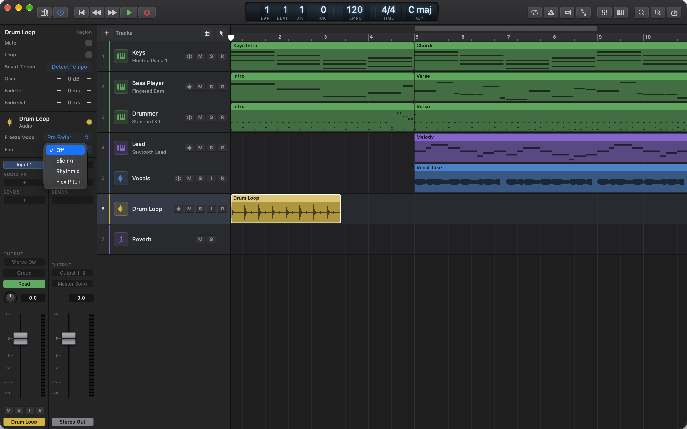
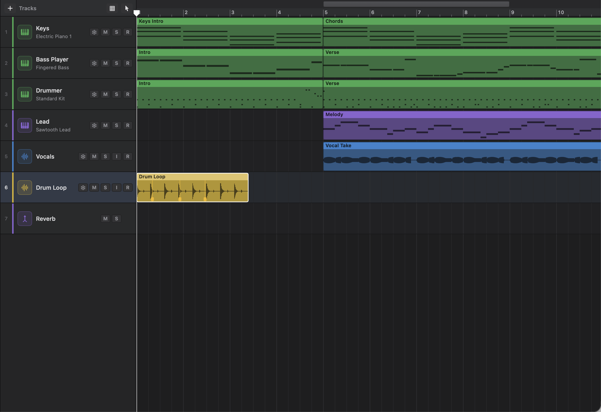
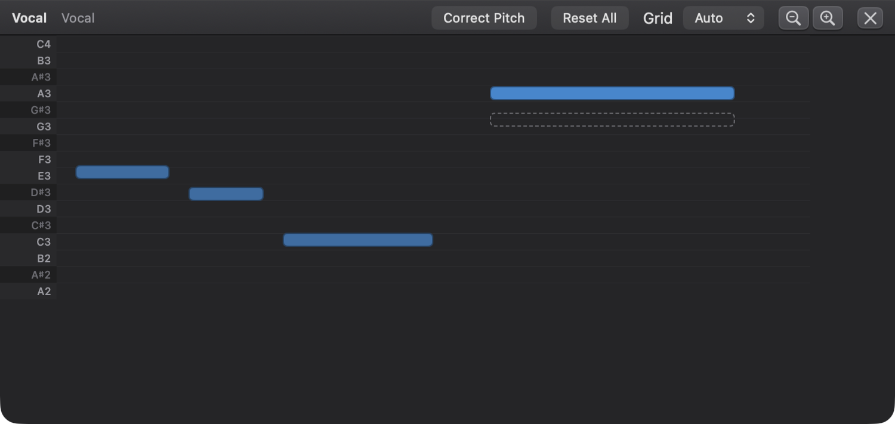
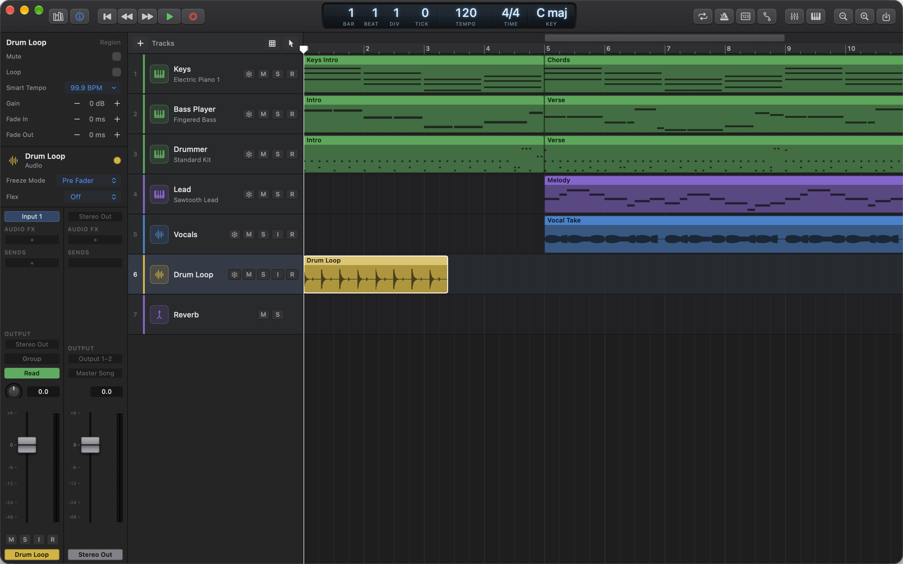

# 6. Flex Time, Flex Pitch and Smart Tempo

Audio recordings are harder to fix than MIDI. A drum hit or a sung note is baked into the sound wave, so you can't just drag it. The tools in this chapter let you do that anyway: **Flex Time** moves the timing of things inside a recording, **Flex Pitch** retunes single sung or played notes, and **Smart Tempo** finds a recording's tempo so the song and the recording can agree.

## How flexing works

All three tools leave your original recording untouched. Ongaku Studio remembers what you asked for (move this hit here, raise this note a semitone, play this loop at 120 BPM), then makes a new, processed copy of the region's audio in the background. Playback switches to the processed copy once it's ready.

From your point of view this means:

- **Your edits are safe and reversible.** Every flex edit can be undone with **Edit › Undo** (⌘Z), and you can remove flex markers, pitch changes or stretching at any time to get the recording back exactly as it was.
- **There can be a short wait.** After an edit, the region keeps playing as it was recorded until the processed copy is ready. While it's being made, the region shows a small spinner and **Processing…** at its bottom left; when the label goes, you're hearing the new version. For a short region that's usually almost instant. For a long one, give it a moment before you judge the result. If something goes wrong, you'll see a message such as "“Vocal” couldn’t be flexed: …".
- **Processed copies aren't saved in your project.** They're made again when you open the project, so flexed regions may show **Processing…** and play unflexed for a moment right after opening.
- **Bouncing and freezing wait for them.** If you bounce the song or freeze a track while regions are still processing, Ongaku finishes processing them first, so what you get includes every flex edit. The Bounce dialog says **Finishing processing flexed audio…** while it waits. See [Chapter 9](09-library-bounce-files-settings.md) for bouncing and [Chapter 7](07-mixing-and-automation.md#freezing-tracks) for freezing.

## Flex Time

Flex Time lets you move a moment inside an audio recording, such as a snare hit that's a little late or a word that's sung early, without cutting the region up. You grab the moment and drag it to where it should be, and the audio around it is stretched or squeezed to fit.

Use it to tighten a drum or bass recording, line up a double-tracked part, or fix one late note in an otherwise great take.

### Turning on Flex for a track

Flex is set per audio track, in the Inspector.

1. Select the audio track.
2. Show the Inspector if it's hidden: press **I**, or choose **View › Show Inspector**.
3. Under the track's name, find **Flex** and choose a mode.

| Mode | How it moves the audio | Best for |
|---|---|---|
| **Off** | Flex is off. Regions play as recorded. | Everything you don't want to flex |
| **Slicing** | Cuts the audio at each flex marker and moves the slices without stretching them. Hits stay crisp, but a slice moved later leaves a short silence before it, and a slice moved earlier cuts off the end of the slice before it. | Drums and percussion |
| **Rhythmic** | Stretches or squeezes the audio between markers, keeping its pitch. | Rhythm guitar, bass, keys, loops, anything with sustained or overlapping notes |
| **Flex Pitch** | Lets you retune single notes (see [Flex Pitch](#flex-pitch)). Flex markers stretch the audio as in Rhythmic. | A voice or a solo instrument playing one note at a time |

Once Flex is on, the track's audio regions show their flex markers, and you can make new ones.

Flex is only available on audio tracks. Software instrument tracks don't need it, because you can move MIDI notes directly (see [Chapter 4](04-midi-editing.md)).

### Flex markers: the idea

A flex marker pins a moment of the recording to a place on the timeline. Think of the region as a strip of elastic that's pinned at its start and its end. Each flex marker is another pin. When you drag a pin, the elastic either side of it stretches or squeezes, but everything stays in order, and the region's start and end stay where they are.

Flex markers show as thin coloured lines through the region, each with a small handle at the bottom.

### Moving audio in time

1. Make sure the track has a Flex mode, and that the **Pointer** or **Pencil** tool is selected.
2. Find the moment you want to move, such as a hit you can see in the waveform.
3. Press in the **lower half** of the region at that moment, and drag left or right. (Dragging in the upper half moves the whole region, as usual.)
4. Let go where it should play. It lands on the nearest grid line, according to your Snap setting (see [Chapter 2](02-arranging-and-editing.md)).

If you pressed on an existing flex marker, you move that marker. If not, a new marker is made at the point you pressed, and you drag it.

While you drag, the region's drawing updates to show the result. When you let go, the new version is processed and plays as soon as it's ready.

> Tip: The first marker you drag stretches everything between the region's start and that marker, and between the marker and the region's end. To move one hit without nudging its neighbours, first drag the hits on either side onto their grid lines. That pins them, so only the audio between them changes.

### Deleting flex markers

- **One marker:** double-click it, in the lower half of the region. This only works while the track has a Flex mode, since that's when the markers are shown.
- **All markers in a region:** select the region, and in the Region Inspector click **Remove Flex Markers** (on the **Flex Markers** row). It removes the markers of every selected region at once, as one undo step.

The **Remove Flex Markers** button is there whenever a selected region has flex markers, even while the track's Flex is **Off** (see [Turning Flex off](#turning-flex-off)).

### Quantizing audio

Quantizing audio does for a recording what quantizing does for MIDI. It finds the hits in the region and moves each one to the nearest grid line, using flex markers.

1. Make sure the track has a Flex mode.
2. Select the audio region.
3. In the Region Inspector, next to **Flex**, open **Quantize Audio** and choose a grid: **1/4 Note**, **1/8 Note**, **1/16 Note**, **1/32 Note**, or one of the triplet grids (**1/4 Triplet** to **1/32 Triplet**).

Ongaku Studio looks for the hits first, which may take a moment, then places a marker on each one and moves it onto the grid. Any markers already in the region are replaced. A hit that's too close to the region's edges, or that would have to cross its neighbour, is left where it is.

If it can't find any hits, you'll see "No hits were found in “…” to quantize."

> Tip: Choose the grid that matches the part. If you pick 1/4 Note for a part full of sixteenths, the in-between notes will be pulled onto beats, and it'll sound wrong. Undo and try a finer grid.

### Turning Flex off

Set the track's **Flex** menu back to **Off**. The track's regions play as recorded again, but their flex markers are kept (hidden). Turn the same mode back on and they come back.

Hidden markers still stop you resizing, splitting or joining the region. To get rid of them without turning Flex on again, select the region and click **Remove Flex Markers** in the Region Inspector.

## Flex Pitch

Flex Pitch finds the notes in a recording of one voice or instrument and shows them like notes in a piano roll. You can drag a note up or down to retune it, or snap every note to the nearest in-tune pitch in one go.

Use it to fix a sharp or flat note in a vocal, or to try a different melody note without singing it again.

### Opening the Flex Pitch editor

1. Select the audio track and set its **Flex** mode to **Flex Pitch** in the Inspector.
2. Double-click an audio region on that track, or select it and press **E**.

The editor pane opens with the **Flex Pitch** editor. It shows **Finding notes…** while Ongaku Studio listens to the recording, which happens once for each region.

Each note found is drawn as a bar, at the pitch it was sung, against note names down the left side. A note sung in tune sits in the middle of its row; one that's a little sharp or flat sits a little above or below.

If no notes are found, you'll see **No Notes Found**. Flex Pitch works on monophonic audio: one voice or instrument playing one note at a time. Chords, full mixes and drums won't work.

### Retuning a note

- **Drag a note up or down.** It moves in steps and lands exactly on a semitone, so dragging a slightly flat note into the row above or below also puts it in tune. While a note is moved, a dashed outline shows where it was sung.
- **Double-click a note** to put it back where it was sung.
- **Hover over a note** to see its name and where it's been moved to, for example "E3 → F3".

You can move a note by up to two octaves either way. The timing stays the same; only the pitch changes.

### Correcting every note

Click **Correct Pitch** at the top of the Flex Pitch editor. Every note that's more than a tiny amount out of tune is moved to the nearest semitone.

If you click it while the notes are still being found, you'll see "Ongaku Studio is still finding the notes. Try again in a moment."

> Gotcha: **Correct Pitch** replaces any notes you've already retuned by hand. It moves each note to its nearest semitone, measured from where it was sung. So if you'd dragged a note up a whole tone, it goes back near its original pitch. Use Correct Pitch first, then make your own changes.

Correct Pitch moves notes to the nearest semitone of the full chromatic scale. It doesn't know your song's key, so a badly out-of-tune note can land on a semitone that's in tune but not in the key. Drag that note by hand.

### Resetting pitch

Click **Reset All** at the top of the Flex Pitch editor to put every note back where it was sung. To reset just one note, double-click it.

You can also reset without opening the editor: select one or more regions and click **Reset Retuned Notes** in the Region Inspector (on the **Flex Pitch** row). The button is there whenever a selected region has retuned notes, whatever the track's Flex mode, and resets every selected region as one undo step.

### Flex markers on a Flex Pitch track

You can use flex markers on a Flex Pitch track too, the same way as in [Moving audio in time](#moving-audio-in-time). They stretch the audio as in Rhythmic mode.

> Note: Retuned notes only play while the track's mode is **Flex Pitch**. If you change the track to Slicing, Rhythmic or Off, the region plays at its sung pitch again, but your changes are kept and come back when you return to Flex Pitch.

## Smart Tempo

Smart Tempo listens to an audio recording and works out its tempo, in beats per minute. Then it can do one of two things:

- **Adapt Project Tempo**: change your song's tempo to match the recording. Use this when the recording came first. For example, you recorded a guitar idea without a click and now want to build a song around it.
- **Match Project Tempo**: stretch the recording to fit your song's tempo, without changing its pitch. Use this when the song came first. For example, you've imported a drum loop at 95 BPM into a 110 BPM song.

Either way, Ongaku Studio also moves the region slightly so its first beat lands on a beat line.

Smart Tempo works on any audio region. The track doesn't need a Flex mode.

### Detecting a recording's tempo

1. Select the audio region.
2. In the Region Inspector, next to **Smart Tempo**, click **Detect Tempo**.
3. A small spinner shows while it listens. When it's done, the button shows the tempo, for example **96.0 BPM**.

If the recording doesn't have a clear, steady beat, you'll see "“…” doesn’t have a steady enough beat to find its tempo." Recordings with strong, regular hits (drums, strummed guitar, piano rhythm parts) work best. Free-time playing, pads and spoken word won't.

Smart Tempo looks for tempos between 60 and 200 BPM and leans toward tempos around 120. A song you think of as 70 BPM may therefore be detected as 140, or the other way round. Both describe the same beat. If the number is twice or half what you expected, the result is usually still usable; when you choose **Adapt Project Tempo**, your bars will just be twice or half as long as you might expect.

### Making the song follow the recording

1. Detect the tempo (see above).
2. Click the tempo (for example **96.0 BPM**) and choose **Adapt Project Tempo**.

The song's tempo changes to the recording's. If your song has tempo changes, the one that's in effect where the region starts is the one that changes. If there's only one tempo, that's the tempo for the whole song. The region is moved slightly so its first beat lands on a beat, and it still plays all of its audio.

> Gotcha: Changing the song's tempo affects everything in it. MIDI regions and the session players follow the new tempo; other audio regions don't speed up or slow down with it. Use Adapt Project Tempo early, before you've recorded much else.

### Making the recording follow the song

1. Detect the tempo.
2. Click the tempo and choose **Match Project Tempo**.

The region is stretched (or squeezed) so it plays at the song's tempo where it starts, keeping its pitch, and it's moved so its first beat lands on a beat. The region gets longer or shorter to match. The stretched version is processed in the background, as described in [How flexing works](#how-flexing-works).

Match Project Tempo can't be used on a region that has flex markers. You'll see "Remove the region’s flex markers first." It also doesn't work on take folders; flatten the take folder first (see [Chapter 3](03-recording-and-takes.md)).

### Removing the stretch

1. Select the stretched region.
2. Next to **Smart Tempo** in the Region Inspector, click **Remove Stretch**. (If the tempo is showing instead, click it and choose **Remove Stretch** from its menu.)

The region plays its recording at its original speed again, starting at the same place.

**Remove Stretch** appears beside **Detect Tempo** whenever the region is stretched, so you don't have to detect the tempo again first, for example after reopening the project. The tempo menu also has **Detect Again**, which listens to the recording again.

## Limitations

- **Flexed, retuned and stretched regions can't be resized, split, joined or crossfaded.** If you try, the message names what's in the way and the button that removes it, for example "To resize, split, join or crossfade “Vocal”, first remove its flex markers (Remove Flex Markers): select it and use the button in the Region Inspector." Do your trimming and splitting first, then flex. Or remove the markers (**Remove Flex Markers**), the pitch changes (**Reset Retuned Notes**) or the stretch (**Remove Stretch**), make your edit, and flex again.
- **Turning Flex off doesn't remove markers.** A region on a track with Flex set to **Off** can still have hidden flex markers or retuned notes, and those still stop you resizing or splitting it. The Region Inspector's **Remove Flex Markers** and **Reset Retuned Notes** buttons appear for such regions, so you can remove them without turning Flex back on.
- **No formant preservation.** Flex Pitch changes pitch by speeding up or slowing down the sound itself. Small corrections sound natural, but moving a voice several semitones also changes its character: higher sounds thinner and smaller, lower sounds darker and bigger.
- **Flex Pitch is for one note at a time.** It finds pitches between about 60 Hz and 1.2 kHz (roughly the range of a bass voice up to a high soprano). Very short sounds, under about 60 milliseconds, are skipped, so consonants, quick slides and grace notes aren't shown as notes.
- **No hit markers to start from.** Ongaku Studio doesn't show where the hits are before you flex; you place markers by eye from the waveform. Only **Quantize Audio** finds hits for you.
- **Quantize Audio always moves hits all the way** to the grid. There's no strength setting.
- **Big stretches soften hits.** In Rhythmic and Flex Pitch modes, stretching a passage a long way can slightly smear sharp attacks. Use Slicing for drums if that happens.
- **Smart Tempo needs a few seconds of audio** with a steady beat, and finds one tempo per region. It doesn't follow a recording that speeds up or slows down.
- **Smart Tempo works on one region at a time**: the first selected region, shown in the Region Inspector.
- **Detected tempos aren't saved with the project.** After you reopen a project, click **Detect Tempo** again to see the tempo. (**Remove Stretch** is shown either way.)
- **There's no progress bar for processing.** **Processing…** shows that a region is being processed, but not how far it has got.

## Quick reference

| Action | How |
|---|---|
| Show the Inspector | **I**, or **View › Show Inspector** |
| Turn on Flex for an audio track | Inspector › **Flex** › **Slicing**, **Rhythmic** or **Flex Pitch** |
| Turn Flex off | Inspector › **Flex** › **Off** (markers are kept) |
| Move audio in time | Drag in the lower half of the region (Pointer or Pencil tool) |
| Move a flex marker | Drag its handle in the lower half |
| Delete a flex marker | Double-click it in the lower half (with Flex on) |
| Quantize audio to the grid | Region Inspector › **Quantize Audio** › choose a grid |
| Remove all flex markers | Region Inspector › **Remove Flex Markers** |
| Open the Flex Pitch editor | Set Flex to **Flex Pitch**, then double-click the region (or select it and press **E**) |
| Retune a note | Drag it up or down in the Flex Pitch editor |
| Reset one note | Double-click it |
| Correct every note | **Correct Pitch** |
| Reset every note | **Reset All**, or Region Inspector › **Reset Retuned Notes** |
| Find a recording's tempo | Region Inspector › **Smart Tempo** › **Detect Tempo** |
| Song follows the recording | Tempo menu › **Adapt Project Tempo** |
| Recording follows the song | Tempo menu › **Match Project Tempo** |
| Remove Smart Tempo stretch | Region Inspector › **Remove Stretch** (or the tempo menu) |
| Undo any of these | **Edit › Undo** (⌘Z) |
