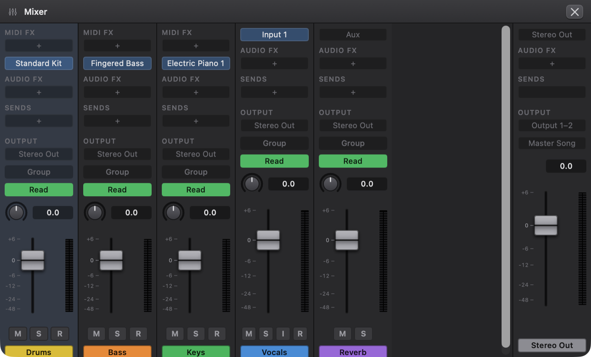
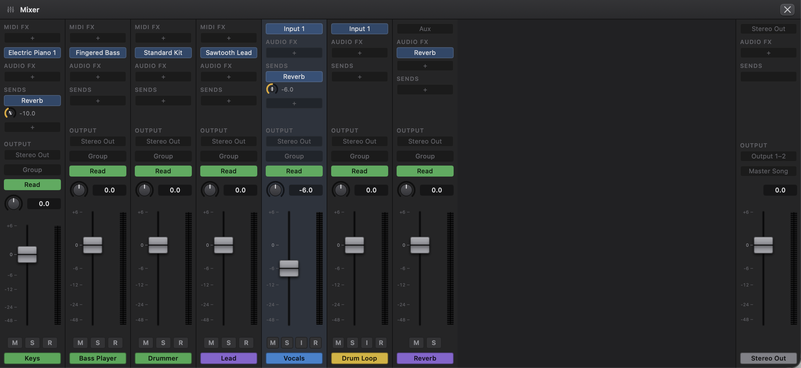
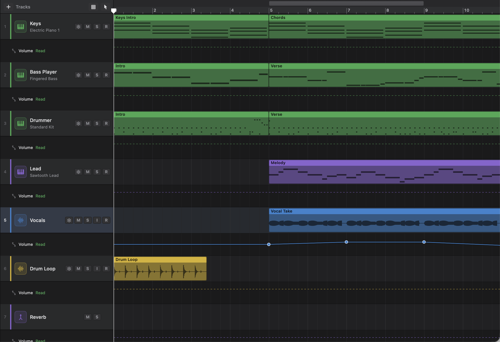

# 7. Mixing and Automation

Mixing is where your tracks become one song: you balance their levels, place them left and right, add effects, and send them to shared reverbs and buses. This chapter walks through the Mixer and its channel strips, plug-ins, sends and outputs, mixer groups, freezing tracks to save processing power, and automation, which lets any of those settings change as the song plays.

## The Mixer and the Inspector

Every track in your song has a **channel strip**: a column of controls that decides how that track sounds in the mix. Think of it as one channel on a mixing desk. Sound enters at the top (from a recording, an instrument or other tracks), passes down through effects, and comes out of the fader at the bottom.

You can see channel strips in two places:

- **The Mixer** shows a strip for every track side by side, with **Stereo Out** (the final mix) on the right. Use it when you're balancing the whole song.
- **The Inspector** shows the selected track's strip next to Stereo Out. Use it when you're working on one track and don't want to leave the Tracks area.

### Opening the Mixer

1. Press **X**, click **Mixer** in the control bar, or choose **View › Show Mixer**.
2. The Mixer opens in the bottom half of the window. If there are more strips than fit, scroll sideways; if a strip has many plug-ins and sends, the Mixer scrolls up and down too.
3. To close it, press **X** again, choose **View › Hide Mixer**, or click the **×** (**Close Mixer**) at the right of its title bar.

To show the Inspector instead, press **I**, click **Inspector** in the control bar, or choose **View › Show Inspector**.

Click anywhere on a strip's background to select that track. As on the track headers, **Shift-click** another strip to select every track in between, and **⌘-click** to add or remove one track at a time. The selected tracks' strips are tinted.

### A tour of the channel strip

From top to bottom, a channel strip has these parts. Not every track has all of them.

| Part | What it does |
|---|---|
| **MIDI FX** slots | Software instrument tracks only. Effects that change the notes before the instrument plays them, such as the Arpeggiator. See [Chapter 8](08-instruments-effects-midi-fx.md). |
| Input or instrument slot | On an audio track, the input you record from (for example **Input 1**, or **Input 1–2** for stereo). On a software instrument track, the instrument (or **No Instrument**). On an aux track it just says **Aux**. |
| **Audio FX** slots | Insert effects, which process the track's sound in order from top to bottom. Up to eight. |
| **Sends** | Copies of the track's sound sent to aux tracks, each with its own level knob. |
| **Output** | Where the track's sound goes: **Stereo Out**, or an aux track. |
| **Group** | Which mixer group the track belongs to, if any. |
| Automation mode | **Off**, **Read**, **Touch** or **Latch** (coloured grey, green, yellow and purple). See [Automation](#automation). |
| Pan knob and level readout | Where the track sits from left to right, and the fader's level in decibels. |
| Fader and meter | The track's volume, and how loud it is right now. |
| **M**, **S**, **I**, **R** | Mute, Solo, Input Monitoring and Record Enable. Only audio tracks have **I**; aux tracks have no **R**. |
| Name | The track's name on its colour. |

An empty slot shows **+**. Click it to add something there.

### Stereo Out

**Stereo Out** is the strip at the far right of the Mixer (and of the Inspector). Everything you hear passes through it on the way to your speakers. It has **Audio FX** slots, a fader and a meter, and its output is labelled **Output 1–2**. Its send slots are empty placeholders that keep the faders lined up. Under its output is **Master Song**, which opens Mastering (see below).

**Plug-ins on Stereo Out** process the whole mix, after every track and aux and before the Stereo Out fader. This is the place for mastering. The easiest way is **Mastering**: click **Master Song** at the bottom of the Stereo Out strip, and Ongaku's Mastering plug-in is put on Stereo Out and opened. It listens to your song and sets up the EQ, compression and loudness for it (see [Mastering](08-instruments-effects-midi-fx.md#mastering) in Chapter 8). If you'd rather build your own chain, use a gentle EQ, a bus compressor and, last of all, the **Maximizer** (its **Loud Master** preset is made for this). You add, open, bypass, reorder and remove them exactly as on a track (see [Plug-ins on a channel strip](#plug-ins-on-a-channel-strip)), with the same **Add Insert** menu and up to eight slots.

Things to know about Stereo Out's plug-ins:

- They're included when you bounce ([Chapter 9](09-library-bounce-files-settings.md)), and their delay is compensated like any other plug-in's.
- They aren't part of any track's freeze file. Freezing a track renders that track only, so Stereo Out's plug-ins keep running.
- Their settings can't be automated: there's no automation lane for Stereo Out.
- The metronome click doesn't pass through them, or through the Stereo Out fader, so a limiter on the mix won't squash the click.

### Fader, pan, mute and solo

- **Fader:** drag the cap up or down. 0 dB is the track at its natural level; the fader goes up to +6 dB, and all the way down is silence (shown as **-∞**). The marks beside it show +6, 0, −6, −12, −24 and −48 dB. Option-click the fader to put it back to 0 dB (its tooltip reminds you).
- **Pan:** drag the small knob up or down. The readout shows **C** at the centre and **L 64** to **R 64** at the extremes. Double-click or Option-click it to centre it again.

Every knob and fader on a strip resets with Option-click, and each reset is one undo step.
- **Meter:** the stereo meter beside the fader shows the level after the fader, from −60 to +6 dB. It's green, turns yellow above −12 dB and red above 0 dB. Red means the track is very hot; pull the fader down.
- **M** (Mute) silences the track. **S** (Solo) plays only soloed tracks. **R** arms the track for recording (see [Chapter 3](03-recording-and-takes.md)).
- **I** (Input Monitoring, audio tracks only) lets you hear the track's input live through this strip: its plug-ins, fader, pan and sends. It lights orange while it's on. Use headphones, or the speakers can feed back into the microphone. See [Chapter 3](03-recording-and-takes.md#hearing-yourself-input-monitoring).

Every change you make on a strip is an ordinary edit: **Edit › Undo** (⌘Z) takes it back.

> Tip: If a fader keeps jumping back while the song plays, the track has volume automation in **Read** mode. The automation is in charge. Change the mode to **Off**, or edit the automation instead (see [Automation](#automation)).

## Plug-ins on a channel strip

A **plug-in** is a piece of software that processes sound. An **insert** is a plug-in placed directly in a track's signal path, in one of its **Audio FX** slots. The whole sound passes through it, top slot first, so order matters: an EQ before a compressor sounds different from a compressor before an EQ.

### Adding an insert

1. On the track's strip (or the Stereo Out strip), click the **+** slot under **Audio FX**.
2. The **Add Insert** menu opens with three groups:
   - **Ongaku**: Ongaku Studio's own effects, in submenus by kind: **EQ**, **Dynamics**, **Reverb & Delay**, **Distortion**, **Imaging** and **Vocal**. These are described in [Chapter 8](08-instruments-effects-midi-fx.md).
   - **Apple (built into macOS)**: Apple's own Audio Unit effects that come with your Mac. Each is listed with Apple's name for the Audio Unit underneath, so you can tell them from Ongaku's:

     | Menu item | Apple's Audio Unit |
     |---|---|
     | **Channel EQ** | Apple AUNBandEQ |
     | **Compressor** | Apple AUDynamicsProcessor |
     | **Multiband Compressor** | Apple AUMultibandCompressor |
     | **Limiter** | Apple AUPeakLimiter |
     | **Reverb** | Apple AUReverb2 |
     | **Delay** | Apple AUDelay |
     | **Distortion** | Apple AUDistortion |
     | **High Pass Filter** | Apple AUHipass |
     | **Low Pass Filter** | Apple AULowpass |

   - **Audio Units**: other Audio Unit effects installed on your Mac, listed as "Maker: Name". If you have none, it says **No Audio Unit effects are installed**.
3. Choose an effect. It appears in the slot, and a new **+** slot appears below it until all eight slots are used.

Note that **Channel EQ**, **Compressor**, **Reverb** and **Delay** appear under both **Ongaku** and **Apple (built into macOS)**. They're different plug-ins: the Ongaku versions have the visual editors described in Chapter 8.

### Opening a plug-in window

Click the insert's slot. The plug-in's own window opens, titled with the track and plug-in name (for example "Vocals — Compressor"). This works on Stereo Out's slots too.

If the window is already open, this brings it to the front. If the plug-in is still loading you'll see a message saying so; try again in a moment. The slot's menu (see below) also has **Show Plug-in Window…**.

For an instrument plug-in, click the instrument slot (or the instrument name on the track header) and choose **Show Instrument Window…** at the top of the menu.

> Important: A plug-in's settings are stored in your song when you close its window (and whenever you save). Closing the window is one undoable step, called **Plug-in Settings**. Changes inside the window have their own undo in Ongaku's plug-ins (see [Chapter 8](08-instruments-effects-midi-fx.md)).

### Bypassing, reordering and removing inserts

Click and **hold** an insert's slot, or **Control-click** (right-click) it, for its menu:

- **Bypass**: switches the plug-in off without removing it, so you can hear the track without it. A bypassed slot is dimmed. Choose **Bypass** again to switch it back on.
- **Move Up** / **Move Down**: changes the order of the inserts.
- **Remove**: takes the plug-in off the strip and closes its window. Any automation of that plug-in's settings goes with it (undo brings both back).

### Instruments and MIDI FX

On a software instrument track, the slot under **MIDI FX** shows the instrument. Click it to choose a different one (the same menu as on the track header). MIDI FX slots are above it, because MIDI effects change the notes before the instrument plays them. Like insert slots, a MIDI FX slot opens its effect when you click it, and shows its menu when you hold or Control-click it. Both are covered in [Chapter 8](08-instruments-effects-midi-fx.md).

## Sends, auxes and buses

### What sends and auxes are

Suppose you want the vocals, the guitar and the snare to share one reverb, so they sound as if they're in the same room. You could put a reverb insert on each track, but that's three reverbs to set up and three times the processing. Instead:

- An **aux track** is a track with no recordings of its own. Its sound comes from other tracks. You put the reverb on the aux.
- A **send** is a knob on each track that sends a copy of that track's sound to the aux. Turn the knob up for more reverb on that track.

The original sound still goes through the track's fader as usual, so you hear the dry track plus the shared reverb. That's why the Ongaku Reverb and Delay say to set their **Mix** to 100 % when they're on an aux: the aux should be all effect.

### Adding a send

1. On the track's strip, click the **+** slot under **Sends**.
2. Choose an aux from the list, or choose **New Aux** to make a new aux track and send to it in one step.
3. The send appears, named after the aux, with a level knob underneath. New sends start at −6 dB.

You can also make an aux with **Track › New Aux Track**.

### Setting a send

- **Level:** drag the send's knob up or down. The number beside it shows the level in dB. The knob turns like the fader: most of its travel is the useful range around 0 dB, it goes up to +6 dB, and all the way down is off (**-∞**). Double-click or Option-click the knob to put it back to −6 dB, where new sends start.
- **Automating it:** the knob follows the send's automation as the song plays, and in **Touch** or **Latch** mode, turning it during playback records send automation, just as the fader does (see [Recording automation by moving the fader](#recording-automation-by-moving-the-fader)).
- **Pre-Fader:** click the send's name and choose **Pre-Fader**. A pre-fader send is taken before the track's fader and mute, so it stays at the same level when you move the fader. Its slot then reads "(pre)" after the name. Use this for things like a headphone mix; for reverbs and delays you usually want the normal (post-fader) send, so the effect follows the fader.
- **Remove Send:** click the send's name and choose **Remove Send**.

A send whose aux has been deleted is labelled **Missing**.

### Track outputs and buses

The **Output** slot decides where the track's fader sends its sound. Normally that's **Stereo Out**. Click it to choose an aux instead. Sending several tracks' outputs to one aux makes a **bus** (sometimes called a submix): for example, route all your drum tracks to an aux called "Drums" so one fader controls the whole kit, and one compressor on the aux squeezes them together.

1. Make an aux (**Track › New Aux Track**) and rename it if you like.
2. On each track you want on the bus, click **Output** and choose the aux.
3. The Output slot shows the aux's name and is highlighted, so you can tell at a glance that the track isn't going straight to Stereo Out.

Tracks inside a summing stack output to their stack automatically; hovering over their Output slot says "This subtrack plays through its summing stack". Summing stacks are covered in [Chapter 2](02-arranging-and-editing.md).

> Note: Ongaku Studio won't let you make a loop, where a track ends up feeding itself. Auxes that would cause a loop simply aren't offered in the send and output menus, and a track can't both send to and output to the same aux.

## Mixer groups

A **mixer group** ties several tracks together so that moving one moves them all. It's handy for a set of backing vocals or a multi-miked drum kit: move one fader and the whole group goes up or down by the same amount, keeping their balance.

### Making a group

1. Select the tracks you want to group: click the first track header (or channel strip in the Mixer), then Shift-click or Command-click the others.
2. On one of their channel strips, click the **Group** slot (just below **Output**).
3. Choose **New Group with Selected Tracks**. The tracks join the lowest free group number, and the slot shows the group's name, **Group 1** to begin with (or 2, 3 and so on, up to 32).

To add one more track to an existing group, click its **Group** slot and choose the group from the list (shown as its number and name, for example "1: Group 1"). Choose **No Group** to take it out.

### Naming a group

To give a group a name you'll recognise, such as "Backing Vocals":

1. Click the **Group** slot of any member.
2. Choose **Rename Group *n*…**.
3. Type the name and click **Rename**.

Every member's Group slot then shows the new name. Renaming can be undone with ⌘Z.

### What a group links

Click the **Group** slot of any member to see the group's settings, under **Group N Settings**:

| Setting | Default | What it does |
|---|---|---|
| **On** | On | Switch the group off to adjust one member on its own, then on again. |
| **Volume** | On | Moving one member's fader moves the others by the same number of dB. |
| **Pan** | Off | Moving one member's pan moves the others by the same amount. |
| **Mute** | On | Muting one mutes them all. |
| **Solo** | On | Soloing one solos them all. |

**Rename Group N…** is described above. **Delete Group N** removes the group (the tracks stay, just ungrouped). When the group is on, its slot has an accent-coloured outline.

## Plug-in delay compensation

Some plug-ins need a moment to think. A look-ahead limiter such as the **Maximizer** listens slightly ahead so it can catch peaks before they happen, and the **Convolution Reverb** works in blocks. Both hand their sound back a little late. If nothing were done about it, a track with one of these on it would play slightly behind the others, and drums would flam against each other.

Ongaku Studio fixes this automatically. It knows how late each plug-in is, and delays every other path through the mixer by just enough that everything arrives at Stereo Out (and at each aux) together. This is called **plug-in delay compensation**. There's nothing to switch on.

What it means for you:

- **The mix stays in time**, however many plug-ins you use, and bounces line up the same way.
- **Recording is lined up too.** What you record is placed where you played it against what you heard.
- **Adding or removing a delaying plug-in during playback restarts playback** from where you are, so everything lines up again. That brief restart is expected.
- **Playing live through a delaying plug-in feels slightly late**, because the whole mix is delayed to match it. If you're recording and it bothers you, bypass the Maximizer or Convolution Reverb until you've finished recording.

## Freezing tracks

A big software instrument with several plug-ins can use a lot of your Mac's processing power. **Freezing** a track renders it to an audio file in the background; from then on, the track plays that file instead of running its instrument and plug-ins. The track sounds the same, but costs almost nothing to play. When you want to change it again, you unfreeze it.

Audio and software instrument tracks can be frozen. Aux tracks and summing stacks can't, and a track with no regions has nothing to freeze.

### Choosing what freezing includes

Before freezing, choose a **Freeze Mode** in the Inspector (press **I**; the row is just under the track's name), or right-click the **Freeze** button (the snowflake) on the track header and choose from **Freeze Mode** there:

| Freeze Mode | What's rendered | What you can still change while frozen |
|---|---|---|
| **Pre Fader** (the default) | The instrument (or audio regions) **and** the inserts | Fader, pan, sends, output, mute, solo and automation |
| **Source Only** | Only the instrument (or audio regions) | All of the above, and the inserts, which keep running |

Pre Fader saves the most processing. Source Only is useful when the instrument is the heavy part but you're still tweaking the effects.

### Freezing and unfreezing

1. Click the **Freeze** button (the snowflake) on the track header. Or Control-click the header and choose **Freeze Track**, or select several tracks and choose **Track › Freeze Tracks**.
2. While it renders, the button shows a progress circle. Click it again (or choose **Stop Freezing**) to cancel.
3. When it's done, the snowflake lights up blue and the track's lane gets an icy tint.

If the track has flexed audio regions that are still being processed ([Chapter 6](06-flex-and-smart-tempo.md#how-flexing-works)), the freeze waits for them first, so the frozen file includes every flex edit.

To unfreeze, click the lit snowflake, choose **Unfreeze Track** from the header's menu, or choose **Track › Unfreeze Tracks** (this menu item says Unfreeze when every selected track is frozen). Unfreezing is instant: the track goes back to playing live, with all its settings as they were.

### What you can't do while a track is frozen

A frozen track's file was made from its regions and plug-ins, so Ongaku Studio stops you changing those until you unfreeze:

- You can't edit, move or add regions on it, or move other regions onto it.
- You can't change its instrument, MIDI FX, or input, record-enable it, or monitor its input (the **R** and **I** buttons are disabled).
- In **Pre Fader** mode you can't add, remove, open or reorder its inserts.
- You can't change its Freeze Mode.

If you try, you'll see a message such as "“Synth” is frozen. Unfreeze it to change its regions or plug-ins." If you edit the track while it's still rendering, the freeze is abandoned and you're asked to freeze it again.

> Tip: Freeze files are saved inside your song, so a frozen song opens frozen. They can always be made again, so unfreezing and re-freezing is safe.

## Automation

### What automation is

**Automation** is a recording of a control moving over time. Instead of setting a track's volume once, you draw a line that fades it up for the chorus and down for the outro, and the fader follows that line every time the song plays. You can automate a track's **volume**, **pan**, each **send level**, and the settings of its **insert plug-ins**.

Each track shows one automation line at a time, in its own **automation strip** directly below the track's lane in the Tracks area. The line is made of **points**; between two points the value moves in a straight line. Before the first point the value is the first point's, and after the last point it stays at the last point's.

### Showing automation

Press **A**, click **Automation** in the control bar, or choose **View › Show Automation**. Every track gets an automation strip just below its lane, showing its automation line. To the left of each strip, under the track header, is the strip's own header with two small menus: the parameter being shown (for example **Volume**) and the automation mode.

The regions stay where they were, above the strips, and you can go on selecting, moving and editing them while automation is showing. Press **A** again to hide the strips.

### Choosing what to automate

Click the parameter menu in the automation strip's header (it starts as **Volume**). It lists:

- **Volume** and **Pan**.
- Each send, as "Send to *aux name*".
- Each insert, as a submenu of that plug-in's settings (for example **Compressor › Threshold**). A plug-in with nothing to automate says **No automatable parameters**.

Parameters that already have automation are marked with a dot (•). Choosing one shows its line in the strip. Until you add points, the strip shows the current setting as a dashed line.

### Drawing and editing points

- **Add a point:** click in the track's automation strip. The point goes where you click: across is the time, up and down is the value.
- **Move a point:** drag it. While you drag, its value is shown above it (for example "−6.0 dB" or "L 40"). Plug-in settings show in their own units, such as "1.50 kHz", "+3.0 dB", "120 ms" or a choice's name like "Saw", while the plug-in is loaded; otherwise they show as a percentage of their range, such as "75%".
- **Delete a point:** double-click it.
- **Delete the whole line:** open the parameter menu and choose **Delete *Volume* Automation** (named after the parameter shown).

Volume and send lanes use the same scale as the fader, so the curve looks like the fader moving. Pan runs from left at the bottom to right at the top. Plug-in settings run from the bottom of each setting's range to the top.

Every point you add, move or delete can be undone with ⌘Z.

Points snap across to the same grid as regions, set with the **Snap** button above the track headers ([Chapter 2](02-arranging-and-editing.md#snapping-to-the-grid)). Their value (up and down) isn't snapped.

> Tip: To place a point between grid lines, hold **⌃** (Control) while you drag it. Press Control after you've started dragging, since a Control-click is a right-click. Or set **Snap** to **Off**.

### Automation modes

The mode decides what a track does with its automation. Set it from the mode menu in the automation strip's header (shown while automation is visible) or from the coloured slot on the channel strip, just above the pan knob.

| Mode | Colour | What happens |
|---|---|---|
| **Off** | Grey | Automation is ignored. Controls stay where you set them. The line is drawn grey. |
| **Read** | Green | Controls follow the automation as the song plays. This is the usual mode. |
| **Touch** | Yellow | Like Read, but while the song plays, moving the fader, pan knob or a send knob records over the automation. When you let go, the control goes back to following the existing line. |
| **Latch** | Purple | Like Touch, but when you let go, the control stays where you left it and that value keeps being written until you stop playback. |

New tracks start in **Read** mode. You can change that in **Settings › Automation** (see below).

### Recording automation by moving the fader

Drawing points is precise, but sometimes it's easier to ride the fader by hand while you listen:

1. Set the track's mode to **Touch** or **Latch**.
2. Start playback.
3. Move the track's fader, pan knob or a send knob in the Mixer or Inspector. Your moves are recorded as you make them.
4. Let go. In **Touch**, the control returns to the existing line straight away. In **Latch**, it holds its last value until you stop.
5. Stop playback. What you recorded becomes one undoable step, named for example **Write Volume Automation**.

In cycle mode, when the playhead jumps back to the start of the cycle, what you've written so far is kept and the next pass records over it from there.

When you've finished, switch the track back to **Read** so you don't record over it by accident.

The **fader**, the **pan** knob and the **send** knobs record automation this way. Plug-in settings are automated by drawing points.

**Grouped tracks.** If the track is in a mixer group that links volume (or pan), moving its fader moves the other members too. Members that are also in **Touch** or **Latch** record their own automation of the move, all in the same undo step. Members in **Read** or **Off** move along while you hold the control, but nothing is written on them.

### Automation settings

Choose **Ongaku Studio › Settings…** (⌘,) and click **Automation**:

- **Mode for new tracks**: the automation mode new tracks start in (**Read** unless you change it).
- **Thin recorded automation**: moving a fader records a great many points. Thinning keeps only the ones that change the curve's shape, so the line is easy to edit afterwards. Choose **Off (keep every point)**, **Light**, **Normal** (the default) or **Heavy**.

See [Chapter 9](09-library-bounce-files-settings.md) for the other settings.

## Limitations

- **Stereo Out can't be automated.** Its fader and its plug-ins' settings stay where you set them.
- **Stereo Out's plug-ins aren't in freeze files**, and the metronome doesn't pass through them.
- **Only volume, pan and send levels can be recorded by moving controls.** Plug-in settings are automated by drawing points, and instrument plug-in settings can't be automated at all (only inserts appear in the parameter menu).
- **Plug-in values show in their own units only while the plug-in is loaded.** Otherwise the automation strip shows them as a percentage of their range.
- **Each track shows one automation line at a time.** Switch between parameters with the parameter menu.
- **Inserts are reordered with Move Up and Move Down**; you can't drag them between slots.
- **Grouped tracks only record automation if they're in Touch or Latch themselves.** Groups link volume and pan; send knobs aren't linked.

## Quick reference

| Action | How |
|---|---|
| Show or hide the Mixer | **X**, **Mixer** button, or **View › Show Mixer** |
| Show or hide the Inspector | **I**, or **View › Show Inspector** |
| Select several strips | Shift-click or ⌘-click them |
| Reset a fader to 0 dB | Option-click the fader |
| Centre the pan | Double-click or Option-click the pan knob |
| Reset a send to −6 dB | Double-click or Option-click its knob |
| Add an insert | Click **+** under **Audio FX** |
| Add a mastering effect to the whole mix | Click **+** under **Audio FX** on the Stereo Out strip |
| Master the song | Click **Master Song** on the Stereo Out strip, then **Listen** (or **Analyze Whole Song**) |
| Hear an audio track's input live | **I** button on the strip or track header |
| Open a plug-in's window | Click the insert slot |
| Bypass, reorder or remove an insert | Hold or Control-click the insert slot › **Bypass**, **Move Up**, **Move Down**, **Remove** |
| Add a send | Click **+** under **Sends**, choose an aux or **New Aux** |
| Make a send pre-fader | Click the send's name › **Pre-Fader** |
| Route a track to a bus | Click **Output**, choose an aux |
| Group tracks | Select tracks › **Group** slot › **New Group with Selected Tracks** |
| Name a group | **Group** slot › **Rename Group *n*…** |
| Freeze or unfreeze a track | Snowflake button on the track header, or **Track › Freeze Tracks** |
| Choose what freezing renders | Inspector › **Freeze Mode**, or right-click the snowflake |
| Show or hide automation | **A**, **Automation** button, or **View › Show Automation** |
| Add, move or delete a point | Click the automation strip, drag a point, double-click a point |
| Move a point off the grid | Hold ⌃ after you start dragging |
| Choose what to automate | The automation strip header's parameter menu |
| Set the automation mode | The automation strip header's mode menu, or the channel strip's mode slot |
| Record automation by hand | **Touch** or **Latch**, play, and move the fader, pan or a send knob |
| Undo a mixer or automation change | ⌘Z |
