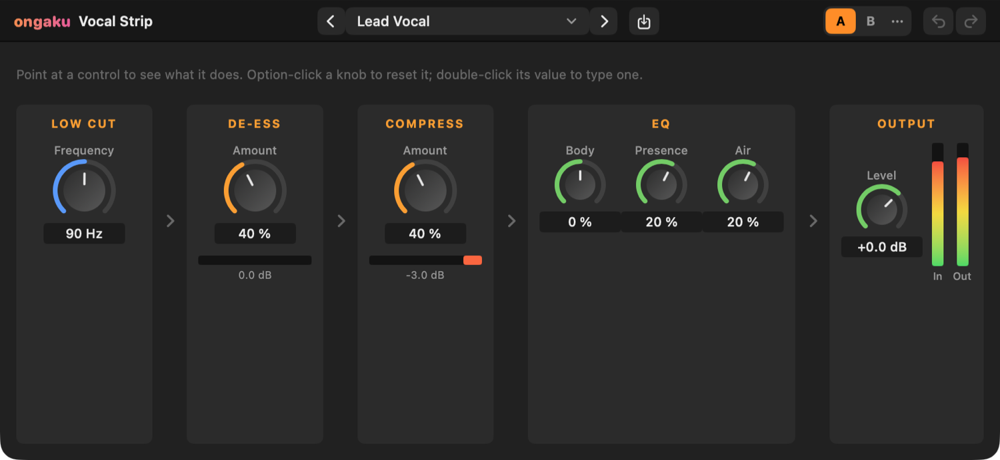
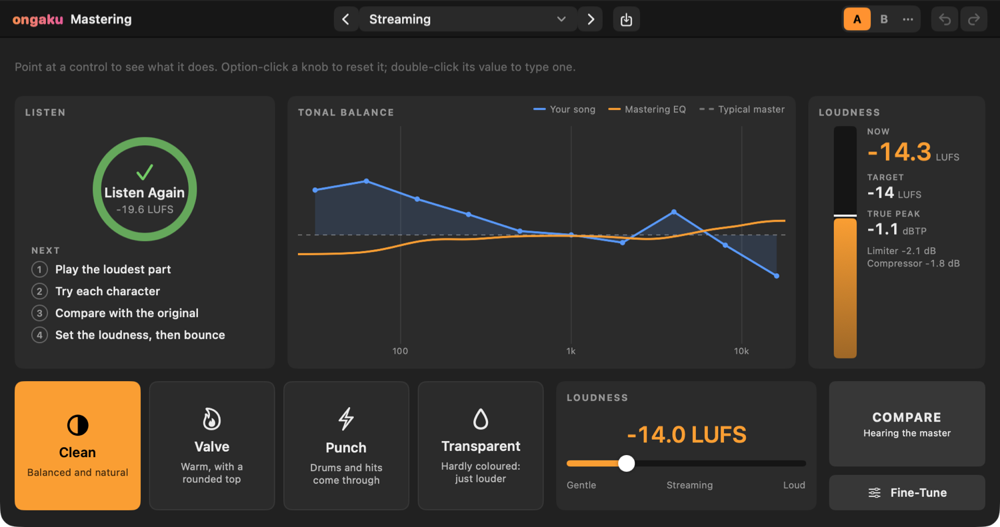
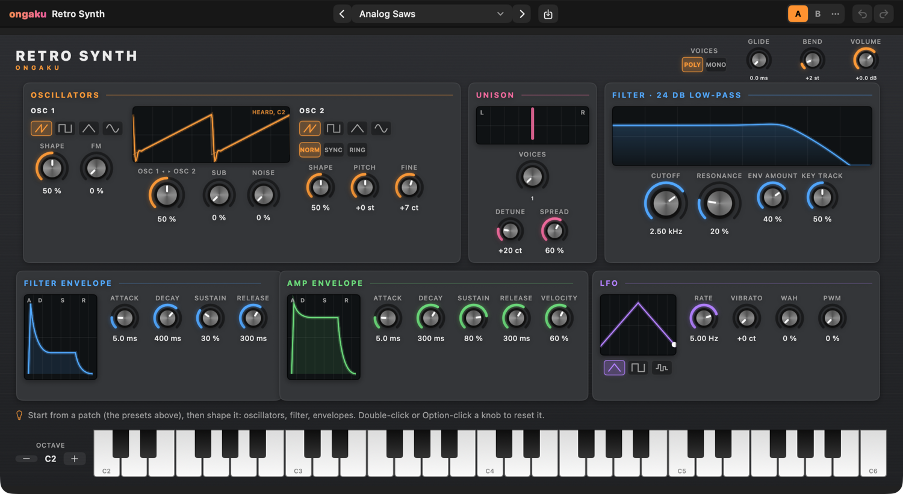
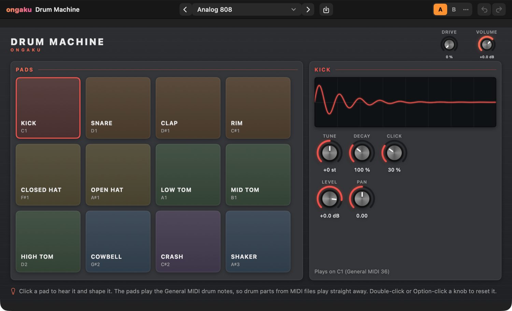
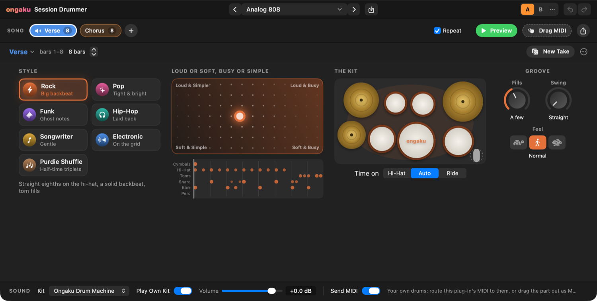
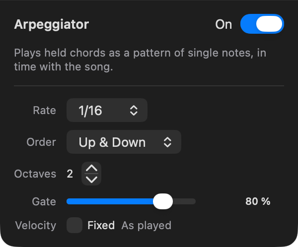

# 8. Ongaku Instruments, Effects and MIDI FX

Ongaku Studio comes with its own set of effects, instruments and MIDI effects. The effects and instruments are full plug-ins with visual editors that show what they're doing to your sound; the MIDI effects reshape the notes you play before they reach an instrument. This chapter explains how the plug-in windows work, then goes through every effect, instrument and MIDI effect with its settings.

## About the Ongaku plug-ins

Ongaku's effects and instruments are **Audio Units**, the standard plug-in format on the Mac. They live inside the Ongaku Studio app, and macOS makes them available to every app on your Mac once Ongaku Studio has been opened at least once. So you can also use them in Logic Pro, GarageBand and other Mac apps that host Audio Units. There they're listed under the maker **Ongaku**, with names such as **Ongaku: Compressor** and **Ongaku: Retro Synth**.

In Ongaku Studio you'll find them here:

- **Effects:** on a channel strip, click **+** under **Audio FX** and look in the **Ongaku** section of the menu. They're grouped as **EQ**, **Dynamics**, **Reverb & Delay**, **Distortion**, **Imaging**, **Vocal** and **Mastering**. See [Chapter 7](07-mixing-and-automation.md) for inserts in general.
- **Instruments:** click a software instrument track's instrument name (on the track header or the channel strip) and look in the **Ongaku** section: **Retro Synth**, **Drum Machine**, **Sampler** and **Session Drummer**. They're also in the Library (see [Chapter 9](09-library-bounce-files-settings.md)).
- **MIDI FX:** click **+** under **MIDI FX** on a software instrument track's channel strip. MIDI FX are part of Ongaku Studio itself rather than plug-ins, so they only work inside Ongaku Studio.

To open a plug-in's window, click its insert slot, or for an instrument click the instrument name and choose **Show Instrument Window…**.

The Ongaku effects aren't the same as Apple's effects of the same name in the **Apple (built into macOS)** section of the **Add Insert** menu (for example Apple's **Compressor**, listed with "Apple AUDynamicsProcessor" under it). See [Chapter 7](07-mixing-and-automation.md#adding-an-insert).

| Effect | Menu group | Factory presets |
|---|---|---|
| Channel EQ | EQ | none |
| Compressor | Dynamics | none |
| Noise Gate | Dynamics | 5 |
| Transient Shaper | Dynamics | 5 |
| Maximizer | Dynamics | 5 |
| De-Esser | Dynamics | 5 |
| Reverb | Reverb & Delay | 5 rooms |
| Delay | Reverb & Delay | none |
| Convolution Reverb | Reverb & Delay | 7 |
| Saturation | Distortion | 5 |
| Doubler | Imaging | 5 |
| Vocal Strip | Vocal | 5 |
| Mastering | Mastering | 4 destinations |

## Working in a plug-in window

Every Ongaku plug-in window has the same header across the top, then the plug-in's own panel. Most panels also have a **hint line**: point at any control and a sentence appears explaining what it does. It's worth leaving your mouse over a knob you don't understand.

### Turning knobs and typing values

- **Drag up or down** on a knob (or its value) to turn it. A full sweep is about 200 points of mouse travel. Frequency and time knobs move evenly by ratio, so a frequency knob sweeps by octaves.
- **Option-click** any knob or value, in any Ongaku plug-in, to reset it to its default. The reset is one step in the window's undo (see below).
- **In the effects**, double-click a knob's value to type a number, then press Return (Escape cancels). You can type units: "2k" or "2 kHz" for 2,000 Hz, "250 ms", "-6 dB".
- **In the instruments** (Retro Synth, Drum Machine, Sampler), double-click a knob to reset it to its default, as Option-click does.

### The plug-in header

From left to right, the header has the plug-in's name, the preset controls, the save button, the A/B switch and undo and redo.

**Presets.** The wide menu in the middle shows the current preset, or **No Preset**. Click it to choose one. This is the only preset menu in the window: the Reverb's rooms, the Retro Synth's patches, the Drum Machine's kits and the Sampler's presets are all chosen here. **Factory** presets come with the plug-in; **My Presets** are the ones you've saved. The **<** and **>** arrows either side step through all of them in turn. An orange dot after the name means you've changed the settings since choosing that preset.

**Saving your own preset:**

1. Set the plug-in up the way you like.
2. Click the save button (the arrow pointing into a tray) next to the preset menu.
3. Type a name and click **Save** (or press Return). Saving with the name of an existing preset of yours replaces it.

Your presets are kept by macOS for that plug-in, so they're also offered when you use the plug-in in other apps.

**Renaming and deleting:** open the preset menu and choose **Rename** or **Delete**, then the preset. These appear once you've saved at least one preset. Factory presets can't be renamed or deleted.

**A/B compare.** The **A** and **B** buttons hold two separate versions of the settings. You start in A. Click **B**, and B starts as a copy of A; change anything you like, then click **A** and **B** to switch back and forth and hear which is better. Changes in each are kept separately. The **⋯** menu beside them has **Copy A to B** (or **Copy B to A**) to make the other one match the one you're hearing.

**Undo and Redo.** The two arrows undo and redo changes made in this window (⌘Z and ⇧⌘Z work too while the window is in front). A whole knob turn counts as one step. Choosing a preset can be undone too. Changes made by automation aren't added to this history.

> Note: The window's undo history and A/B versions last while the window is open. When you close it, its settings are stored in your song as one step called **Plug-in Settings**, which **Edit › Undo** in the main window can take back.

## Effects

Each effect section gives what the effect does, when you'd reach for it, and a table of its settings. Ranges and defaults are exactly what the knobs offer. Names in the tables are the knob labels; they're also the names you'll see in the automation menu (see [Chapter 7](07-mixing-and-automation.md)).

### Channel EQ

**What it is.** An equalizer (EQ) turns particular frequency ranges up or down: more bass, less boxiness, more sparkle. The Channel EQ has eight bands, from a low cut on the left to a high cut on the right, shown as one curve over a live picture of your sound (the **Analyzer**).

**When to use it.** On almost any track: to remove rumble under vocals and guitars, to cut a muddy frequency, or to brighten something that sounds dull.

**How to use it.**

1. Play the track and watch the analyzer (the blue area) to see where its energy is.
2. Drag a band's coloured handle on the graph: left and right change its frequency, up and down change its gain. Dragging a band that's off turns it on.
3. Click a band's name button under the graph to switch it on or off. Bands that are off are dimmed.
4. Fine-tune each band's **Frequency**, **Gain** and **Q** with the values in its column.

**Q** is how wide a band is: low Q affects a broad range, high Q a narrow one. The **Low Cut** and **High Cut** bands have a **Slope** instead of a gain: how steeply they cut, from **6 dB/Oct** to **48 dB/Oct** (default **12 dB/Oct**). Click **Analyzer** to hide the spectrum.

| Band | On at first | Frequency | Q |
|---|---|---|---|
| **Low Cut** | No | 30 Hz | 0.71 |
| **Low Shelf** | Yes | 80 Hz | 0.71 |
| **Low Mid** | Yes | 200 Hz | 1.1 |
| **Mid** | Yes | 500 Hz | 1.1 |
| **High Mid** | Yes | 1.5 kHz | 1.1 |
| **Presence** | Yes | 4 kHz | 1.1 |
| **High Shelf** | Yes | 10 kHz | 0.71 |
| **High Cut** | No | 17 kHz | 0.71 |

| Setting | Range | Default |
|---|---|---|
| Band **Frequency** | 20 Hz – 20 kHz | see above |
| Band **Gain** (all but the cuts) | −24 to +24 dB | 0 dB |
| Band **Q** | 0.1 – 12 | see above |
| Cut **Slope** | 6, 12, 18, 24, 36 or 48 dB/Oct | 12 dB/Oct |
| **Gain** (output, left of the bands) | −24 to +24 dB | 0 dB |

The bands start at 0 dB, so a new Channel EQ changes nothing until you move something.

> Tip: A good first move on vocals, guitars and keys is to switch on **Low Cut** and raise its frequency until the sound starts to thin out, then back it off a little.

### Compressor

**What it is.** A compressor turns down the loud parts of a sound, so the difference between loud and quiet is smaller. The result sounds more even and more solid.

**When to use it.** On vocals that jump between whispers and shouts, on bass to keep every note the same weight, on drums for punch.

**How it works.** When the sound goes above the **Threshold**, it's turned down according to the **Ratio**: at 4 : 1, a sound 8 dB over the threshold comes out only 2 dB over. **Attack** is how quickly it reacts, **Release** how quickly it lets go. The panel shows the **Gain Reduction** meter across the top (how much it's turning down right now), the compressor's curve with a dot riding on it at the current level, and **In** and **Out** meters.

| Setting | Range | Default | What it does |
|---|---|---|---|
| **Threshold** | −60 to 0 dB | −20 dB | The level above which it starts turning down. Lower means more compression. |
| **Ratio** | 1 : 1 to 30 : 1 | 4 : 1 | How hard it turns down. 2 : 1 is gentle; 10 : 1 and above acts like a limiter. |
| **Knee** | 0 – 24 dB | 6 dB | How gradually it starts. A soft (higher) knee sounds smoother. |
| **Make Up** | −20 to +40 dB | 0 dB | Turns the result back up to make up for what was taken off. |
| **Attack** | 0.1 – 200 ms | 10 ms | How quickly it clamps down. Longer lets the start of each note through, for punch. |
| **Release** | 5 – 2,000 ms | 150 ms | How quickly it recovers. |
| **Mix** | 0 – 100 % | 100 % | Blends compressed and original sound ("parallel compression" when below 100 %). |
| **Auto Gain** | On / Off | Off | Adds make-up gain automatically, based on the threshold and ratio. |
| **Detection** | **Peak** / **RMS** | Peak | Peak reacts to every spike; RMS reacts to average loudness and sounds smoother. |

> Tip: Start from the defaults, play the track, and lower the **Threshold** until the Gain Reduction meter moves by a few dB on the loudest parts. Then raise **Make Up** until the track is as loud as it was with the Compressor bypassed.

### Noise Gate

**What it is.** The opposite of a compressor: it turns the sound down when it's *quiet*. Between notes it shuts out hum, hiss, headphone spill or the other drums bleeding into a mic. An **OPEN** / **CLOSED** light shows what it's doing, and a scrolling graph shows the level against the threshold (the dashed line).

**When to use it.** On noisy guitar amps, tom and kick mics, or to tidy breaths between vocal phrases.

| Setting | Range | Default | What it does |
|---|---|---|---|
| **Threshold** | −80 to 0 dB | −45 dB | The level the sound must reach to open the gate. Set it just above the noise between notes. |
| **Reduction** | −100 to 0 dB | −100 dB | How far it turns the sound down when closed. Less than all the way sounds more natural. |
| **Hysteresis** | 0 – 20 dB | 4 dB | How far below the threshold the level must fall before the gate closes, so it doesn't chatter. |
| **Attack** | 0.1 – 200 ms | 1 ms | How quickly it opens. |
| **Hold** | 0 – 500 ms | 40 ms | How long it stays open after the level drops. |
| **Release** | 1 – 2,000 ms | 120 ms | How long it takes to close. Longer lets notes ring out. |
| **Key Low Cut** | 20 Hz – 2 kHz | 20 Hz | Ignores lows when deciding whether to open, so rumble or kick spill doesn't open it. |

**Factory presets:** **Clean Gate** (the defaults), **Tight Drums**, **Vocal Breaths** (only turns breaths down by 15 dB), **Guitar Hum** (ignores lows below 150 Hz) and **Gated Snare** (the 1980s gated-reverb trick: a long hold and a very fast release).

### Transient Shaper

**What it is.** A **transient** is the very start of a sound: the crack of a snare, the pluck of a string. The Transient Shaper turns the start of each hit up or down, and separately the ring after it, without a threshold to set. The picture shows a drum hit before (dashed) and after your changes.

**When to use it.** To make drums punchier or softer, or to dry out (or bring out) the room sound in a drum recording.

| Setting | Range | Default | What it does |
|---|---|---|---|
| **Attack** | −100 to +100 % | 0 % | Turns the start of each hit up (punchier) or down (softer, further away). |
| **Sustain** | −100 to +100 % | 0 % | Turns the ring after each hit up (more room and body) or down (tighter, drier). |
| **Output** | −24 to +12 dB | 0 dB | The level out. |
| **Mix** | 0 – 100 % | 100 % | Blends the shaped sound with the original. |

**Factory presets:** **Neutral**, **Punchy Drums** (Attack +60 %, Sustain −15 %), **Tighten** (Sustain −60 %), **More Room** (Sustain +60 %) and **Soften Attack** (Attack −60 %).

### Maximizer

**What it is.** A limiter for making a finished mix louder. **Gain** pushes the level up while the **Ceiling** stops any peak going over a set level. It also measures **loudness** the way streaming services do, in **LUFS** (Loudness Units relative to Full Scale).

**When to use it.** As the very last effect on your mix, when you want it to be as loud as commercial releases without clipping. Put it in the last **Audio FX** slot on the **Stereo Out** strip, so it works on the whole mix (see [Chapter 7](07-mixing-and-automation.md#stereo-out)). The **Loud Master** preset is a good place to start there. For a master set up for the song, with EQ and compression too, use [Mastering](#mastering) instead.

The readouts show:

- **Momentary**: loudness over the last 0.4 s.
- **Short-Term**: loudness over the last 3 s.
- **Integrated** (the big orange number): loudness of everything since you last reset it. Streaming services aim for about −14 LUFS.
- **True Peak**: the highest peak since the reset, including peaks between samples, in dBTP.

Click **Reset Loudness** and then play the song from the top to measure the whole song. The graph shows gain reduction over the last few seconds.

| Setting | Range | Default | What it does |
|---|---|---|---|
| **Gain** | 0 – 24 dB | 0 dB | How hard the level is pushed into the limiter. |
| **Ceiling** | −6 to 0 dB | −1 dB | The highest the output can go. −1 dB leaves room for MP3 and AAC encoding. |
| **Release** | 1 – 1,000 ms | 60 ms | How quickly the gain comes back after a peak. Shorter is louder but can pump or distort. |
| **True Peak** | On / Off | On | Also catches peaks between samples, which can clip after conversion. |

**Factory presets:** **Safety Limiter** (the defaults: no extra gain, just a −1 dB ceiling), **Gentle Lift** (+3 dB), **Loud Master** (+8 dB), **Very Loud** (+12 dB) and **Broadcast Safe** (+4 dB, −2 dB ceiling).

> Tip: Start with **Gentle Lift**, reset the loudness, play the whole song, and read **Integrated**. Raise **Gain** a little at a time; when the gain reduction graph is moving constantly, you've gone far enough.

The Maximizer looks slightly ahead to catch peaks, which delays its sound a little. Ongaku Studio compensates automatically (see "Plug-in delay compensation" in [Chapter 7](07-mixing-and-automation.md)).

### De-Esser

**What it is.** A compressor that only listens to the hissy part of a voice: the "ss", "sh" and "t" sounds (called **sibilance**), which can sound harsh, especially after EQ and compression. It turns down everything above its **Frequency** when that part gets too loud. The picture shows the band it's turning down, dipping as it works.

**When to use it.** On vocals and spoken word, usually after the compressor.

| Setting | Range | Default | What it does |
|---|---|---|---|
| **Frequency** | 2 – 12 kHz | 6.5 kHz | Where the sibilance starts. |
| **Threshold** | −60 to 0 dB | −30 dB | How loud the sibilance must be before it's turned down. Lower catches more. |
| **Range** | 0 – 24 dB | 8 dB | The most it turns the sibilance down. |
| **Listen** | On / Off | Off | Plays only what's being taken out, to help you find the frequency. |

**Factory presets:** **Vocal** (the defaults), **Female Vocal** (7.5 kHz), **Male Vocal** (5.5 kHz), **Gentle** and **Strong**.

> Tip: Turn on **Listen** and sweep **Frequency** until you hear only the "ss" sounds, then turn **Listen** off and lower **Threshold** until they're tamed but the voice still sounds natural.

### Reverb

**What it is.** Reverb is the sound of a space: the echoes of a room, hall or plate blurring into a tail behind the sound. The Reverb's panel shows three pictures: the **Early echoes**, how the tail dies away (the **Decay** picture, with the highs dying sooner when **High Cut** is lower), and the **Tone** after the cuts.

**When to use it.** To put dry recordings and instruments in a believable space, or for a big, washy effect. It's usually best on an aux that several tracks send to (see [Chapter 7](07-mixing-and-automation.md)), with **Mix** at 100 %.

| Setting | Range | Default | What it does |
|---|---|---|---|
| **Predelay** | 0 – 250 ms | 25 ms | The gap before the reverb starts. Longer keeps vocals and drums clear of their reverb. |
| **Decay** | 0.2 – 20 s | 2.8 s | How long the reverb takes to die away (by 60 dB). |
| **Size** | 0 – 100 % | 75 % | How big the space is. Bigger spaces spread their early echoes further apart. |
| **Diffusion** | 0 – 100 % | 75 % | How quickly the echoes blur into a smooth wash. Low sounds like a bare room, high like a plate. |
| **High Cut** | 1 – 20 kHz | 7 kHz | Darkens the reverb, and makes its highs die away sooner. |
| **Low Cut** | 20 Hz – 1 kHz | 60 Hz | Thins the reverb so it doesn't muddy the bass. |
| **Modulation** | 0 – 100 % | 30 % | Gently wobbles the echoes, smoothing out metallic ringing. |
| **Width** | 0 – 100 % | 100 % | How wide the reverb spreads. 0 % is mono. |
| **Mix** | 0 – 100 % | 30 % | How much reverb against the dry sound. |

**Rooms.** The Reverb's factory presets are its rooms. Pick a space from the header's preset menu: **Room**, **Chamber**, **Hall** (what a new Reverb starts as), **Plate** and **Cathedral**. Choosing a room sets every knob except **Mix**, so your balance stays as it was.

### Delay

**What it is.** An echo effect: it repeats the sound after a set time. Each repeat comes back quieter, a little darker and a little thinner, like a tape echo. The picture shows each echo as a bar over the song's beats.

**When to use it.** For slap-back on vocals and guitars, rhythmic echoes on synths, or a sense of space that's clearer than reverb.

**Tempo sync.** With **Sync** on (the default), the delay time is a note value at the song's tempo, so the echoes stay in time if you change the tempo. The tempo it's following is shown at the top right (for example **120.0 BPM**). Turn **Sync** off to set the time in milliseconds instead. The **Note** knob then becomes **Time**. Note values with **T** are triplets; a dot means half as long again.

| Setting | Range | Default | What it does |
|---|---|---|---|
| **Sync** | On / Off | On | Times the echoes in notes at the song's tempo. |
| **Note** (Sync on) | 1/32, 1/16T, 1/16, 1/16., 1/8T, 1/8, 1/8., 1/4T, 1/4, 1/4., 1/2 | 1/8. | The time between echoes. |
| **Time** (Sync off) | 1 – 2,000 ms | 375 ms | The time between echoes. |
| **Feedback** | 0 – 100 % | 35 % | How much of each echo comes back as another. Higher repeats for longer. |
| **Ping-Pong** | On / Off | Off | Bounces the echoes from side to side. |
| **Low Cut** | 20 Hz – 2 kHz | 120 Hz | Thins the echoes, a little more with every repeat. |
| **High Cut** | 500 Hz – 20 kHz | 5 kHz | Darkens the echoes, a little more with every repeat. |
| **Wow & Flutter** | 0 – 100 % | 20 % | Wobbles the echoes' timing and pitch like a tape machine. |
| **Drive** | 0 – 100 % | 15 % | Saturates loud echoes softly, like tape pushed hard. |
| **Mix** | 0 – 100 % | 30 % | How much echo against the dry sound. Use 100 % on an aux send. |

The Delay has no factory presets; save your favourite settings as your own presets.

### Convolution Reverb

**What it is.** A reverb built from an **impulse response**: a recording of how a real space responds to a click. Convolution reverbs sound very natural. Ongaku's can make its own impulse response from **Decay**, **Size** and **Damping** (the panel says **Synthesized from Decay, Size and Damping**), or use a file you load.

**When to use it.** When you want a realistic room or hall, or the reverb of a specific real space you have an impulse response for.

**Loading an impulse response:**

1. Click **Load Impulse Response…** and choose an audio file (WAV or AIFF), or drag a file onto the picture.
2. The panel shows its name and length. The first 8 seconds of the file, and its first two channels, are used. If the file is longer or has more channels, an orange note under the picture says what was left out, for example "Only the first 8 s is used." or "Only the first two of its 6 channels are used."
3. **Decay**, **Size** and **Damping** are dimmed, since the file now decides the room's shape. The other knobs still work.
4. Click **Use Synthesized** to go back to the built-in response.

If a file can't be used, a message in orange says why.

| Setting | Range | Default | What it does |
|---|---|---|---|
| **Predelay** | 0 – 250 ms | 12 ms | The gap before the reverb starts. |
| **Decay** | 0.2 – 7 s | 2.2 s | How long the reverb takes to die away (synthesized responses only). |
| **Size** | 0 – 100 % | 55 % | How big the space is: how far apart its first reflections are (synthesized only). |
| **Damping** | 0 – 100 % | 40 % | How fast the highs die away: soft rooms are damped, stone ones aren't (synthesized only). |
| **Width** | 0 – 100 % | 100 % | How wide the reverb spreads. 0 % is mono. |
| **Low Cut** | 20 Hz – 1 kHz | 120 Hz | Thins the reverb. |
| **High Cut** | 1 – 20 kHz | 12 kHz | Darkens the reverb. |
| **Mix** | 0 – 100 % | 30 % | How much reverb against the dry sound. Use 100 % on an aux send. |

**Factory presets:** **Medium Hall** (the defaults), **Small Room**, **Studio Room**, **Concert Hall**, **Cathedral**, **Bright Plate** and **Dark Chamber**.

Like the Maximizer, the Convolution Reverb delays its sound slightly, and Ongaku Studio compensates for it automatically.

### Saturation

**What it is.** Gentle distortion that adds warmth and harmonics, like recording through tape, a valve (tube) amp or a transistor circuit pushed hard. The level stays about the same as you turn up **Drive**, so you hear the colour rather than just "louder". The picture shows the curve for the type and drive.

**When to use it.** To warm up a thin synth or DI bass, glue a drum bus together, or deliberately dirty something up.

| Setting | Range | Default | What it does |
|---|---|---|---|
| **Type** | **Tape**, **Tube**, **Transistor** | Tape | Tape is soft and warm, with a little low bump. Tube is rounder. Transistor is harder and grittier. |
| **Drive** | 0 – 36 dB | 6 dB | How hard the sound is pushed: warmer, then dirtier. |
| **Tone** | −100 to +100 % | 0 % | Darker to the left, brighter to the right. |
| **Output** | −24 to +12 dB | 0 dB | The level out. |
| **Mix** | 0 – 100 % | 100 % | Blends the saturated sound with the clean one. |

**Factory presets:** **Warm Tape** (the defaults), **Tube Glow**, **Subtle Glue** (3 dB of drive at 60 % mix, a good start on a bus), **Crunch** and **Lo-Fi Drive**.

### Doubler

**What it is.** Makes one performance sound like two or three: it adds two slightly late, slightly out-of-tune copies, one either side of the original, that drift like real second takes. The picture shows the original in the middle and the copies spread across the stereo field.

**When to use it.** To widen a lead vocal or a guitar part without recording it twice.

| Setting | Range | Default | What it does |
|---|---|---|---|
| **Delay** | 5 – 60 ms | 18 ms | How far behind the copies are. 10–30 ms sounds like a second take; less is tighter. |
| **Detune** | 0 – 50 cents | 9 cents | How out of tune the copies are (one sharp, one flat). A lot sounds like chorus. |
| **Drift** | 0 – 100 % | 40 % | How much the copies' timing and tuning wander. |
| **Width** | 0 – 100 % | 80 % | How far left and right the copies sit. |
| **Mix** | 0 – 100 % | 60 % | How loud the copies are against the original. |

**Factory presets:** **Natural Double** (the defaults), **Wide Guitars**, **Tight ADT**, **Chorused** and **Subtle**.

### Vocal Strip

**What it is.** A whole vocal chain in one plug-in, with one simple control per stage. From left to right: **Low Cut**, **De-Ess**, **Compress**, **EQ** and **Output**. The De-Ess and Compress stages each show how much they're turning the voice down right now.

**When to use it.** When you want a vocal (or podcast voice) to sound finished quickly, without setting up four separate plug-ins.

| Stage | Knob | Range | Default | What it does |
|---|---|---|---|---|
| **Low Cut** | **Frequency** | 20 – 400 Hz | 90 Hz | Cuts rumble, handling noise and pops below this. |
| **De-Ess** | **Amount** | 0 – 100 % | 40 % | Softens harsh "ss" and "t" sounds. |
| **Compress** | **Amount** | 0 – 100 % | 40 % | Evens out the level so quiet words are heard and loud ones don't jump out. |
| **EQ** | **Body** | −100 to +100 % | 0 % | Warmth and weight, around 220 Hz. |
| **EQ** | **Presence** | −100 to +100 % | +20 % | Clarity and forwardness, around 4.5 kHz. |
| **EQ** | **Air** | −100 to +100 % | +20 % | Breathiness and sparkle, above 12 kHz. |
| **Output** | **Level** | −24 to +12 dB | 0 dB | The level out. |

In the automation menu these appear as **Low Cut**, **De-Ess**, **Compress**, **Body**, **Presence**, **Air** and **Output**.

**Factory presets:** **Lead Vocal** (the defaults), **Natural**, **Backing Vocals**, **Podcast Voice** and **Rap Vocal**.

### Mastering

**What it is.** **Mastering** is the last step before a song is released: a gentle EQ to even out its balance, a little compression to hold it together, and a limiter to make it as loud as other records without clipping. Ongaku's **Mastering** plug-in does all of that in one window, and sets most of it up for you. It **listens** to your song, compares it with a typical finished master, and chooses the EQ, compression and stereo width the song needs. You then choose a **character** and a **loudness** by ear, and use **Compare** to check that the master really is better than the mix.

**When to use it.** Once your mix is finished, on **Stereo Out**, as the very last plug-in, so it works on the whole song. It isn't meant for single tracks.

#### Putting Mastering on Stereo Out

Click **Master Song** at the bottom of the Stereo Out strip in the Mixer or the Inspector (or choose **File › Mastering…**). If Stereo Out doesn't have Mastering yet, it's added after any plug-ins already there, and its window opens. If it has, the window opens.

You can also add it like any other effect: click **+** under **Audio FX** on Stereo Out and choose **Ongaku › Mastering › Mastering**.

#### Mastering a song, step by step

1. **Listen.** Click the big **Listen** ring, then play your song: all of it, or at least its loudest part. The ring fills as it listens (a full minute fills it) and shows how long it has heard. Click **Done**. Mastering works out the settings for the song, and they're one step in the window's undo. It needs at least 10 seconds of music that isn't silent; if it heard less, it says so and changes nothing. Instead of playing the song, you can click **Analyze Whole Song** in the window's title bar; see [Analyze Whole Song](#analyze-whole-song) below.
2. **Follow the Next list.** Once it has listened, the Listen card shows what's left to do, and ticks each step off as you do it:
   1. **Play the loudest part.** The **Loudness** meter on the right should settle near your target. It ticks once the master plays within 1.5 LU of it.
   2. **Try each character.** Click the four character cards while the song plays, and keep the one you like (see the table below). **Clean** is the neutral starting point.
   3. **Compare with the original.** Click **Compare** to hear the song as it came in, at the same loudness and timing, then click it again for the master. If the master doesn't sound better, try another character, or click **Fine-Tune** and turn **EQ Amount** or **Dynamics** down.
   4. **Set the loudness, then bounce.** Drag the **Loudness** slider (see below), then bounce the song (**File › Bounce…**). Mastering stays on Stereo Out, so what you bounce is the master.

The ticks are only a guide: they start again whenever you listen again, and aren't kept when you close the window.

> Note: Until Mastering has listened, it doesn't turn the song up at all: it doesn't yet know how loud the song is. The Loudness card says **Listen first** until then.

#### The window

- **Listen** (left): the Listen ring, the song's measured loudness once it has listened, and the **Next** list.
- **Tonal Balance** (middle): your song's balance from low to high (blue) against a typical finished master (the dashed flat line), and the EQ Mastering applies (orange). Where the blue line is above the dashed line, the song has more of those frequencies than most masters; the orange curve dips there to even it out. The orange curve follows the character, **EQ Amount** and the EQ knobs as you change them.
- **Loudness** (right): how loud the master is now (over the last 3 seconds, the orange bar and the big number), your target (the white line), the **True Peak** (red if it goes over the ceiling), and how much the limiter and compressor are turning the sound down.
- **Character** cards, the **Loudness** slider, **Compare** and **Fine-Tune** along the bottom.

| Character | What it sounds like |
|---|---|
| **Clean** | Balanced and natural: the EQ and compression as set for the song. |
| **Valve** | Warm, with a rounded top: a little tube warmth, and the Air and High bands 0.5 dB lower. |
| **Punch** | Drums and hits come through: a slower compressor attack, and 1 dB more low end. |
| **Transparent** | Hardly coloured, just louder: half the EQ and compression, and no widening. |

The **Loudness** slider runs from −16 to −8 LUFS (LUFS measures loudness the way streaming services do). Its words say where you are: **Gentle** below −14.5, **Streaming** around −14, **Loud** from about −12.5, and **Very loud** above −9.5. Streaming services play songs at about −14 LUFS and turn louder songs down, so going louder only helps if you want the song to match loud records outside streaming.

#### Fine-Tune

Click **Fine-Tune** to replace the graph and meter with every setting; click **Overview** to go back. The window remembers which you were looking at. The first row is the overall controls; the second is what Listen sets for the song (listening again replaces them).

| Setting | Range | Default | What it does |
|---|---|---|---|
| **Character** | Clean, Valve, Punch, Transparent | Clean | The flavour of the master (see above). |
| **Loudness** | −16 to −8 LUFS | −14 LUFS | How loud the master ends up. |
| **EQ Amount** | 0 – 100 % | 100 % | How much of the song's EQ is applied. |
| **Dynamics** | 0 – 100 % | 50 % | How firmly the compressor works: 50 % is as set for the song, less is gentler, more is firmer. |
| **Width** | 0 – 100 % | 0 % | Widens the stereo image above about 300 Hz. Listen sets 20 % or 40 % for a narrow mix, and none for a mix whose sides cancel in mono. |
| **Low-End Mono** | 50 – 200 Hz | 120 Hz | Makes the lows mono below this frequency, for a solid centre. At its lowest it's off. |
| **Ceiling** | −3 to 0 dBTP | −1 dBTP | The highest the output can go, between samples too. −1 dBTP leaves room for MP3 and AAC encoding. |
| **Low**, **Low-Mid**, **Presence**, **Air**, **High** | −6 to +6 dB | 0 dB | The EQ: a low shelf at 100 Hz, bells at 250 Hz, 3 kHz and 7 kHz, and a high shelf at 10 kHz. Listen corrects at most 3 dB in each. |
| **Threshold** | −40 to 0 dB | −18 dB | Where the compressor starts working. |
| **Ratio** | 1 : 1 to 4 : 1 | 1.5 : 1 | How firmly it works above the threshold (scaled by Dynamics). Listen chooses 1 : 1 to 2 : 1, more for a mix with big peaks. |
| **Attack** | 1 – 100 ms | 20 ms | How quickly the compressor acts. |
| **Release** | 20 – 1,000 ms | 200 ms | How quickly it lets go. |

**Factory presets** say where the song is going, and set only the **Loudness** and **Ceiling** (and turn Compare off). They leave the character and the settings Listen chose alone. **Streaming** (−14 LUFS, −1 dBTP; the defaults), **Gentle** (−16 LUFS), **Loud** (−10 LUFS) and **Club / CD** (−8 LUFS, −0.3 dBTP).

#### Analyze Whole Song

Playing the whole song for Listen takes as long as the song. **Analyze Whole Song** does the same listening offline, faster than the song plays, like a bounce:

1. Open Mastering's window and click **Analyze Whole Song** in its title bar, or choose **File › Analyze Whole Song for Mastering**. If Stereo Out doesn't have Mastering yet, it's added first.
2. Playback stops and a progress sheet appears. Mastering hears the whole song, from the start to the end of the last region, even if Cycle is on. Flexed audio is finished first, as for a bounce. Click **Cancel** to stop.
3. When it's done, the song's Mastering takes what it found: the graph, the EQ, the compressor, the width and the measured loudness. If its window is open, it shows the new settings straight away.

The result is one step called **Analyze Whole Song**, which **Edit › Undo** takes back. Analyze Whole Song is part of Ongaku Studio; in other apps, use **Listen**.

#### Things to know

- **Plug-ins before Mastering** on Stereo Out are part of what it hears and masters. The Stereo Out fader comes after it, so keep the fader at 0 dB when mastering, or the master won't reach the loudness you set.
- **Its settings are saved with the song**, including what Listen found, so the Tonal Balance graph is still there when you reopen the project.
- **Mastering delays the sound by 3.5 ms** (168 samples at 48 kHz) while it looks ahead and catches peaks between samples. Ongaku Studio compensates automatically (see "Plug-in delay compensation" in [Chapter 7](07-mixing-and-automation.md)), and Compare is delayed to match.
- **Don't use the Maximizer after it.** Mastering already ends in a true-peak limiter, so a second one only squashes the song further.

## Instruments

Ongaku's instruments go in a software instrument track's instrument slot. Each has a keyboard or pads in its window so you can hear it without a MIDI keyboard, and a hint line along the bottom. Double-click or Option-click any knob to reset it. Choose patches, kits and presets from the header's preset menu.

> Note: The plug-in windows name notes the way Ongaku Studio's Piano Roll and Logic do: middle C (MIDI note 60) is **C3**.

### Retro Synth

**What it is.** A classic analog-style synthesizer: two oscillators make the raw sound, a 24 dB low-pass filter shapes its tone, two envelopes shape how each note moves, and an LFO adds wobble. It also has a sub oscillator, noise, FM, oscillator sync and ring modulation, and unison for huge, wide sounds.

**Getting started.** Choose a patch from the header's preset menu (or step with its **<** and **>** arrows): **Analog Saws** (the default), **Fat Bass**, **Soft Pad**, **Square Lead**, **Brass**, **Pluck**, **PWM Strings**, **Supersaw**, **Sync Lead**, **Ring Bells**, **FM Keys** or **Sub Bass**. Then change it. Play the keyboard at the bottom with your mouse (click or drag across the keys); **OCTAVE −** and **+** move its lowest C between C0 and C5.

The tables give each knob's label on the panel; where the automation menu uses a different name, it's in brackets.

**Top row**

| Control | Range | Default | What it does |
|---|---|---|---|
| **VOICES** (POLY / MONO) | Poly, Mono | Poly | Poly plays chords. Mono plays one note at a time and glides between notes played legato. |
| **Glide** | 0 – 2,000 ms | 0 ms | How long notes take to slide into each other. |
| **Bend** (Bend Range) | 1 – 12 semitones | 2 | How far the pitch bend wheel bends. |
| **Volume** | −24 to +12 dB | 0 dB | The synth's overall volume. |

**Oscillators**

| Control | Range | Default | What it does |
|---|---|---|---|
| Osc 1 wave | Saw, Pulse, Triangle, Sine | Saw | Where the sound starts: saw is bright, pulse hollow, triangle soft, sine pure. |
| **Shape** (Osc 1 Shape) | 5 – 95 % | 50 % | The pulse's width, or how far a saw, triangle or sine skews. |
| **FM** | 0 – 100 % | 0 % | Oscillator 2 bends oscillator 1's wave: from warm to bell-like and metallic. |
| **Osc 1 ◂ ▸ Osc 2** (Osc Mix) | 0 – 100 % | 50 % | Blends the two oscillators. |
| **Sub** (Sub Osc) | 0 – 100 % | 0 % | A square wave an octave below oscillator 1, for weight in basses. |
| **Noise** | 0 – 100 % | 0 % | Breath for pads, a chiff for plucks. |
| Osc 2 wave | Saw, Pulse, Triangle, Sine | Saw | Oscillator 2's wave. |
| Osc 2 mode (NORM / SYNC / RING) | Normal, Sync, Ring | Normal | Sync restarts oscillator 2 with oscillator 1 (sweep its Pitch for a tearing lead). Ring multiplies them, for metallic, bell-like tones. |
| **Shape** (Osc 2 Shape) | 5 – 95 % | 50 % | Oscillator 2's shape. |
| **Pitch** (Osc 2 Pitch) | −24 to +24 semitones | 0 | Tunes oscillator 2: +12 is an octave, +7 a fifth. |
| **Fine** (Osc 2 Fine Tune) | −50 to +50 cents | +7 | Slight detuning, for a thick, chorused sound. |

**Unison and filter**

| Control | Range | Default | What it does |
|---|---|---|---|
| **Voices** (Unison Voices) | 1 – 7 | 1 | How many copies of each note play at once: more is thicker and wider. |
| **Detune** (Unison Detune) | 0 – 100 cents | 20 | How far apart the copies are tuned. |
| **Spread** (Stereo Spread) | 0 – 100 % | 60 % | How widely the copies spread across the stereo field. |
| **Cutoff** | 20 Hz – 20 kHz | 2.5 kHz | The filter's brightness. Lower is darker and warmer. |
| **Resonance** | 0 – 100 % | 20 % | Boosts the sound at the cutoff, for a sharper, squelchy tone. |
| **Env Amount** (Filter Env Amount) | −100 to +100 % | +40 % | How much the filter envelope opens the filter on each note (below 0 closes it). |
| **Key Track** | 0 – 100 % | 50 % | Opens the filter more for higher notes, so they stay as bright as low ones. |

**Envelopes and LFO**

An **envelope** is how something changes over the life of a note: **Attack** (how long it takes to rise), **Decay** (how long it then takes to fall), **Sustain** (where it stays while you hold the key) and **Release** (how long it takes to fade after you let go).

| Control | Range | Filter Envelope default | Amp Envelope default |
|---|---|---|---|
| **Attack** | 1 – 10,000 ms | 5 ms | 5 ms |
| **Decay** | 1 – 10,000 ms | 400 ms | 300 ms |
| **Sustain** | 0 – 100 % | 30 % | 80 % |
| **Release** | 1 – 10,000 ms | 300 ms | 300 ms |
| **Velocity** (Amp Envelope only) | 0 – 100 % | | 60 % (how much playing harder makes notes louder) |

In the automation menu, the Filter Envelope's knobs are **Filter Attack**, **Filter Decay**, **Filter Sustain** and **Filter Release**; the Amp Envelope's are plain **Attack**, **Decay**, **Sustain** and **Release**.

| Control | Range | Default | What it does |
|---|---|---|---|
| LFO wave | Triangle, Square, Random | Triangle | A smooth wobble, a jump between two values, or a new value each cycle. |
| **Rate** (LFO Rate) | 0.05 – 20 Hz | 5 Hz | How fast the LFO wobbles. |
| **Vibrato** | 0 – 100 cents | 0 | How much the LFO wobbles the pitch. The mod wheel adds more. |
| **Wah** (LFO Wah (to Filter)) | 0 – 100 % | 0 % | How much the LFO moves the filter cutoff. |
| **PWM** (LFO PWM (to Shape)) | 0 – 100 % | 0 % | How much the LFO moves both oscillators' shape, for a shimmering sound. |

### Drum Machine

**What it is.** A synthesized drum kit with twelve pads, in the spirit of classic drum machines. The pads play the standard General MIDI drum notes, so drum parts from MIDI files and the Drummer play on it straight away.

**Using it.**

1. Choose a kit from the header's preset menu: **Analog 808** (the default), **Punchy 909**, **Lo-Fi** or **Electro**.
2. Click a pad to hear it and select it. Pads light up as they play.
3. Shape the selected drum with the knobs on the right. The picture shows how it dies away.
4. **Drive** and **Volume** at the top right affect the whole kit.

| Pad | Plays on | Its third knob | Starting pan |
|---|---|---|---|
| **Kick** | C1 (MIDI 36) | **Click**: how much click it starts with | Centre |
| **Rim** | C♯1 (37) | **Tone** (not used: use **Tune**) | Slightly left |
| **Snare** | D1 (38) | **Snappy**: how much the snares rattle | Centre |
| **Clap** | D♯1 (39) | **Brightness** | Centre |
| **Closed Hat** | F♯1 (42) | **Brightness** | Slightly right |
| **Low Tom** | A1 (45) | **Attack**: stick attack | Left |
| **Open Hat** | A♯1 (46) | **Brightness** (the closed hat cuts it off) | Slightly right |
| **Mid Tom** | B1 (47) | **Attack** | Centre |
| **Crash** | C♯2 (49) | **Brightness** | Slightly left |
| **High Tom** | D2 (50) | **Attack** | Right |
| **Cowbell** | G♯2 (56) | **Tone** (not used: use **Tune**) | Left |
| **Shaker** | A♯3 (70) | **Tone** (not used: use **Tune**) | Right |

Note names here (and in the Drum Machine's window) put middle C, MIDI note 60, at C3, as in the Piano Roll.

| Setting | Range | Default | What it does |
|---|---|---|---|
| Pad **Tune** | −12 to +12 semitones | 0 | Tunes the drum up or down. |
| Pad **Decay** | 10 – 300 % | 100 % | How long the drum rings: shorter is tighter, longer is boomier. |
| Pad third knob | 0 – 100 % | 30 % (kick and toms), 50 % (others) | See the pad table. |
| Pad **Level** | −36 to +6 dB | 0 dB | How loud this drum is in the kit. |
| Pad **Pan** | −100 to +100 | see the pad table | Where the drum sits, left to right. |
| **Drive** | 0 – 100 % | 0 % | Saturates the whole kit: warmer, then dirtier. |
| **Volume** | −24 to +12 dB | 0 dB | The kit's overall volume. |

In the automation menu, pad settings are named after the pad, for example **Snare Tune** or **Kick Click**.

### Sampler

**What it is.** Plays any sound you give it from the keyboard: a single note of a real instrument, a vocal phrase, a drum hit, a sound effect. Higher keys play it faster and higher, lower keys slower and lower, unless you fix the pitch. It has a filter, envelopes and an LFO for shaping the sound, much like the Retro Synth.

**Loading a sample.**

1. Click **Load Sample…** and choose an audio file, or drag a file onto the waveform area (it says **Drag an audio file here** when empty).
2. The section title shows the sample's name, length and whether it's mono or stereo.
3. The start and end markers go back to the ends of the sample, and if the sound has a clear pitch, the **Root Note** is set to it for you.
4. Play it from the keyboard at the bottom. The dot on the keyboard marks the root note, where the sample plays at its own pitch.

The sample is saved inside your song (and inside the plug-in's settings in other apps too), so you don't need to keep the original file.

> Important: The Sampler keeps the **first 60 seconds** of a file, and its first two channels. When a file is cut to fit, an orange note on the waveform says so: "Only the first 60 s is used.", "Only the first two of its 6 channels are used.", or both. Trim long files first if you need a particular part.

**Markers and looping.** Drag the **S** and **E** flags to set where the sample starts and ends; the parts outside are shaded. In **Classic** mode with **Loop** on, two more markers along the bottom set the part that repeats while you hold a key, so short sounds can sustain. A white line shows where each sounding note has got to.

| Setting | Range | Default | What it does |
|---|---|---|---|
| **Mode** (CLASSIC / 1 SHOT) | Classic, One Shot | Classic | Classic plays while you hold the key, and can loop. One Shot plays the whole sample from one tap, for drums and hits. |
| **Loop** (OFF / FWD / ALT) | Off, Forward, Alternate | Off | Forward jumps from the loop's end back to its start; Alternate plays back and forth. |
| **Direction** (FWD / REV, "Reverse") | Forward, Reverse | Forward | Plays the sample backwards. |
| **X-Fade** (Loop X-Fade) | 0 – 500 ms | 20 ms | Blends the loop's end into its start so the jump is smooth. |
| Sample Start / End (S, E) | 0 – 100 % | 0 % / 100 % | Where the sample starts and ends. |
| Loop Start / End | 0 – 100 % | 25 % / 90 % | The part that repeats. |
| **Root Note** | C−2 – G8 | C3 (MIDI 60) | The key that plays the sample at its own pitch. |
| **Transpose** | −24 to +24 semitones | 0 | Shifts the whole sample up or down. |
| **Fine** (Fine Tune) | −100 to +100 cents | 0 | Tunes the sample finely. |
| **Follow Keys** (FIXED / KEYS) | Fixed, Keys | Keys | Fixed plays every key at the sample's own pitch, for drums and sound effects. |
| **VOICES**, **Glide**, **Bend**, **Volume** | as the Retro Synth | Poly, 0 ms, 2, 0 dB | As the Retro Synth's top row. |
| **Filter** (OFF / ON) | Off, On | Off | Turns on the 24 dB low-pass filter. |
| **Cutoff** | 20 Hz – 20 kHz | 4 kHz | The filter's brightness. |
| **Resonance** | 0 – 100 % | 15 % | Boosts the sound at the cutoff. |
| **Env Amount** (Filter Env Amount) | −100 to +100 % | 0 % | How much the filter envelope opens the filter. |
| **Key Track** | 0 – 100 % | 50 % | Opens the filter more for higher notes. |
| Filter Envelope A / D / S / R | as the Retro Synth | 5 ms / 400 ms / 50 % / 300 ms | Shapes the filter over each note. |
| Amp Envelope A / D / S / R | as the Retro Synth | 1 ms / 300 ms / 100 % / 150 ms | Shapes the volume over each note. |
| **Velocity** | 0 – 100 % | 60 % | How much playing harder makes notes louder. |
| LFO wave, **Rate** | as the Retro Synth | Triangle, 5 Hz | |
| **Vibrato** | 0 – 100 cents | 0 | Wobbles the pitch. The mod wheel adds more. |
| **Wah** (LFO Wah (to Filter)) | 0 – 100 % | 0 % | Moves the filter cutoff. |
| **Tremolo** | 0 – 100 % | 0 % | Wobbles the volume. |

**Presets**, chosen from the header's preset menu, set how the sample plays, never the sample itself, its markers or its root note: **Classic**, **One Shot**, **Sustained Loop**, **Soft Pad**, **Pluck**, **Reverse Swell**, **Lo-Fi**, **Mono Lead** and **Fixed Pitch**.

> Tip: For a drum hit or sound effect, choose the **Fixed Pitch** preset. For a sustained instrument note, try **Sustained Loop**, then drag the loop markers to a steady part of the sound and raise **X-Fade** until the loop is smooth.

### Session Drummer

**What it is.** The plug-in version of Ongaku Studio's Drummer (see [Chapter 5](05-session-players.md)). It plays a drum part that follows the host app's tempo and position, section by section. Other apps don't tell plug-ins about their song sections, so the Session Drummer keeps its own list, laid out from bar 1 of the host's timeline. It's mainly for using Ongaku's drummer in other apps; inside Ongaku Studio, a Drummer track does the same job with your real arrangement markers.

A new Session Drummer starts with a Rock **Verse** and **Chorus** of 8 bars each, repeating.

**The song strip (top).**

- Each section is a coloured chip with its length in bars. Click one to select it; while the song plays, the playing section has a speaker icon and a white outline.
- **+** adds a section after the selected one: **Intro**, **Verse**, **Pre-Chorus**, **Chorus**, **Bridge**, **Solo**, **Breakdown** or **Outro**.
- **Repeat**: after the last section, start again from the first (otherwise the last one carries on).
- **Preview** / **Stop**: hear the drummer while your song is stopped. When the song plays, the drummer follows it.
- **Drag MIDI**: drag this into your song's tracks (in Ongaku Studio, or another app that accepts dropped MIDI files) to drop in the whole part as a MIDI region you can edit or play on another drum instrument.
- The export button (an arrow out of a box) saves the part as a MIDI file.

**The section bar.** Click the section's name to rename it; it's played to suit the new name. The stepper sets its length (1 to 64 bars), and "bars 9–16" shows where it falls. **New Take** plays the same settings a different way. The **⋯** menu has **Move Earlier**, **Move Later**, **Duplicate** and **Delete**.

**How the selected section is played.** These work as in the Drummer editor described in [Chapter 5](05-session-players.md):

- **Style**: **Rock**, **Pop**, **Funk**, **Hip-Hop**, **Songwriter**, **Electronic** or **Purdie Shuffle**.
- **Loud or Soft, Busy or Simple**: drag the dot; right is busier, up is louder. The chart below shows the first two bars.
- **The Kit**: click a piece to leave it out or bring it back (cymbals, toms, kick and snare, and shaker go in and out together). **Time on** chooses what keeps time: **Hi-Hat**, **Auto** (opens up to the ride when the part gets loud) or **Ride**.
- **Groove**: **Fills** (None to Lots), **Swing** (Straight to Shuffle; in Purdie Shuffle this knob is **Ghosts**, for the ghost notes) and **Feel** (**Half Time**, **Normal**, **Double Time**). Double-click or Option-click **Fills** or **Swing** to put it back where a new section in that style starts.

**The Sound bar (bottom).** Choose what plays the part:

| Control | Choices | What it does |
|---|---|---|
| **Kit** | **Ongaku Drum Machine**, **Apple Standard Kit**, **Apple Power Kit**, **Apple Electronic Kit**, **Apple TR-808 Kit**, **Apple Brush Kit**, **Apple Orchestra Kit** | Ongaku's Drum Machine, or one of the General MIDI kits built into macOS. With the Drum Machine, choose its kit (Analog 808, Punchy 909, Lo-Fi, Electro) from the header's preset menu. |
| **Play Own Kit** | On / Off (On) | Plays the part on the chosen kit. Turn it off to hear only your own drums through MIDI. |
| **Volume** (Kit Volume) | −40 to +6 dB (0 dB) | The kit's level. |
| **Send MIDI** | On / Off (On) | Sends the part out as MIDI, for apps that can route a plug-in's MIDI to another drum instrument. |

The song and all its sections are saved with the plug-in's settings, and the header's undo and A/B include them.

## MIDI FX

### What MIDI FX are

A MIDI effect changes **notes**, not sound. It sits before the instrument on a software instrument track and changes what's played: turning a held chord into an arpeggio, adding a chord to every note, forcing notes into a key, and so on.

- **Your recordings stay as you played them.** MIDI FX are applied as the song plays, so the notes in your regions are your own playing. You can change, bypass or remove an effect at any time and the region is untouched. The Piano Roll always shows the notes you played, not the effect's output.
- **They work live.** When you play a MIDI keyboard into the track, you hear your playing through the effects. While the song plays, the Arpeggiator and Note Repeater stay on the song's grid. The sustain pedal and pitch bend pass straight through.
- **Order matters.** Up to eight MIDI FX can be stacked; notes go through them top to bottom. A Chord Trigger above a Scale Quantize gives chords that stay in key.
- **They're included** when the track is bounced or frozen. While a track is frozen, its MIDI FX can't be changed.

### Adding and editing MIDI FX

1. Open the Mixer (**X**) or Inspector (**I**) and find the software instrument track's strip.
2. Click **+** under **MIDI FX** and choose an effect: **Arpeggiator**, **Chord Trigger**, **Note Repeater**, **Randomizer**, **Scale Quantize**, **Transposer** or **Velocity Processor**.
3. Click the effect's slot to open its editor, a small popover with a one-line description, an **On** switch and its settings. Changes are heard straight away, and each one can be undone with ⌘Z (a slider's change counts when you let go).
4. Click and **hold** the slot, or **Control-click** it, for its menu: **Edit *name*…**, **Bypass**, **Move Up**, **Move Down** and **Remove**. A bypassed effect is dimmed.

Note values used below: **1/4** is a quarter note, **1/8** an eighth, and so on; a **T** after one means a triplet (**1/8T** is an eighth-note triplet).

### Arpeggiator

Plays held chords as a pattern of single notes, in time with the song. Hold a chord and it steps through the notes; let go of every key and the pattern starts again from the beginning next time.

| Setting | Choices | Default | What it does |
|---|---|---|---|
| **Rate** | 1/4, 1/4T, 1/8, 1/8T, 1/16, 1/16T, 1/32, 1/32T | 1/16 | How fast the pattern steps. |
| **Order** | Up, Down, Up & Down, Down & Up, As Played, Random, Chord | Up | The order of the notes. **As Played** follows the order you pressed the keys; **Chord** plays the whole chord on every step. |
| **Octaves** | 1 – 4 | 1 | How many octaves the pattern climbs through. |
| **Gate** | 5 – 100 % | 80 % | How long each note plays, as a share of a step. Low is staccato. |
| **Velocity** | **Fixed** (1 – 127) or As played | As played | Tick **Fixed** to play every note at one velocity (it starts at 100). |

### Chord Trigger

Plays a whole chord from each note you play, with your note as the root.

| Setting | Choices | Default |
|---|---|---|
| **Chord** | Major, Minor, Dominant 7th, Major 7th, Minor 7th, Sus 4, Add 9, Power (5th), Octaves | Major |

### Note Repeater

Repeats each note like an echo, fading (or growing) and optionally climbing as it goes.

| Setting | Range | Default | What it does |
|---|---|---|---|
| **Rate** | 1/4 to 1/32T (as the Arpeggiator) | 1/8 | The time between repeats. |
| **Repeats** | 1 – 16 | 3 | How many repeats follow each note. |
| **Velocity** | −100 to +100 % | −25 % | How much each repeat's velocity changes from the last. Negative fades out. |
| **Transpose** | −12 to +12 semitones | 0 | How far each repeat moves from the last, for rising or falling runs. |

### Randomizer

Changes notes a little at random so a part sounds less mechanical. The changes come out the same way every time the song plays (and bounces), so your mix doesn't change from one play to the next.

| Setting | Range | Default | What it does |
|---|---|---|---|
| **Velocity** | ± 0 – 64 | ± 15 | How far velocities can move either way. |
| **Timing** | ± 0 – 120 ticks | ± 0 | How far notes can move earlier or later. 120 ticks is a 1/32 note. |
| **Pitch** | ± 0 – 12 semitones | ± 0 | How far pitches can move… |
| **How Often** | 0 – 100 % | 0 % | …and how often a note's pitch is changed. |

Click **New Random Pattern** for a different set of random changes.

### Scale Quantize

Moves every note to the nearest note of a scale, so nothing is out of key. When a note is exactly between two scale notes, it goes to the lower one.

| Setting | Choices | Default |
|---|---|---|
| **Root** | C, C♯, D, D♯, E, F, F♯, G, G♯, A, A♯, B | C |
| **Scale** | Major, Natural Minor, Harmonic Minor, Dorian, Mixolydian, Major Pentatonic, Minor Pentatonic, Blues | Major |

### Transposer

Shifts every note up or down.

| Setting | Range | Default |
|---|---|---|
| **Transpose** | −48 to +48 semitones | 0 |

Notes pushed outside the MIDI range are dropped.

### Velocity Processor

Makes notes louder or softer, keeps them within a range, or fixes them all at one velocity. Each note's velocity is multiplied by **Scale**, then **Offset** is added, then the result is kept inside **Range**.

| Setting | Range | Default | What it does |
|---|---|---|---|
| **Fixed** | Off, or 1 – 127 | Off (As played) | Every note at one velocity. Overrides Scale and Offset. |
| **Scale** | 0 – 200 % | 100 % | Multiplies each velocity. Below 100 % evens out a heavy-handed part. |
| **Offset** | −127 to +127 (steps of 5) | 0 | Adds to each velocity. |
| **Range** | 1 to 127 (steps of 5) | 1 to 127 | The lowest and highest velocity allowed. |

## Limitations

- **The Sampler keeps only the first 60 seconds** (and the first two channels) of a file, and the Convolution Reverb the first 8 seconds (and two channels) of an impulse response. Each says so when it cuts a file short.
- **Channel EQ, Compressor and Delay have no factory presets.** Save your own with the header's save button.
- **Plug-in undo and A/B are per window.** They're cleared when the window closes; after that, use **Edit › Undo** in the main window.
- **Plug-in settings show in their own units in the automation strip only while the plug-in is loaded** (see [Chapter 7](07-mixing-and-automation.md)); otherwise they show as a percentage of their range. Instrument settings can't be automated in Ongaku Studio.
- **MIDI FX only work inside Ongaku Studio**, on software instrument tracks.
- **The Delay assumes 120 BPM** until the app hosting it has told it the song's tempo. If the tempo readout at the top right doesn't match your song, synced echoes won't either.
- **There's no way to turn MIDI FX output into ordinary notes.** The effects always play live from your original notes.

## Quick reference

| Action | How |
|---|---|
| Add an Ongaku effect | Channel strip › **+** under **Audio FX** › **Ongaku** › category |
| Choose an Ongaku instrument | Instrument name on the track header or strip › **Ongaku** |
| Open a plug-in window | Click the insert slot; instrument › **Show Instrument Window…** |
| Turn a knob | Drag up or down |
| Type a value (effects) | Double-click the value, type, press Return |
| Reset a knob or value | Option-click it (instruments: double-click works too) |
| Choose a preset, patch, kit or room | Header preset menu, or the **<** **>** arrows |
| Save, rename or delete your preset | Header save button; preset menu › **Rename** / **Delete** |
| Compare two settings | **A** / **B** in the header; **⋯** › **Copy A to B** |
| Undo or redo in a plug-in window | Header arrows, or ⌘Z / ⇧⌘Z |
| Load a sample | Sampler › **Load Sample…**, or drag a file onto the waveform |
| Load an impulse response | Convolution Reverb › **Load Impulse Response…**, or drag a file onto the picture |
| Take the Session Drummer's part as MIDI | Drag **Drag MIDI** into the tracks, or click the export button |
| Add a MIDI effect | Channel strip › **+** under **MIDI FX** |
| Edit a MIDI effect | Click its slot |
| Bypass, move or remove a MIDI effect | Click and hold its slot, or Control-click it |
