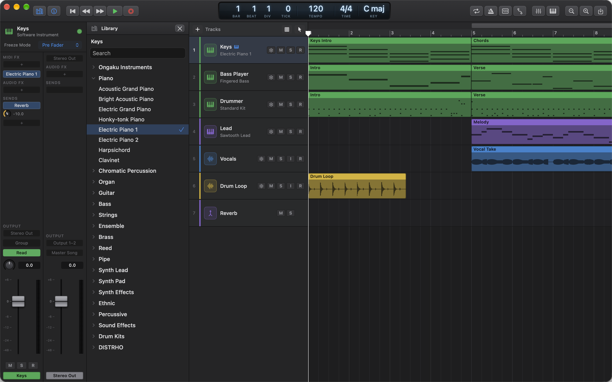
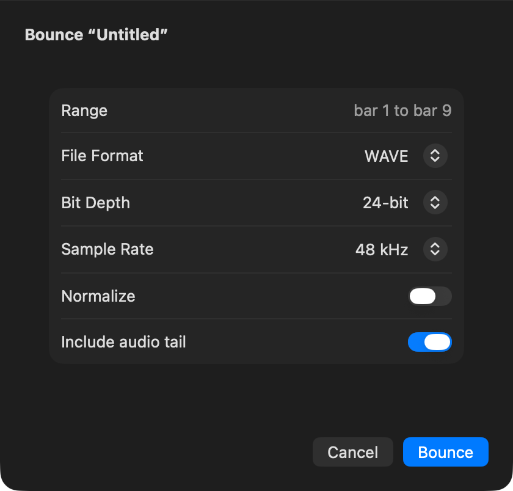
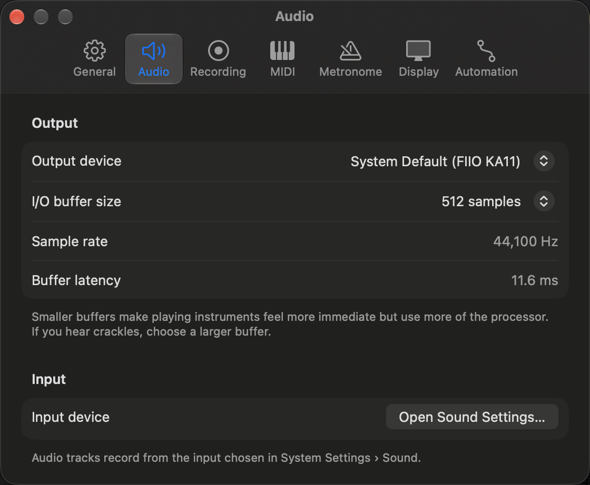

# 9. Library, Bounce, MIDI Files and Settings

This chapter covers getting sounds in and music out. You'll use the Library to pick the sound a track plays, Bounce to turn your song into an audio file you can share, MIDI files to bring parts in from other apps (or send them out), and the Settings window to set up how Ongaku Studio behaves on your Mac.

## The Library

### What it is

The Library is a panel on the left of the project window that lists every sound a software instrument track can play. Click a sound and the selected track switches to it straight away. You don't need to confirm anything, so you can keep playing your MIDI keyboard while you click down the list and hear each sound in turn. It's the quickest way to audition sounds.

The Library only deals with **instrument sounds** for software instrument tracks. It doesn't list effects, and it doesn't list presets inside a plug-in. (Effects go on the mixer's insert slots, covered in [Chapter 7](07-mixing-and-automation.md). Presets for Ongaku's own plug-ins are in each plug-in's header, covered in [Chapter 8](08-instruments-effects-midi-fx.md).)

### Opening and closing the Library

Use any of these:

- Press **Y**.
- Click the **Library** button at the far left of the control bar. It's lit while the Library is showing.
- Choose **View › Show Library** (the item changes to **Hide Library** while it's open).
- Click the close button in the Library's own header (**Hide Library**).

The Library opens next to the Inspector if the Inspector is showing (press **I** for the Inspector).

### Choosing a sound for a track

1. Click the header of a software instrument track to select it. The Library shows that track's name at the top. If you select an audio or aux track, the Library says **No Instrument Track Selected**, because those tracks don't have an instrument.
2. Click a category name to open it. The category that holds the track's current sound opens by itself, and the current sound is highlighted with a tick.
3. Click a sound. The track plays it straight away.
4. Play a few notes (or press **Space** to play the song) to hear it. If you don't like it, click another sound. You can also press **⌘Z** to go back, because each change is a normal undoable edit called "Change Instrument".

### What's in the list

The categories always appear in this order:

| Category | What it holds |
| --- | --- |
| **Ongaku Instruments** | Ongaku's own instruments: **Retro Synth**, **Drum Machine**, **Sampler** and **Session Drummer** (see [Chapter 8](08-instruments-effects-midi-fx.md)). |
| General MIDI families | The 128 standard General MIDI sounds from the Mac's built-in sound set, in 16 families: **Piano**, **Chromatic Percussion**, **Organ**, **Guitar**, **Bass**, **Strings**, **Ensemble**, **Brass**, **Reed**, **Pipe**, **Synth Lead**, **Synth Pad**, **Synth Effects**, **Ethnic**, **Percussive** and **Sound Effects**. |
| **Drum Kits** | Seven General MIDI drum kits: **Standard Kit**, **Power Kit**, **Electronic Kit**, **TR-808 Kit**, **Brush Kit**, **Orchestra Kit** and **Sound Effects Kit**. |
| One category per maker | Any other Audio Unit instruments installed on your Mac, grouped under their manufacturer's name. An instrument you install while Ongaku Studio is open appears here (and in the instrument menus) by itself, without opening a new window. |

### Searching

Type in the **Search** field at the top of the Library to filter the list. Every word you type has to appear in the sound's name or its category's name, and capitals and accents don't matter. So "bass" finds everything in the Bass family plus any sound with "bass" in its name, and "synth pad" narrows it to the Synth Pad family. While you're searching, every matching category stays open. If nothing matches, the Library tells you so. Clear the field to see everything again.

### Another way: the track's instrument menu

Each software instrument track header shows its current sound's name under the track name. Click it (or right-click the header and choose **Instrument**) to get the same sounds as menus: **Ongaku**, **General MIDI**, **Drum Kits** and **Audio Units**. For a plug-in instrument there's also **Show Instrument Window…**. The menu is handy when the Library is closed. The Library is better for auditioning, because you can click through many sounds in a row.

### Tips and limitations

- A new choice replaces the track's instrument completely. If you had adjusted a plug-in instrument's settings, choosing a different sound starts fresh. Press **⌘Z** if you didn't mean to.
- If a sound you expect isn't there, check that you selected a *software instrument* track and not an audio track. If you've just installed it, close and open the Library (**Y** twice): it looks for new instruments each time it opens.

## Bounce: turning your song into an audio file

### What it is

"Bouncing" means recording the whole mix, with every track, effect, fader and automation move, into a single stereo audio file. You'd bounce to send a song to a friend, upload it, burn it to a CD, or put it on your phone. Ongaku Studio renders the bounce faster than real time, so you don't have to sit and listen while it works.

Mute and solo count: whatever you'd hear when you press play is what gets bounced, including any mastering plug-ins on the **Stereo Out** strip ([Chapter 7](07-mixing-and-automation.md#stereo-out)). The metronome is never bounced. Plug-in windows you still have open are included with their current settings.

### What part of the song is bounced

Bounce decides the range for you, the way Logic does:

- **If Cycle is on** (press **C**), it bounces exactly the cycle range. This is how you bounce just a section, such as the chorus.
- **If Cycle is off**, it bounces from the very start of the project to the end of the last region, including the repeats of looped regions.

The dialog shows the range it will use at the top, for example "bar 1 to bar 33" or "Cycle range, bar 5 to bar 9". If the project has no regions at all, you'll see "There's nothing to bounce: the project has no regions." instead of the dialog.

### Bouncing step by step

1. If you only want part of the song, set the cycle range in the ruler and turn Cycle on. Otherwise turn Cycle off.
2. Choose **File › Bounce…** or press **⌘B**. Playback stops and the Bounce dialog opens, titled with your project's name.
3. Choose the options (each is explained below).
4. Click **Bounce** (or press **Return**). A progress bar shows the render. If flexed audio regions are still being processed ([Chapter 6](06-flex-and-smart-tempo.md#how-flexing-works)), the dialog first says **Finishing processing flexed audio…** and waits for them, so the bounce includes every flex edit. Click **Cancel** (or press **Escape**) to stop it.
5. When it's done, the dialog shows the bounce's **Length** and its **Peak** level. Read any warning (see "Checking the result" below).
6. Click **Save…** (or press **Return**). A save panel opens, suggesting your project's name and the right file extension. Choose a folder, such as Desktop or Music, and click **Save**. The dialog closes.

If you'd rather change something first, click **Bounce Again** to return to the options, or **Discard** to throw the render away and close the dialog.

### The options

| Option | Choices | What it does |
| --- | --- | --- |
| **File Format** | **WAVE**, **AIFF**, **AAC (M4A)** | WAVE and AIFF are full-quality, uncompressed files that every music app reads. AAC (M4A) is a much smaller compressed file, good for phones, email and sharing. |
| **Bit Depth** | **16-bit**, **24-bit**, **32-bit Float** (WAVE); **16-bit**, **24-bit** (AIFF) | How much detail each sample keeps. 24-bit is a safe choice. Use 16-bit for CDs. 32-bit Float is for sending to another studio app for further mixing or mastering. |
| **Quality** | Shown for AAC only: **256 kbit/s** | AAC files are always encoded at 256 kbit/s, which is high quality for a compressed file. There's nothing to choose. |
| **Sample Rate** | **44.1 kHz**, **48 kHz**, **88.2 kHz**, **96 kHz** (AAC: 44.1 or 48 kHz only) | Samples per second. 44.1 kHz is CD and most streaming. 48 kHz is video. Higher rates make bigger files. |
| **Normalize** | On or off | Raises or lowers the whole bounce so its loudest moment sits just below full scale (−0.1 dBFS, or −1 dBFS for AAC, which needs a little more room). It's an easy way to get a good level, and it stops clipping. It doesn't change the balance or squash the dynamics: the whole file goes up or down by the same amount. |
| **Include audio tail** | On or off | When on, the bounce keeps going after the last note until reverb and delay have faded away, so the ending isn't cut off. It stops once the sound has stayed silent for half a second, and never runs more than 20 seconds past the end. Turn it off if you need the file to stop exactly at the end of the range, for example for a loop. |

Some notes on these:

- Ongaku Studio remembers your last choices for the next bounce, even after you quit.
- If you switch to a format that can't store the bit depth or sample rate you'd picked, the dialog shows the nearest one it can store, and that's what gets written. For example, 32-bit Float becomes 24-bit for AIFF.
- 16-bit bounces automatically get *dither*: a tiny amount of noise that keeps quiet fades smooth instead of grainy. You don't need to do anything.

### Checking the result

After rendering, the dialog may warn you:

- **"The mix goes over 0 dBFS and will clip."** Part of the mix is louder than a digital file can hold, which sounds like harsh crackling. Lower your faders, or turn on **Normalize**, then click **Bounce Again**.
- **"The bounce is silent."** Nothing was heard. Check that your tracks aren't muted, or that a solo isn't silencing everything.

### Where the file goes

Until you click **Save…**, the bounce lives in a temporary folder that Ongaku Studio cleans up itself. **The file only ends up somewhere you can find it once you save it** in the save panel. If you click **Discard** or close the dialog, the render is deleted.

### Limitations

- You can't type a custom start and end. Use the cycle range to choose a section.
- Bounce always renders the whole mix. To render a single track, solo it first. (To save processor power on a heavy track, use **Track › Freeze Tracks** instead. That renders the track for playback inside the project, not as a file you can share.)

## MIDI files

### What they are

A Standard MIDI File (".mid") holds notes and controller moves, not sound. Almost every music app can read and write them, so they're the easiest way to move a part or a whole song between Ongaku Studio and other software, or to start from a MIDI file you've downloaded.

### Importing a MIDI file

1. Choose **File › Import MIDI File…**.
2. Pick one or more ".mid" files and click **Open**.

You can also **drag MIDI files from the Finder** onto the tracks area. You can drag audio and MIDI files together, and each goes the right way.

Each imported track gets a new software instrument track, added below your existing tracks. The whole import is one step, so **⌘Z** undoes it.

#### What happens to the file's contents

| In the file | In Ongaku Studio |
| --- | --- |
| Each track | A software instrument track with one MIDI region, named after the file's track name (or "Track 1", "Track 2"… if it has none). The region runs from the start of the bar with the first note to the end of the bar with the last one. |
| A file track that uses several MIDI channels | One Ongaku track per channel, named like "Piano (Ch 2)". |
| Channels with only controllers and no notes | Left out. |
| Program changes | The first one on each channel picks the track's General MIDI sound. Channel 10 becomes a General MIDI drum kit. Later program changes are ignored. |
| Controllers, pitch bend, aftertouch | Kept in the region. You can see and edit them in the Piano Roll's MIDI Draw lane ([Chapter 4](04-midi-editing.md)). |
| Tempo and time signature changes | Used only if your project is empty (see below). |
| System exclusive and other data | Ignored. |

#### Importing into an empty project vs. an existing one

This is the part that most often surprises people:

- **Into a project with no regions yet** (for example a brand-new project), Ongaku Studio takes over the file's **tempo, time signatures and key signatures**, including every tempo change and key change, and places the notes exactly where they are in the file. Use this when you want to start a song from a MIDI file.
- **Into a project that already has regions**, your project keeps **its own** tempo and meter. The file's tempo is ignored, and its parts are placed starting at **the bar containing the playhead** (or the bar where you dropped the file, if you dragged it in). The notes keep their positions in bars and beats, so they'll play at your song's tempo.

If you import several files at once into an empty project, the first file sets the tempo and the rest follow your new song's tempo.

#### Track colours

By default every imported track gets the colour set for new instrument tracks (green, unless you've changed it in **Settings › Display**). If you'd like each track in a different colour, so a big arrangement is easier to read, change **Settings › MIDI › Importing MIDI Files › Track colors** to **A different color for each track**. See "Settings" below.

#### Limitations

- Only format 0 and format 1 files with normal (beat-based) timing are supported. Format 2 files and SMPTE-timed files show an error.
- A file with no notes shows "doesn't contain any notes" and adds nothing.
- Imported tracks play the Mac's built-in General MIDI sounds. Use the Library to swap in a better instrument afterwards.

### Exporting the project as a MIDI file

Use this to take your notes into another app, or to give a part to someone who uses different software.

1. Choose **File › Export Project as MIDI File…**.
2. Choose a name and folder (the project's name is suggested) and click **Save**.

What gets written:

- A first "conductor" track with your song's **tempo changes and time signatures**.
- One track for **each software instrument track**, named after it, with its notes and MIDI controllers. Tracks using a General MIDI sound or drum kit also get a program change, so the other app picks a similar sound.
- What you hear is what you get: **muted regions and muted notes are left out**, and notes are cut off at the end of their region.
- **Looped regions** are written with their repeats, as far as they play: to the next region on the track, the loop end you dragged, or the end of the song.
- **Take folders** are written as their comp plays: each part from the take chosen for it.

#### Limitations

- Audio tracks and aux tracks aren't exported, because they don't hold MIDI.
- Mixer automation, markers and the chord track aren't written to the file. The key and key changes are, as key signatures.
- Tracks playing an Ongaku instrument or another plug-in get no program change, so the receiving app picks its own default sound.
- MIDI effects aren't applied: the file has the notes you played, not what an arpeggiator (say) makes of them.

## Importing audio files

You can bring in recordings, loops and samples with **File › Import Audio Files…** (**⇧⌘I**), the **Import Audio** button at the right of the control bar, or by dragging files from the Finder onto the tracks area.

- From the menu or button, files go in at the playhead (snapped to the grid, as dropped files are). If an audio track is selected, they're placed one after another on that track. Otherwise each file gets its own new audio track.
- When you drag files in, they go where you drop them (snapped to the grid), onto the audio track under the pointer if there is one.
- The files are copied into your project when you save, so the project keeps working even if you move or delete the originals.

See [Chapter 2](02-arranging-and-editing.md) for working with audio regions once they're in.

## Settings

### What it is

The Settings window holds the choices that apply to the whole app rather than to one song: your audio interface, your MIDI keyboards, the metronome sound, and so on. Open it with **Ongaku Studio › Settings…** (**⌘,**). The window has a tab for each area. Changes take effect straight away in every open project, and there's no OK button. Just close the window when you're done.

### General

| Setting | What it does |
| --- | --- |
| **New projects start with** | What **File › New** gives you: **One software instrument track** (the default), **One audio track**, or **No tracks**. Pick the one that matches how you usually start. |
| **Snap regions to** | What dragging regions, resizing them and clicking in the tracks area lines up to. **Automatic (follows the zoom)** (the default) snaps to bars when you're zoomed out and finer divisions as you zoom in. You can also fix it to **Bars**, **Beats**, **1/8 Triplets** or **1/16 Triplets**, or turn it **Off** for free placement. It's the same setting as the **Snap** button above the track headers, so changing one changes the other. Automation points snap to it too. The Piano Roll has its own **Grid** menu and **Snap** button for notes. |
| **Scroll to follow the playhead during playback** | When on (the default), the tracks area scrolls along as the song plays so the playhead stays in view. Turn it off if you want to look at another part of the song while it plays. When you jump the playhead while stopped, the view always follows. |

### Audio

| Setting | What it does |
| --- | --- |
| **Output device** | Where Ongaku Studio plays: **System Default** (whatever macOS uses, shown in brackets), or a specific interface or headphones. If the device you chose is unplugged, it shows as **Not Connected** and stays chosen, and the system default plays in the meantime. |
| **I/O buffer size** | How many samples the Mac processes at a time: 32 to 2048 (default **512 samples**), limited to what your device accepts. **Smaller** buffers make playing a keyboard feel more immediate but work the processor harder. **Larger** buffers are safer for big mixes. If you hear crackles or dropouts, choose a larger buffer. This only affects Ongaku Studio, not your other apps. |
| **Sample rate** | Shown for information: the output device's current rate. |
| **Buffer latency** | Shown for information: how long one buffer takes, in milliseconds. This is the delay the buffer adds between pressing a key and hearing it. |
| **Input device** | The **Open Sound Settings…** button opens macOS's Sound settings. Audio tracks record from the input chosen there. |

### Recording

These settings are explained more fully in [Chapter 3](03-recording-and-takes.md).

| Setting | What it does |
| --- | --- |
| **Count-in** | Clicks before recording starts, so you can get ready: **None**, **1 bar** or **2 bars**. The **Count-in** button in the control bar switches between the length you chose here and **None**. |
| **Click while recording, even with the metronome off** | Turns the metronome on during recording only, so you can keep it off for listening back. |
| **File type** | The format of new audio recordings: **CAF**, **WAV** or **AIFF**. |
| **Bit depth** | **16-bit**, **24-bit** (the default) or **32-bit float**. |

Recordings are saved inside the project, at the output device's sample rate.

### MIDI

| Setting | What it does |
| --- | --- |
| **Inputs** | A switch for each connected MIDI keyboard or controller. Ongaku Studio plays and records from the inputs that are on. Switch one off to ignore it, for example a control surface that sends stray notes. If nothing is connected, it says so. |
| **Track colors** (under **Importing MIDI Files**) | **All the same color**: imported tracks get the colour set for new software instrument tracks on the Display tab (the swatch beside it shows that colour). **A different color for each track**: each track gets the next colour in the rainbow, starting again for each file. |

Your MIDI keyboard plays the frontmost project window: every record-enabled instrument track, or, if none is armed, the selected track. A keyboard icon after a track's name shows which tracks it's playing ([Chapter 3](03-recording-and-takes.md#which-tracks-you-hear)).

### Metronome

| Setting | What it does |
| --- | --- |
| **Sound** | **Click**, **Woodblock**, **Hi-Hat** or **Beep**. |
| **Volume** | How loud the metronome is, from 0% to 100%. |
| **Accent the first beat of each bar** | Makes beat one stand out, so you can always tell where the bar starts. |

Switch the metronome itself on with **K** or the **Metronome** button in the control bar; whether it's on is saved with each project. The count-in is set on the Recording tab.

### Display

| Setting | What it does |
| --- | --- |
| **LCD color** | The colour of the display in the middle of the control bar: **Blue**, **Amber**, **Green** or **White**. A sample shows the result. |
| **Colors of New Tracks** | The colour new **Software instrument tracks** (green by default), **Audio tracks** (blue) and **Aux tracks** (purple) get. Tracks you already have keep their colours. |

### Automation

Automation is explained in [Chapter 7](07-mixing-and-automation.md).

| Setting | What it does |
| --- | --- |
| **Mode for new tracks** | The automation mode new tracks start in: **Off**, **Read** (the default), **Touch** or **Latch**. Read plays a track's automation. Touch and Latch also record it while you move a fader or pan control during playback. |
| **Thin recorded automation** | Moving a control records lots of points. Thinning removes the ones that don't change the shape of the curve, so it's easier to edit later. **Off (keep every point)**, **Light**, **Normal** (the default) or **Heavy**. |

### Agents

AI agents are explained in [Chapter 11](11-ai-agents.md).

| Setting | What it does |
| --- | --- |
| **Let AI agents make music in Ongaku Studio** | Switches on the MCP server that agents such as Claude Code connect to. Off by default. **Status** shows whether it's ready and which agents are connected. |
| **Port** | The port the server listens on, 7317 unless you change it. |
| **Address** | What agents connect to. |
| **Token** | The secret agents must send. **Copy** copies it; **New Token** replaces it (agents using the old one stop working). |
| **Copy Setup Command** | Copies a Terminal command that adds Ongaku Studio to Claude Code. |

## About Ongaku Studio

Choose **Ongaku Studio › About Ongaku Studio** to see which version you have. That's useful to know when you report a problem.

## Quick reference

| To… | Do this |
| --- | --- |
| Show or hide the Library | **Y**, the **Library** button, or **View › Show Library** |
| Change a track's sound | Select the track, then click a sound in the Library |
| Find a sound | Type in the Library's **Search** field |
| Bounce the song to an audio file | **File › Bounce…** (**⌘B**), **Bounce**, then **Save…** |
| Bounce only a section | Set the cycle range and turn Cycle on (**C**), then bounce |
| Avoid clipping in a bounce | Turn on **Normalize**, or lower the faders |
| Import a MIDI file | **File › Import MIDI File…**, or drag it onto the tracks area |
| Keep a MIDI file's tempo | Import it into a project with no regions yet |
| Export notes as a MIDI file | **File › Export Project as MIDI File…** |
| Import audio | **File › Import Audio Files…** (**⇧⌘I**), or drag files in |
| Open Settings | **Ongaku Studio › Settings…** (**⌘,**) |
| Fix crackles | **Settings › Audio › I/O buffer size**: choose a larger buffer |
| Change what regions snap to | The **Snap** button above the track headers, or **Settings › General › Snap regions to** |
| Switch a MIDI keyboard off | **Settings › MIDI › Inputs** |
