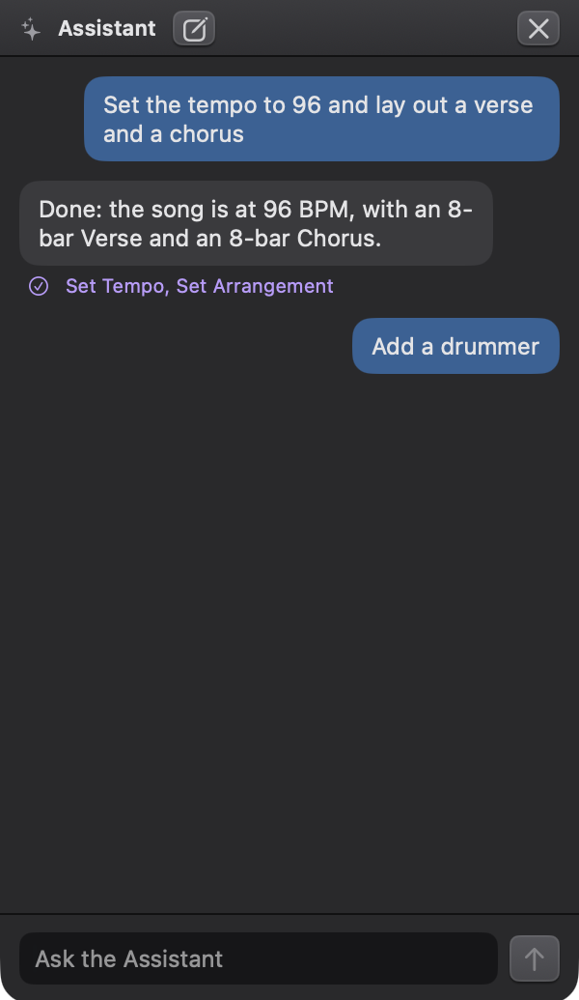

# 11. Making Music with AI Agents

Ongaku Studio can let an AI agent, such as Claude, work in your song with you. You describe what you want in plain words ("a 16-bar lo-fi groove in D minor with a walking bass", "make the chorus lift more", "mix this and bounce it"), and the agent builds it in the open project window while you watch: tracks appear, sections and chords fill in, the drummer starts playing, effects go on. You can play it, change anything by hand, or undo what the agent did, exactly as if you'd done it yourself.

There are two ways to do this:

- **The Assistant** is built in. It uses Apple Intelligence on this Mac: nothing to set up, and nothing leaves your Mac. It's best at one clear change at a time.
- **An agent over MCP**, such as Claude Code, connects from outside. It takes a few minutes to set up and uses a much larger model, so it can build and mix a whole song from one request.

This chapter covers the Assistant first, then explains what an MCP agent can do, how to connect one, and how to work with it.

## The Assistant



Choose **View › Show Assistant** (⌃⌘A), or click the **Assistant** button (the sparkles) in the control bar. The panel opens down the right of the window.

Type what you want and press Return, for example:

- "Set the tempo to 96 and the key to A minor"
- "Lay out Intro, Verse, Chorus, Verse, Chorus, Outro"
- "Add a Drummer that plays every section"
- "Put a reverb on the Piano track"

The Assistant works in the song in front of you with the same tools an MCP agent uses. While it works, the panel shows what it's doing ("Add Drummer…"). Under each reply it lists what it changed. Every change is one step called **Agent: …** in the Edit menu, so ⌘Z takes it back. Click the stop button to stop a request, and the **New Conversation** button to start again.

It remembers your last request and its reply, so a follow-up such as "make it louder" knows what "it" is. It doesn't remember further back.

**What you need:** a Mac with Apple Intelligence turned on in **System Settings › Apple Intelligence & Siri**. If it isn't available, the panel says why. Apple Intelligence downloads its model in the background after you turn it on, so it may take a while before the Assistant works.

**Privacy:** the Assistant runs entirely on this Mac. Your song, your requests and its replies aren't sent anywhere.

**Good to know:**

- **One thing at a time works best.** The on-device model is small and holds only a little at once. For each request it first picks the two or three tools it needs, then uses them. Ask for one clear change, or a couple of closely related ones, rather than a whole song in one go.
- **Check what it did.** The list under a reply shows the changes it actually made. If every attempt failed, the reply says **Nothing changed** and why. A small model can misunderstand, so look and listen, and undo if it isn't right.
- **Name things as you see them.** Use track names, section names and bar numbers ("bar 9", "the Chorus") as they appear in the window.
- For bigger jobs (writing parts note by note, mixing a whole song, mastering and bouncing it), connect an agent over MCP as described below.

## What it is

## What it is

An AI agent is a program that uses an AI model to carry out tasks by calling *tools*. Ongaku Studio offers tools for making music through **MCP** (the Model Context Protocol), a standard way for agents to use apps. Claude Code, Claude Desktop and many other agents speak it.

When you switch it on, Ongaku Studio runs a small MCP server on your Mac. An agent that connects to it can:

- **Read the song**: tempo, key, sections, chords, tracks, regions and notes.
- **Set up the song**: tempo, time signature, key and key changes, the cycle, Arrangement sections, markers and the Chord track.
- **Write and arrange**: create tracks with any sound from the Library, write notes into regions, transform and quantize them, copy, move, split and join regions, reorder tracks, and cut, insert or repeat a stretch of the whole song (as the section commands do).
- **Use your sound libraries**: if you've added libraries in **Settings › Libraries**, an agent can search their instruments (a sampled grand piano, strings, a SoundFont preset) and play them on tracks, find loops by instrument, key, tempo and genre and add them to the song (fitted to its tempo and key, as dragging from the Loop Browser does), and give the Convolution Reverb an impulse response.
- **Use the session players**: add the Drummer and the Bass and Keyboard players to sections, change their style and settings, or ask for a new take (see [Chapter 5](05-session-players.md)).
- **Mix**: set levels, pan, mute and solo; add effects and change their settings and presets, and the settings of an instrument or MIDI effect plug-in; send tracks to an aux with a reverb; draw automation; add MIDI effects such as the Arpeggiator (see [Chapter 7](07-mixing-and-automation.md) and [Chapter 8](08-instruments-effects-midi-fx.md)).
- **Listen, in its way**: an agent can't hear, so it can *measure* the mix instead. It renders the song (faster than real time, nothing is played) and gets its loudness, peaks, stereo width and tonal balance compared with a typical finished master, for the whole song and each section.
- **Finish**: master the song with Ongaku Mastering's Analyze Whole Song, bounce it to an audio file, and save.
- **Play and stop** the song, so you can listen to what it made.

An agent works on the song in the **frontmost project window**. If no song is open, it asks you to open one.

## Is it safe?

- The server is **off** until you switch it on in Settings.
- Only programs on **your Mac** can connect, and only with a secret **token** that you give them.
- Every change an agent makes is a normal edit, one per step. The Edit menu names them, such as **Undo Agent: Add Drummer**, so you can always undo.
- Agents can't open or delete files. They can save the open song, and their bounces go only to **Music › Ongaku Studio › Bounces**.
- From your sound libraries, agents see only the library names and the names, folders and tags of the sounds in them, as the Loop Browser shows them. A loop an agent adds is copied into the song, exactly as when you drag it in.
- What an agent reads of your song (its notes, names, structure and measurements) goes to the AI service the agent uses, such as Anthropic for Claude. Ongaku Studio doesn't send your audio. An agent that can read files on your Mac, as Claude Code can, could still open a bounced file, so keep to agents you trust.

## Setting it up

### Switching on the server

1. Choose **Ongaku Studio › Settings…** (⌘,) and click **Agents**.
2. Turn on **Let AI agents make music in Ongaku Studio**. The **Status** line changes to **Ready for agents**.

The server listens on port **7317**. If another app already uses that port, the status says so; type another number in **Port**.

### Connecting Claude Code

Claude Code is Anthropic's agent for the Terminal. If you don't have it, install it first, for example with Homebrew: `brew install --cask claude-code`. Then run `claude` once and sign in.

1. In **Settings › Agents**, click **Copy Setup Command**.
2. Open **Terminal**, paste the command and press Return. It adds Ongaku Studio to Claude Code with your token.
3. Open a song in Ongaku Studio.
4. In Terminal, run `claude` and ask for something, such as "Make a 16-bar lo-fi groove in Ongaku Studio".

### Connecting other agents

Other MCP agents need two things from **Settings › Agents**: the **Address** (`http://127.0.0.1:7317/mcp`) and the **Token**, sent as the header `Authorization: Bearer <token>`. Click **Copy** next to the token to copy it.

Agents that can only start a program rather than connect to an address, such as Claude Desktop, can use a bridge such as `mcp-remote`. In Claude Desktop, choose **Settings › Developer › Edit Config** and add:

```json
{
  "mcpServers": {
    "ongaku": {
      "command": "npx",
      "args": ["-y", "mcp-remote", "http://127.0.0.1:7317/mcp",
               "--header", "Authorization: Bearer YOUR_TOKEN"]
    }
  }
}
```

### A new token

Click **New Token** to make a new secret, for example if you shared a setup command by mistake. Agents set up with the old token stop working until you set them up again.

## Working with an agent

### Seeing it work

While an agent is connected, a small badge with its name appears in the control bar, next to the LCD. It glows while the agent is working. Hold the pointer over it to see what it did last. The Settings window's **Status** line also lists the connected agents.

### Asking well

Agents do best when you say what you're after musically and leave the clicking to them:

- **Start broad, then refine.** "A gentle indie-folk song, about two minutes, in G" is a good start. Then: "the verse drums are too busy", "give the chorus a brighter keys part", "end with the intro again".
- **Name things the way the song does.** "The Bass Player track", "the second chorus", "bar 17".
- **Ask it to listen.** "Analyze the mix: is the chorus louder than the verse?" makes the agent measure rather than guess.
- **Point it at your libraries.** "Use the Steinway from my Logic library for the piano", "find a funky bass loop near this tempo", "put the verse vocal in a small room": agents search libraries when asked, and otherwise reach for the built-in sounds.
- **Play it yourself.** The agent can press play, but only you can hear whether it works. Tell it what you think.

### Built-in starting points

Agents that support MCP *prompts* list Ongaku Studio's ready-made requests (in Claude Code, type `/` to see them):

| Prompt | What it does |
| --- | --- |
| **Sketch a Song** | Builds a whole song from a style and mood: sections, chords, drums, bass, keys, a melody and a rough mix. |
| **Arrange This Idea** | Turns what's in the song now (a loop or a few bars) into a full arrangement. |
| **Write a Melody** | Writes a melody over the chords of a section, on a new track. |
| **Mix and Master** | Balances the mix, adds EQ, compression and a shared reverb, checks it with Analyze Mix, masters it and bounces it. |

The agent can also read this manual, so you can ask it how a feature works.

### How agents describe music

You don't need to know this to use an agent, but it helps to read what it says:

- Positions are **bar:beat**: "5:3" is beat 3 of bar 5.
- Note lengths are in beats: 1 is a quarter note, 0.5 an eighth.
- Note names put middle C at **C3**, as Ongaku's Piano Roll and Logic do, so an agent's notes have the names you see. If you'd rather agents use scientific names (middle C is **C4**), choose it in **Settings › Agents › Middle C is**. An agent picks up the change when it next connects.

## Tips and limitations

- **Undo what you don't like.** Each agent step is one undo, so ⌘Z takes back the last thing it did. You can also ask the agent to undo.
- **You can keep working.** Edit, play and mix while an agent is connected. It reads the song afresh each time, so it sees your changes.
- **The frontmost window.** If you have several songs open, the agent works on the one in front. Bring the right one forward before asking.
- **Plug-in windows.** If a plug-in's window is open while an agent changes the plug-in, close and reopen the window to see the new settings.
- **What agents can't do yet**: record audio, edit audio regions in detail (Flex, takes, comping), freeze tracks, or import files from outside your sound libraries. Ask them to tell you when you need to do something by hand.
- **Measurements aren't ears.** Analyze Mix tells an agent where a mix stands against a typical master, which is a good guide, not a verdict. Trust your ears.
