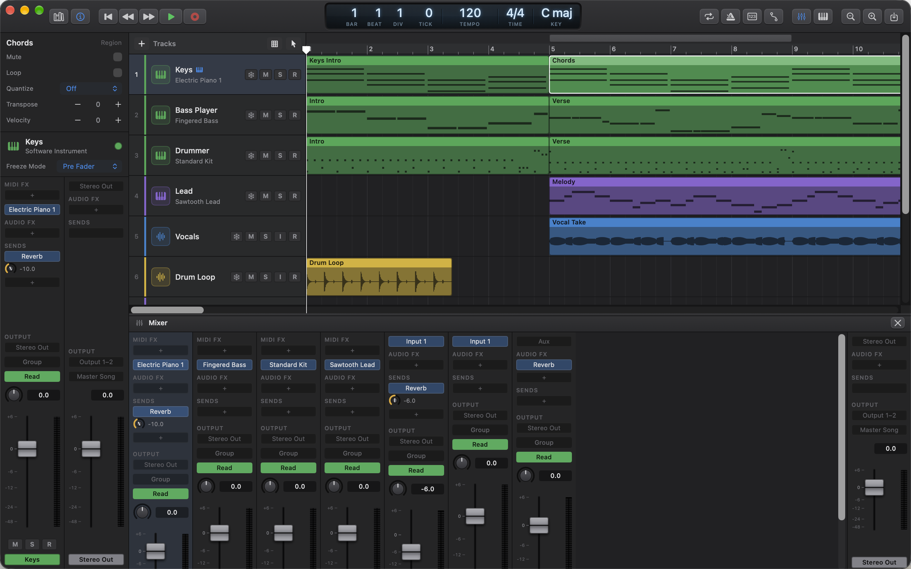
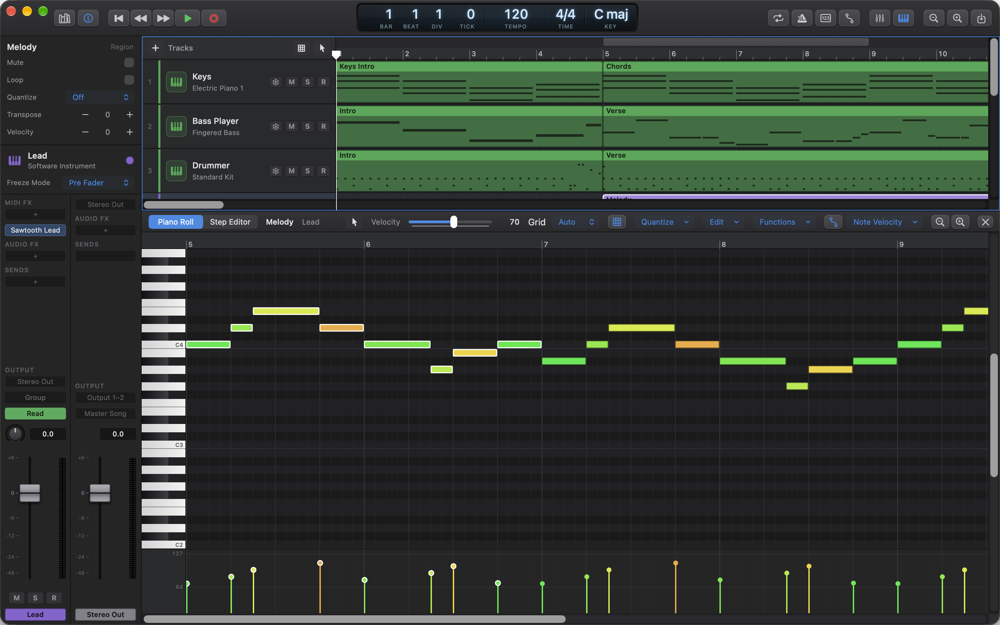

# Ongaku Studio

A Logic Pro–style digital audio workstation for the Mac, written in Swift and SwiftUI.

Ongaku Studio is a personal project: a DAW I'm building for myself, in the open. It aims to work the way Logic Pro does, with a dark arrange window, piano roll, mixer and session players, while being small enough for one person to read and change.

The [user manual](Docs/Manual/README.md) explains every feature, step by step.

## Features

**Arranging and editing**
- Audio and software instrument tracks, regions, fades and crossfades, looped regions
- Logic-style tools (pointer, pencil, eraser, scissors, glue, mute, fade), clipboard, repeat, option-drag copies and section edits between the locators
- Markers, arrangement, tempo, signature and Chord tracks
- Track stacks (summing stacks), track freeze and plug-in delay compensation

**MIDI**

- Piano Roll with quantize (including triplet and mixed grids), velocity and note functions
- Step Editor, Step Sequencer pattern regions and MIDI Draw lanes for controllers, pitch bend and aftertouch
- MIDI FX: Arpeggiator, Chord Trigger, Scale Quantize, Note Repeater, Transposer and more

**Recording and audio editing**
- Audio and MIDI recording, cycle recording into take folders, quick-swipe comping
- Flex Time, Flex Pitch and Smart Tempo (pure Swift and Accelerate DSP)

**Session players**
- A Drummer that plays each section of the song, and bass and keyboard players that follow the Chord track

**Mixing**
- Channel strips with inserts, aux sends, groups, meters and automation of volume, pan, sends and plug-in parameters
- Bounce to audio files

**Ongaku plug-ins**
- An AUv3 extension inside the app, with C++ real-time kernels behind SwiftUI windows: Channel EQ, Compressor, Reverb, Convolution Reverb, Delay, Noise Gate, Transient Shaper, Maximizer, De-Esser, Saturation, Doubler and Vocal Strip; Retro Synth, Drum Machine, Sampler and Session Drummer instruments
- They're ordinary Audio Units, so they also work in Logic Pro, GarageBand and other Mac hosts

**Interchange**
- Standard MIDI files in and out

**AI agents**
- An optional MCP server, off by default, that lets agents such as Claude Code compose, arrange, mix, master and bounce in the open song, one undoable step at a time. See [Chapter 11 of the manual](Docs/Manual/11-ai-agents.md).

## Requirements

- macOS 27 or later
- Xcode 27 or later

## Building

1. Clone the repository and open `Ongaku.xcodeproj`.
2. Choose your own team under Signing & Capabilities for each target (the app, OngakuCore, OngakuEngine and OngakuEffects), or build with "Sign to Run Locally".
3. Build and run the **Ongaku** scheme.

The Ongaku plug-ins register with the system once the app has run. You can check them with `auval -a | grep Ongk`.

## Project layout

| Folder | What's in it |
| --- | --- |
| `OngakuCore` | The model, edit commands with undo, persistence, MIDI file import and export, DSP and the playback plan; no UI or audio engine |
| `OngakuEngine` | The real-time engine on AVAudioEngine: track channels, instruments, recording, metronome, bounce |
| `OngakuEffects` | The AUv3 extension with the Ongaku effects and instruments (C++ DSP, SwiftUI windows) |
| `Ongaku` | The app: arrange window, editors, mixer, inspector, Library and settings |
| `OngakuCoreTests`, `OngakuTests`, `OngakuUITests` | Swift Testing unit tests and XCUITest UI tests |

## Tests

Run the tests from Xcode (Product › Test). A few tests read files that exist only on my Mac and are skipped elsewhere.

## A note on Logic Pro

Ongaku Studio takes its workflow from Logic Pro, but it isn't affiliated with or endorsed by Apple, and it can't open Logic projects or load Logic's instruments and effects. The repository doesn't include any Apple sound content. The General MIDI sounds and drum kits Ongaku can play come with macOS.

## Contributing

This is a personal project, so I may not get to issues or merge pull requests quickly, or at all. Bug reports and ideas are still welcome.

## License

Copyright © 2026 John Forde.

Ongaku Studio is free software: you can redistribute it and/or modify it under the terms of the GNU General Public License as published by the Free Software Foundation, either version 3 of the License, or (at your option) any later version. It's distributed in the hope that it will be useful, but without any warranty; without even the implied warranty of merchantability or fitness for a particular purpose. See [LICENSE](LICENSE) for the full terms.

In short: you can use, study, change and share it, including selling copies, as long as anything you distribute that's based on it is also released under the GPL with its source code.

## Third-party code

Swift packages, fetched by Xcode when you build:

| Package | Licence |
| --- | --- |
| [MCP Swift SDK](https://github.com/modelcontextprotocol/swift-sdk) | MIT and Apache 2.0 |
| [SwiftNIO](https://github.com/apple/swift-nio), [Swift Log](https://github.com/apple/swift-log), [Swift System](https://github.com/apple/swift-system), [Swift Collections](https://github.com/apple/swift-collections), [Swift Atomics](https://github.com/apple/swift-atomics) | Apache 2.0 |
| [EventSource](https://github.com/mattt/eventsource) | MIT |
